# Topic 13: Latches and flip-flops

Slide exercises: none set · Past finals: used inside 2023 Q2a (D flip-flops) and Q3 (JK flip-flops)

Slides: Lecture 11/12, all

---

## The big idea

Up to now, the output depended **only on the inputs right now**. That's **combinational** logic.

Now we add **memory**.

A circuit with memory can give different outputs for the same inputs. It depends on what happened before.

That's **sequential** logic.

 

The memory is built from **latches**.

Two latches together make a **flip-flop**.

A flip-flop stores **one bit**, and only changes on a **clock edge**.

---

**How to use these notes:**
When you see 🧠, stop.
Answer it on paper first.
Then click to check.

---

## 🎯 In the final

Not asked on its own in 2023.

But **every** sequential question uses flip-flops:

- 2023 Q2a: a ripple counter built from **D** flip-flops (Topic 16).
- 2023 Q3: a state machine built from **JK** flip-flops (Topic 15).

You must know the **characteristic table** of JK, D and T by heart. Without it you can't do Q2 or Q3.

---

## ⭐ Learn by heart from this topic

There is **no formula sheet** in this exam. So learn all of this.

- Rule 38: SR latch (NOR): 00 = hold, 01 = reset (Q = 0), 10 = set (Q = 1), 11 = **not allowed**.
- Equation 39: characteristic equations:

$$Q_{t+1} = JQ' + K'Q \qquad Q_{t+1} = D \qquad Q_{t+1} = TQ' + T'Q$$

- JK: 00 hold, 01 reset, 10 set, 11 **toggle**.
- T: 0 hold, 1 toggle.
- Rule 40: a **latch** follows its input while enabled (level). A **flip-flop** changes only on a clock **edge**.
- Master-slave (two latches + inverter) = **negative edge** triggered.

**Memory hook:** "JK = SR that toggles instead of breaking."

---

## 1. Combinational → sequential

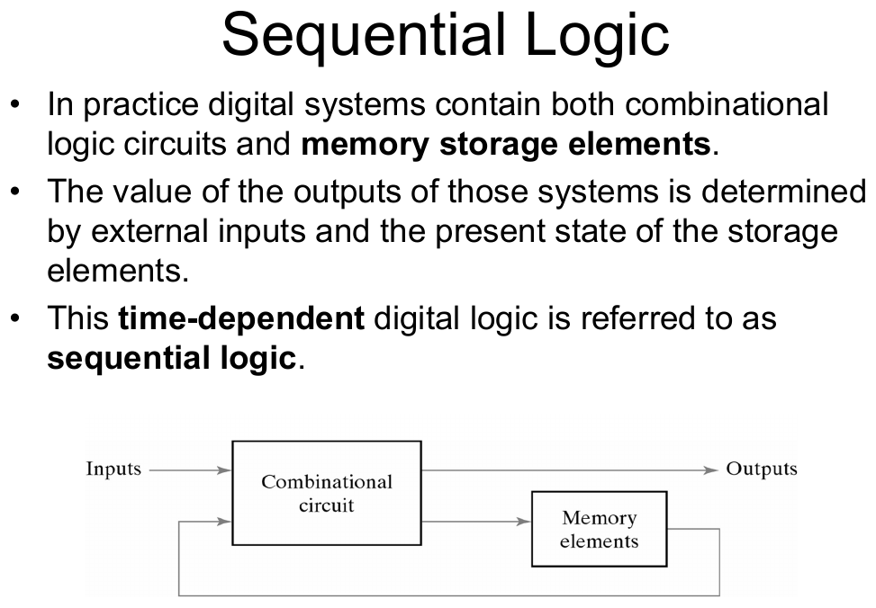

**How to read this diagram:**
- A combinational circuit in the middle, as before.
- A new box: **memory elements**.
- Some outputs go into the memory. The memory feeds back into the inputs.

So the output depends on the inputs **and** the stored state.

 

A one-bit memory must do three things:

1. Hold a value.
2. Let you read it.
3. Let you change it (set it to 1, or reset it to 0).

---

## 2. The SR latch (NOR gates)

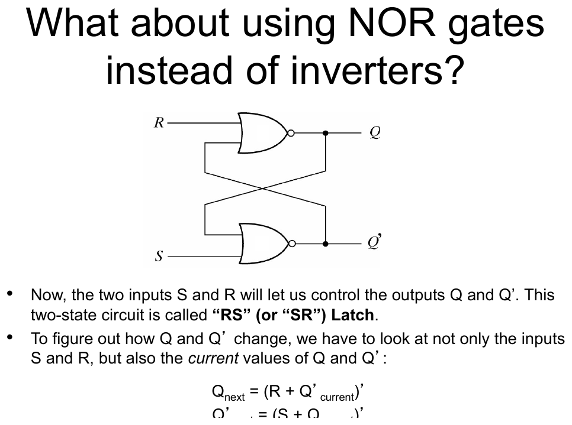

**How to read this diagram:**
- Two NOR gates. Each output feeds back into the other gate.
- R goes into the top gate (output Q). S goes into the bottom gate (output Q').
- The loop is what remembers.

 

The two equations:

$$Q_{next} = (R + Q'_{current})'$$

$$Q'_{next} = (S + Q_{current})'$$

 

Work through each input:

| S | R | What happens | Q |
|---|---|---|---|
| 0 | 0 | Q_next = Q_current. It **holds**. | no change |
| 0 | 1 | R = 1 forces Q = 0. **Reset.** | 0 |
| 1 | 0 | S = 1 forces Q' = 0, then Q = 1. **Set.** | 1 |
| 1 | 1 | Both outputs go to 0. Not complements any more. | ✗ |

---

### 📐 Rule 38: the SR latch table

| S | R | Q |
|---|---|---|
| 0 | 0 | no change |
| 0 | 1 | 0 (reset) |
| 1 | 0 | 1 (set) |
| 1 | 1 | **indeterminate**: avoid |

**Why SR = 11 is bad:**
Q and Q' both become 0. Then if S and R both drop to 0 together, both outputs go to 1, then 0, then 1... It can loop forever.

**Use it when:**
Any question on latches, and to understand why D and JK flip-flops exist.

---

### 🧠 Check
A NOR latch has Q = 1. S goes to 0 and R stays at 0. What is Q?

Answer

SR = 00 is **hold**. Q stays **1**.

This is the memory: the same inputs (00) can give Q = 0 or Q = 1, depending on the past.

---

## 3. The SR = 11 problem

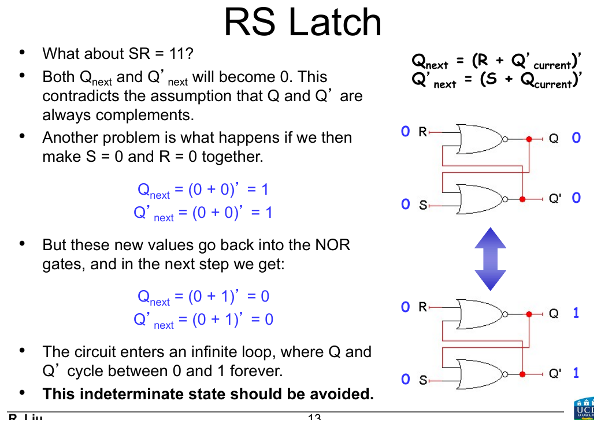

**How to read this diagram:**
- Top: S = R = 0 after both were 1. Both outputs start at 0.
- Both gates now see 0 + 0, so both outputs flip to 1.
- Bottom: now both see a 1, so both flip back to 0.
- The arrow shows it bouncing forever.

That's why SR = 11 is **forbidden**.

---

## 4. The full latch table

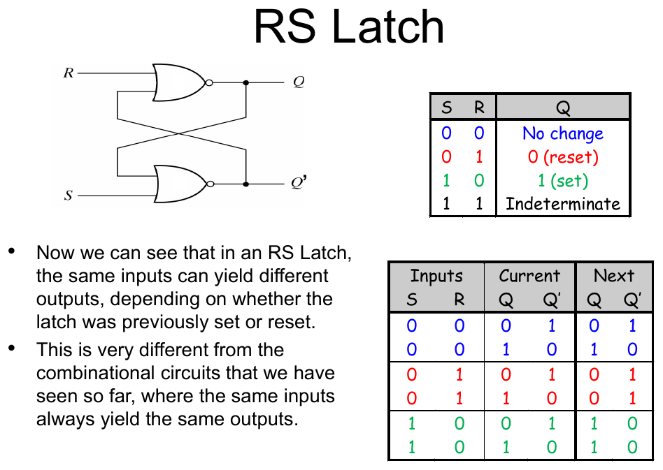

**How to read this diagram:**
- Top table: the short version (Rule 38).
- Bottom table: the long version, with the **current** Q in the middle.
- Look at the blue rows (SR = 00): the next Q equals the current Q. Same inputs, different outputs.

That is the big difference from combinational logic.

---

## 5. The NAND latch (S'R' latch)

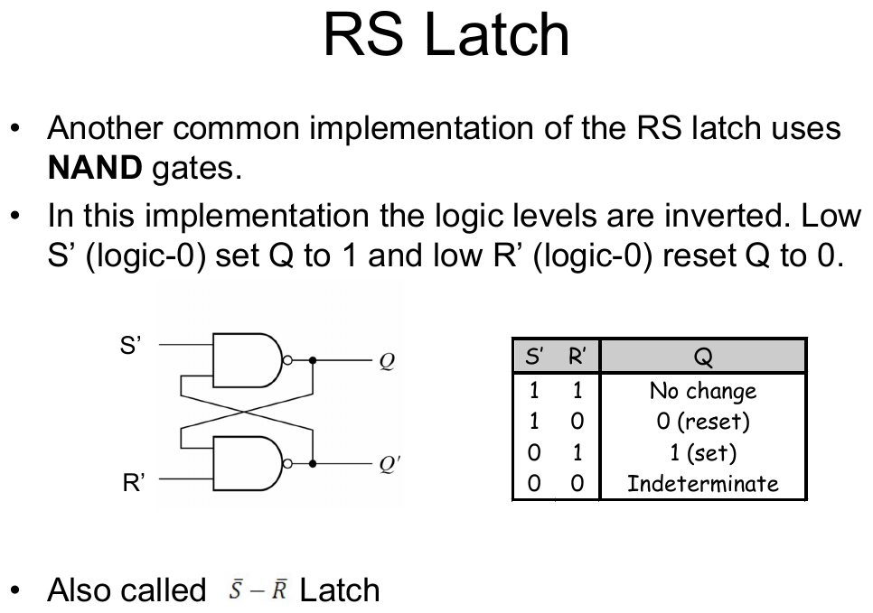

**How to read this diagram:**
- Same idea, made from NAND gates.
- The inputs are **active low**: a **0** does the work.
- S' = 0 sets Q to 1. R' = 0 resets Q to 0.
- S' = R' = 0 is the forbidden one now. S' = R' = 1 holds.

| S' | R' | Q |
|---|---|---|
| 1 | 1 | no change |
| 1 | 0 | 0 (reset) |
| 0 | 1 | 1 (set) |
| 0 | 0 | indeterminate |

 

### 🧠 Check
Which input combination is forbidden in a NAND latch?

Answer

**S' = R' = 0.** Both outputs would go to 1.

(For the NOR latch it's S = R = 1.)

---

## 6. Clocked (enabled) SR latch

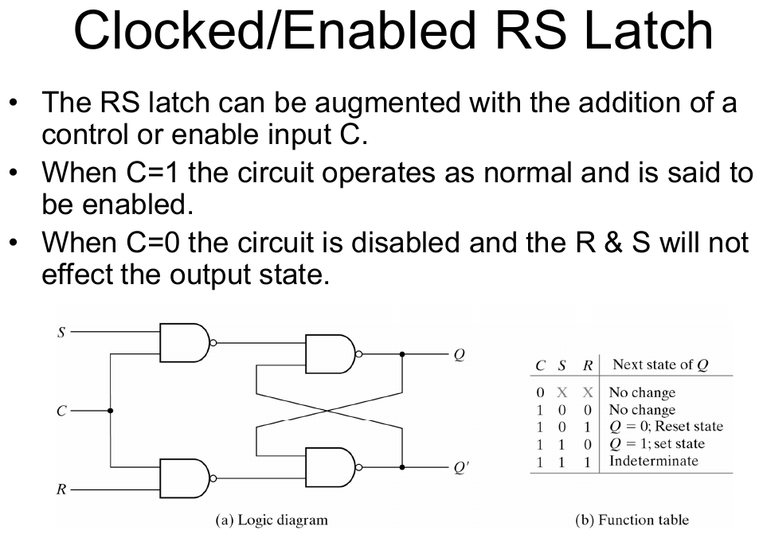

**How to read this diagram:**
- Two AND gates in front of the latch, both controlled by **C**.
- C = 0: both ANDs give 0, so the latch sees 00 and **holds**.
- C = 1: S and R pass through. The latch works as normal.

 

If C is a square-wave clock, the latch is **clocked**.

It is enabled for the **whole time** C is high. That's **level triggering**.

The problem: while C is high, the output can change **many times**.

---

## 7. The flip-flop: master and slave

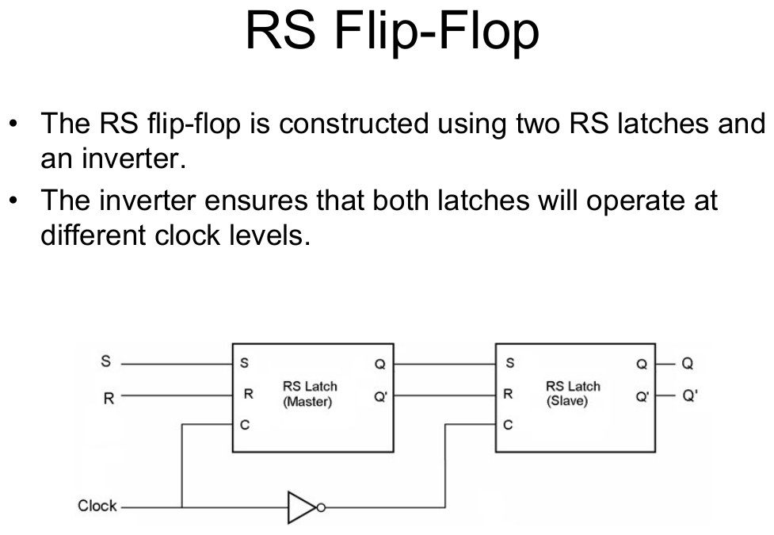

**How to read this diagram:**
- Two clocked latches in a row: the **master** and the **slave**.
- The clock goes straight to the master, and through an **inverter** to the slave.
- So only one latch is enabled at a time.

 

| Clock | Master | Slave |
|---|---|---|
| goes 1 | enabled: takes in S and R | disabled |
| goes 0 | disabled: freezes | enabled: copies the master |

The output Q (on the slave) can only change when the clock goes **1 → 0**.

That's a **negative-edge-triggered** flip-flop.

---

### 📐 Rule 40: latch vs flip-flop

| | Latch | Flip-flop |
|---|---|---|
| Changes when | the enable is **high** (a level) | the clock **edges** (an instant) |
| Can change many times per clock? | yes | no, once |
| Built from | gates | two latches (master-slave) |

**Use it when:**
"Explain the difference between a latch and a flip-flop" (a classic short question).

---

## 8. The D latch

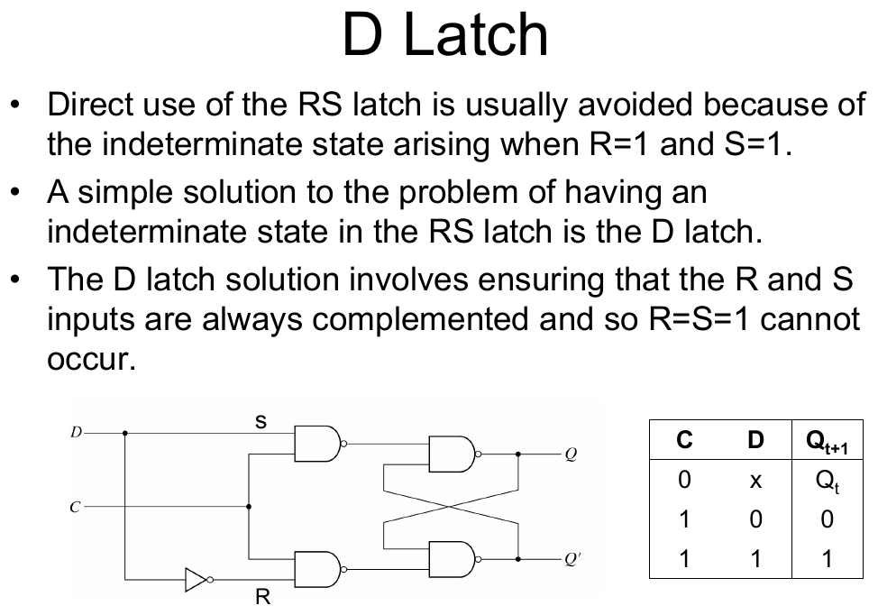

**How to read this diagram:**
- D goes to S directly, and to R through an **inverter**.
- So S and R are **always opposite**. SR = 11 can never happen.
- C enables it, as before.

| C | D | Q next |
|---|---|---|
| 0 | x | Q (hold) |
| 1 | 0 | 0 |
| 1 | 1 | 1 |

When C = 1, Q copies D. When C = 0, Q keeps the last value.

---

## 9. The D flip-flop

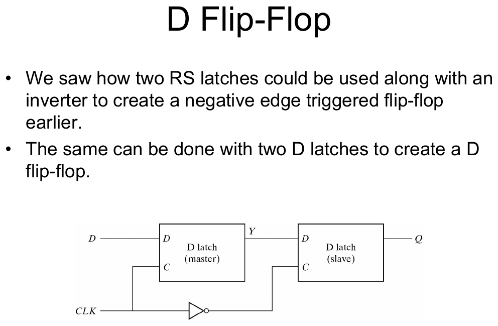

**How to read this diagram:**
- Two D latches, master and slave, with an inverter on the clock. Same trick as §7.
- Y is the master's output.
- Q only takes the value D had at the **falling edge**.

 

The D flip-flop is the most popular. It's cheap and simple.

A positive-edge version can be built from three SR latches.

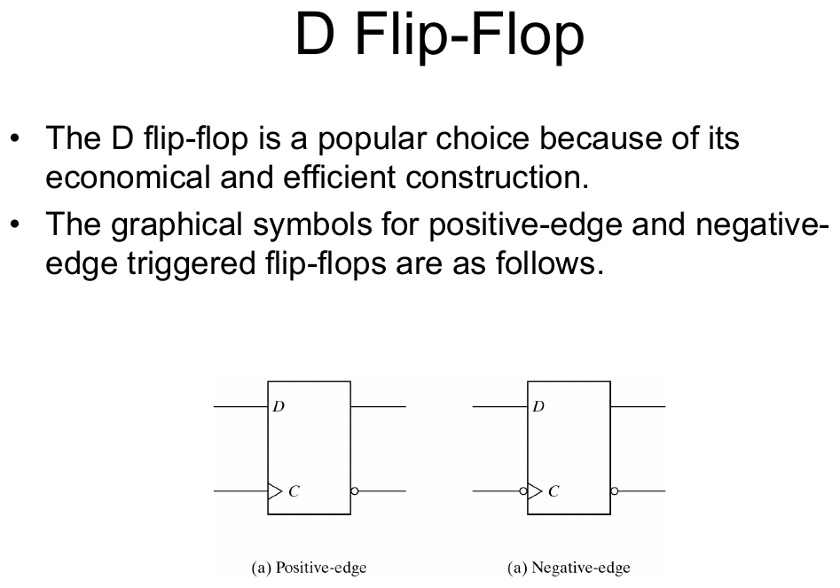

**How to read the symbols:**
- The small triangle **>** at C means edge-triggered.
- A **bubble** before the triangle means **negative** edge (1 → 0).
- No bubble: **positive** edge (0 → 1).

---

## 10. The JK flip-flop

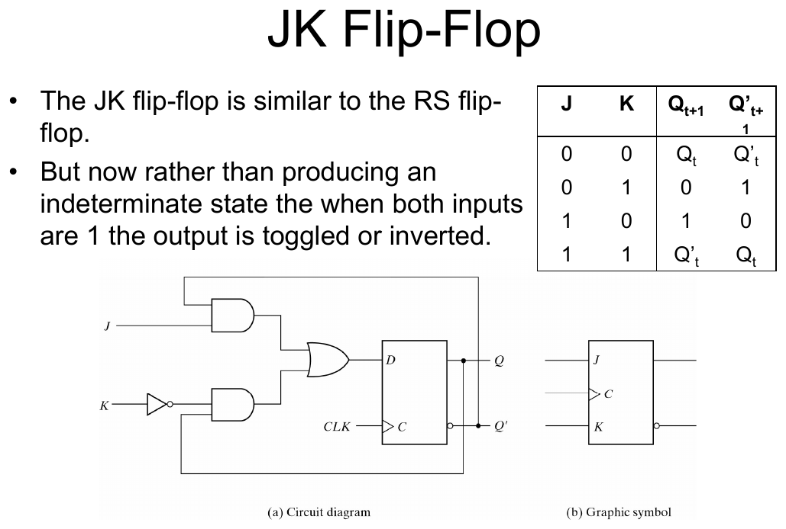

**How to read this diagram:**
- A D flip-flop with logic in front.
- D = JQ' + K'Q. That's the JK characteristic equation.
- Right: the JK symbol.

 

| J | K | Q next | |
|---|---|---|---|
| 0 | 0 | Q | hold |
| 0 | 1 | 0 | reset |
| 1 | 0 | 1 | set |
| 1 | 1 | Q' | **toggle** |

Like SR, but the "bad" input 11 now does something useful: it flips Q.

 

### 🧠 Check
Use Q_next = JQ' + K'Q. Show that J = K = 1 toggles.

Answer

J = K = 1: Q_next = 1·Q' + 0·Q = **Q'**.

So the output flips.

---

## 11. The T flip-flop

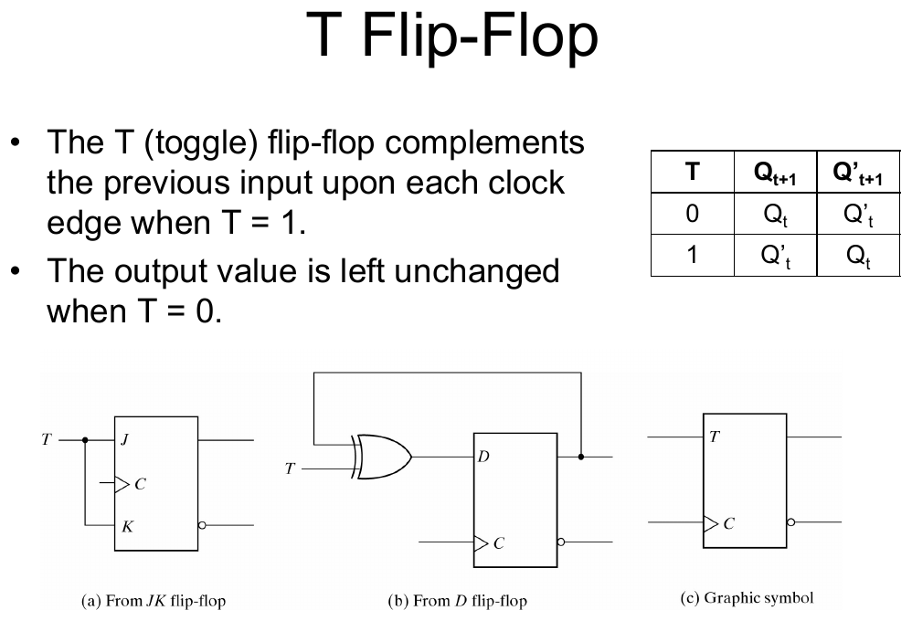

**How to read this diagram:**
- (a) A JK with J and K tied together: J = K = T.
- (b) A D flip-flop with D = T ⊕ Q.
- (c) The T symbol.

| T | Q next |
|---|---|
| 0 | Q (hold) |
| 1 | Q' (toggle) |

T = toggle. Every clock edge with T = 1 flips the output.

That's exactly what a **counter** needs (Topic 16).

---

## 12. Characteristic equations

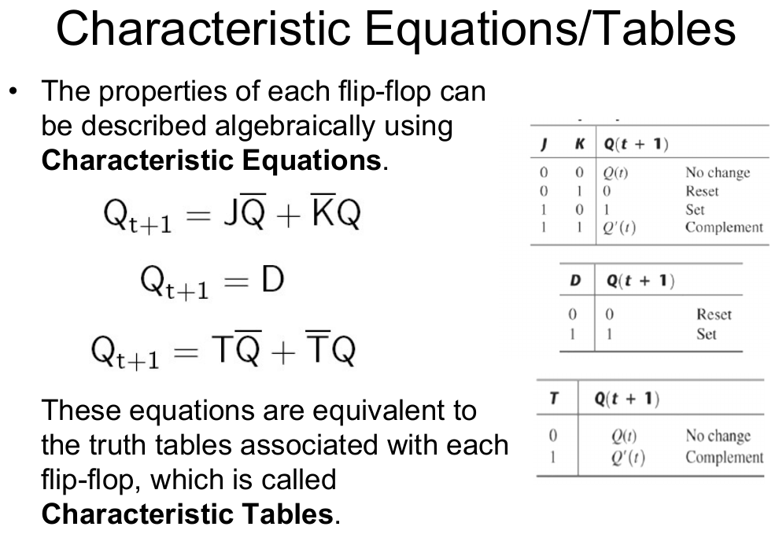

---

### 📐 Equation 39: characteristic equations

$$\text{JK:}\quad Q_{t+1} = JQ' + K'Q$$

$$\text{D:}\quad Q_{t+1} = D$$

$$\text{T:}\quad Q_{t+1} = TQ' + T'Q = T \oplus Q$$

| Symbol | Means |
|---|---|
| Q, Q_t | the output now (present state) |
| Q_t+1 | the output after the next clock edge (next state) |
| J, K, D, T | the flip-flop's inputs |

**What it means:**
Give it the inputs and the present state. It tells you the next state.

**Use it when:**
**Analysing** a circuit (Topic 14): you know the inputs, you want the next state.

**Not when:**
**Designing** (Topic 15). Then you know the next state and want the inputs. Use the **excitation table** (Rule 44) instead.

---

## 13. Asynchronous reset

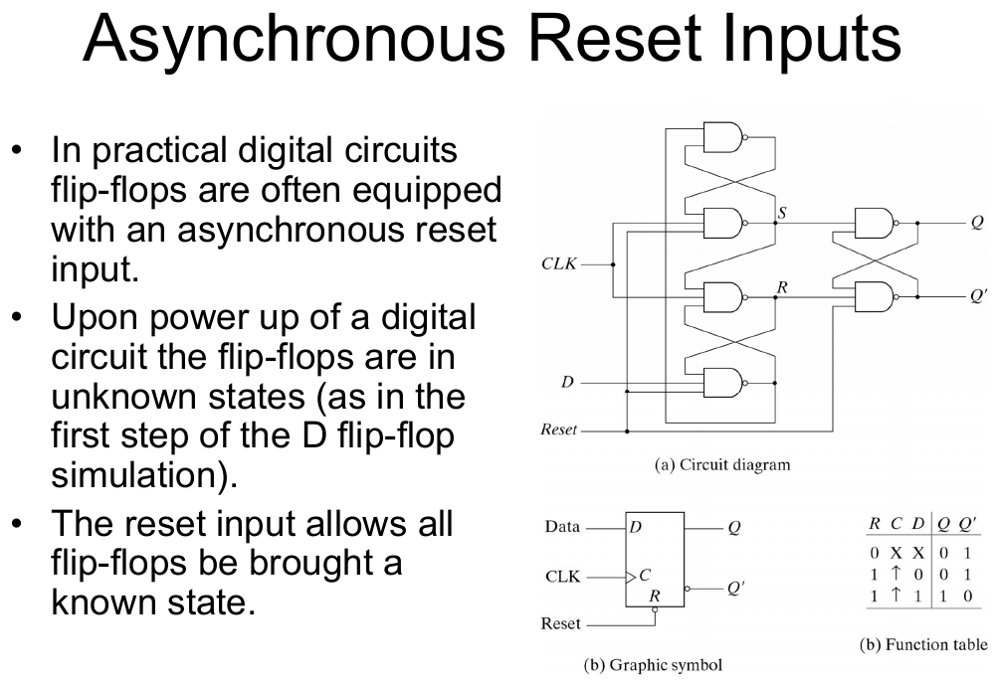

**How to read this diagram:**
- A D flip-flop with an extra **Reset** input.
- At power-up, flip-flops hold random values.
- Reset forces Q = 0 straight away, **without waiting for the clock**. That's why it's called asynchronous.
- The function table: Reset = 0 → Q = 0 whatever C and D are.

Counters and registers use it to start from 000 (Topics 16, 17).

---

## Drawing checklist: a flip-flop symbol

1. A rectangle. Inputs on the left (J, K or D or T). Q and Q' on the right.
2. Clock input C with a small triangle **>**.
3. Negative edge? Add a **bubble** before the triangle.
4. Q' has a bubble (or label it Q').
5. Reset (if any) at the bottom.

---

## Method: "what does this flip-flop do next?"

| You're asked for | Use |
|---|---|
| next Q of a JK, D or T | the table in §10, §9, §11, or Equation 39 |
| why SR = 11 is a problem | §3, Rule 38 |
| latch vs flip-flop | Rule 40 |
| which edge it triggers on | bubble on C = negative edge (§9) |
| how to build T from JK or D | §11: J = K = T, or D = T ⊕ Q |
| how to build D from SR | §8: R = D' |

---

Next: [End-of-topic test](../questions/13-latches-flip-flops.md)
