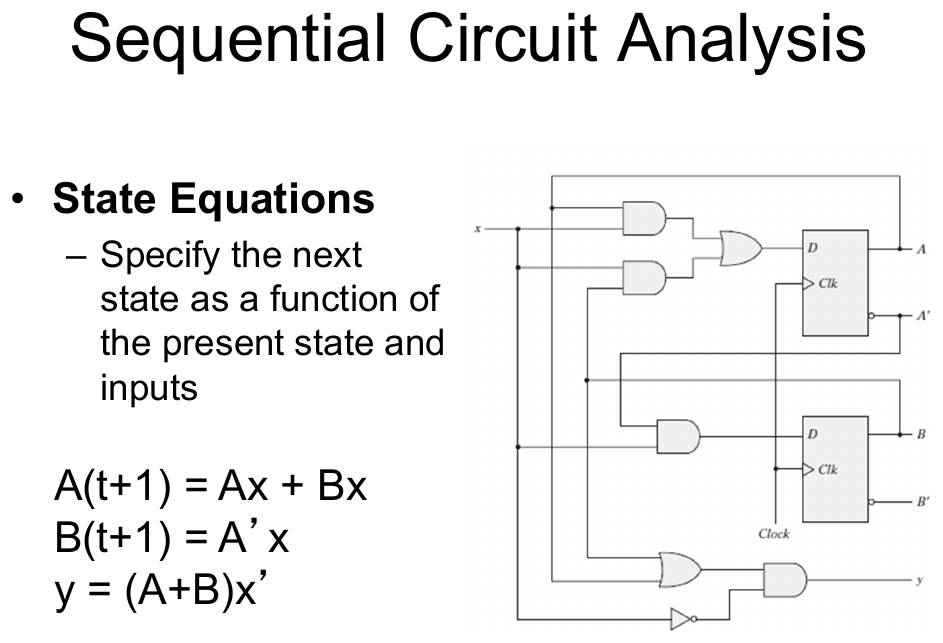
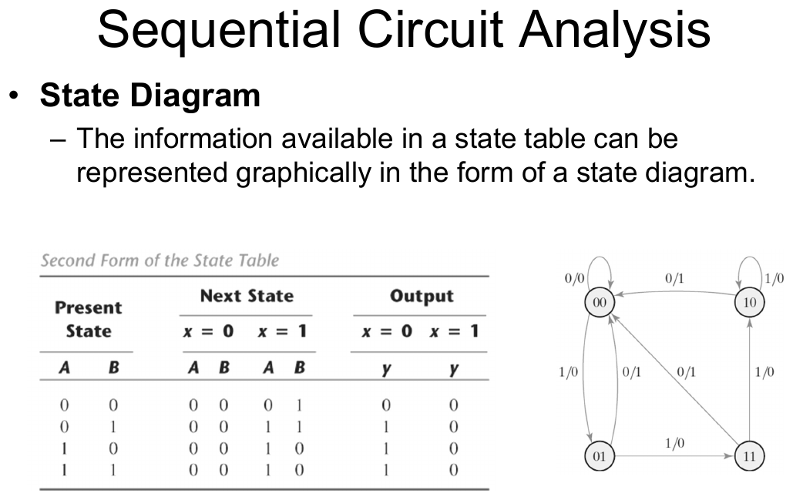
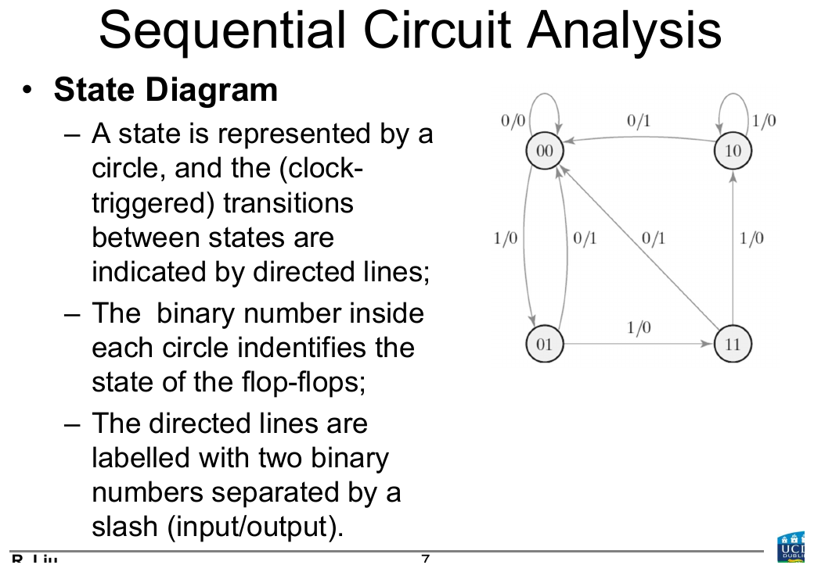
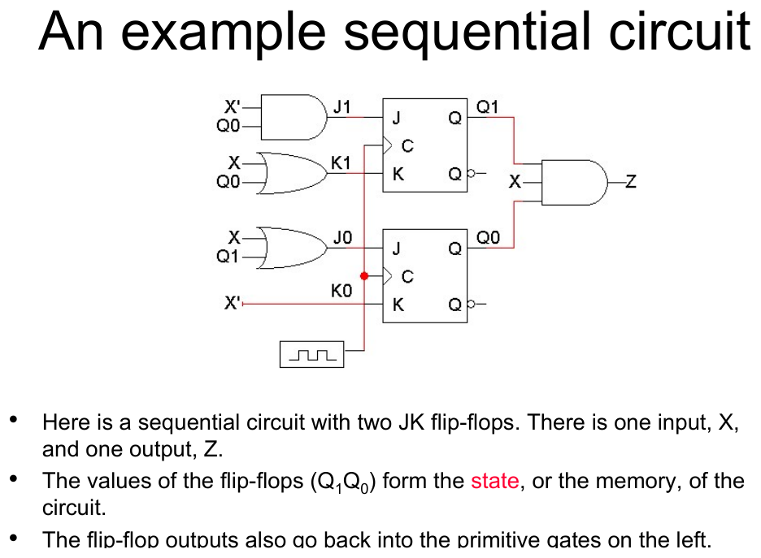
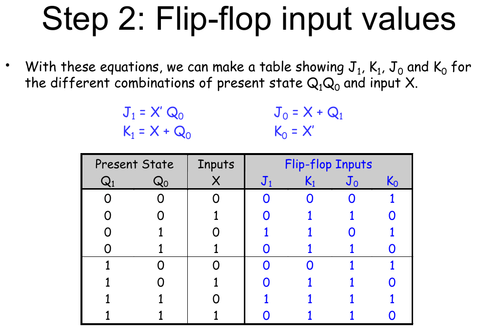
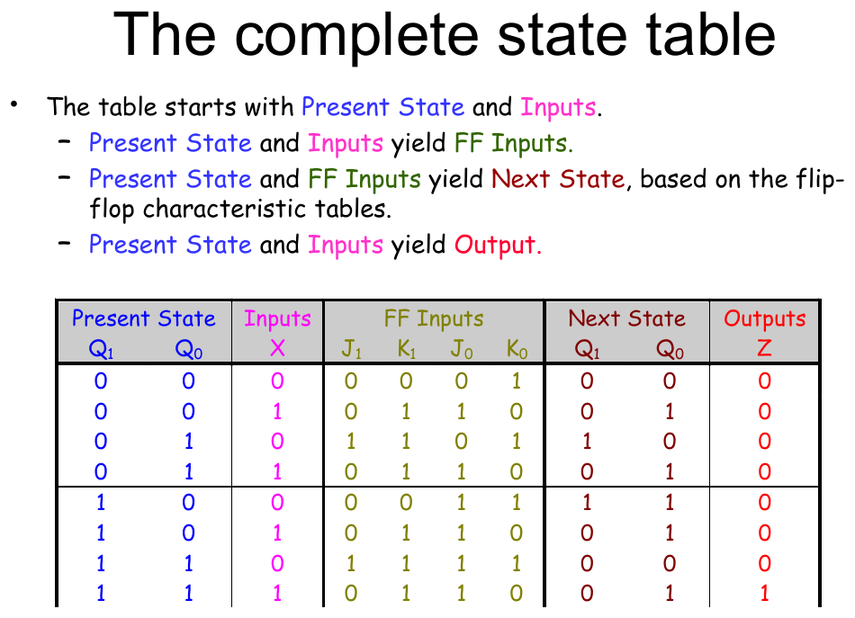
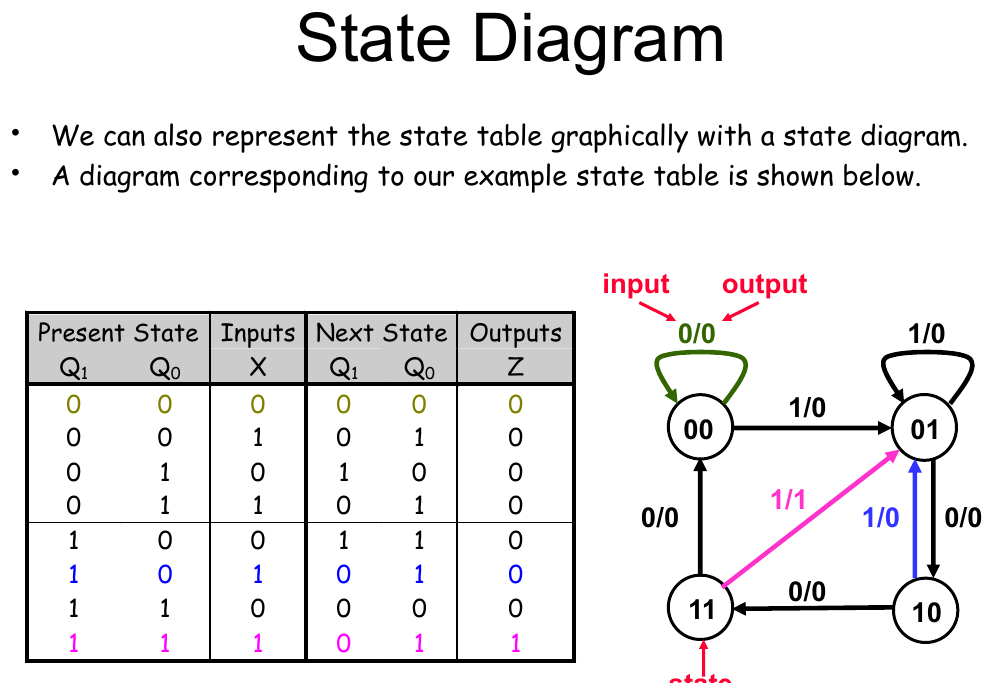
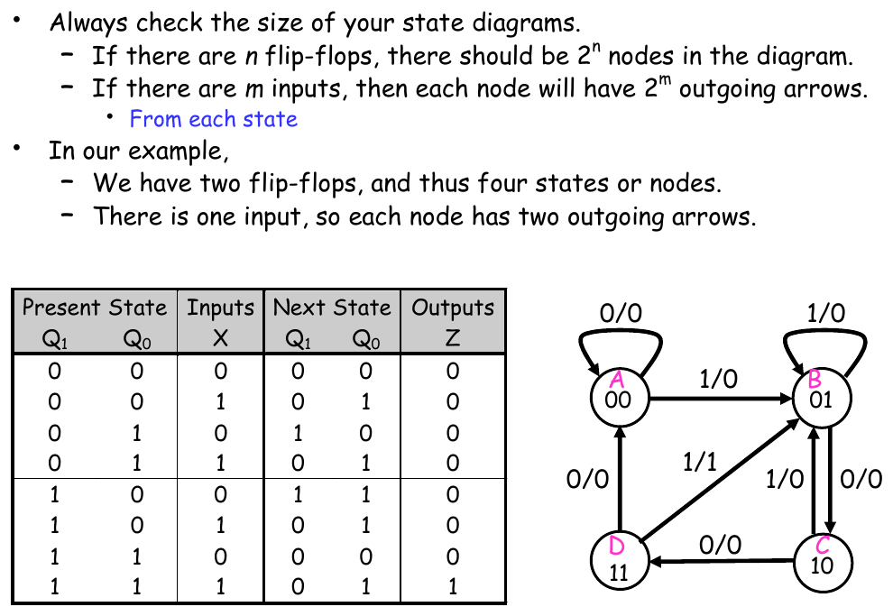

# Topic 14: Analysing clocked sequential circuits

Slide exercises: the two-JK example (Lecture 13, slides 8 to 18) · Past finals: the same skills drive 2023 Q3 and Q4

Slides: Lecture 13, all

---

## The big idea

You are given a circuit with flip-flops.

You want to know **what it does**.

 

The answer is a **state table** or a **state diagram**.

They list, for every state and every input: the **next state** and the **output**.

 

The method is always the same three steps:
1. Write the flip-flop **input equations** from the gates.
2. Fill in the flip-flop inputs for every row.
3. Use the **characteristic table** (Topic 13) to get the next state.

---

**How to use these notes:**
When you see 🧠, stop.
Answer it on paper first.
Then click to check.

---

## 🎯 In the final

Not a question on its own in 2023.

But it's the **reverse** of design (Topic 15), and you need it to **check** your design: after you design a counter or state machine, analyse it back to make sure it cycles correctly. That's how you catch mistakes in 2023 Q3.

"Analyse the operation of synchronous digital circuits using state equations, state diagrams and transition tables" is a learning outcome. Expect it.

---

## ⭐ Learn by heart from this topic

There is **no formula sheet** in this exam. So learn all of this.

- Rule 41: analysis = input equations → flip-flop input values → next state (characteristic table).
- Rule 42: n flip-flops → **2ⁿ** states (circles). m inputs → **2ᵐ** arrows out of every circle.
- Mealy arrows are labelled **input / output**.
- JK: Q_t+1 = JQ' + K'Q. D: Q_t+1 = D. T: Q_t+1 = T ⊕ Q (Equation 39).

**Memory hook:** "Equations, inputs, next."

---

## 1. Three ways to describe a sequential circuit

**How to read this diagram:**
- Two D flip-flops, A and B. One input x. One output y.
- The gates in front of each D give its input.
- Because D flip-flops copy D, the **state equations** are just the D inputs:

$$A(t+1) = Ax + Bx \qquad B(t+1) = A'x \qquad y = (A + B)x'$$

 

The three descriptions:

| Name | What it is |
|---|---|
| **State equations** | next state as a formula of present state and inputs |
| **State table** | a table of every present state and input → next state and output |
| **State diagram** | the same thing as circles and arrows |

---

## 2. State table and state diagram

**How to read this diagram:**
- The table: present state AB, then the next state for x = 0 and x = 1, then the output y for x = 0 and x = 1.
- The diagram: one **circle** per state, with the state AB inside.
- One **arrow** per row of the table. It goes from the present state to the next state.
- Each arrow is labelled **x / y**: the input that causes it, then the output.

 

The full table for this circuit (from the state equations):

| A B | x | A B next | y |
|---|---|---|---|
| 00 | 0 | 00 | 0 |
| 00 | 1 | 01 | 0 |
| 01 | 0 | 00 | 1 |
| 01 | 1 | 11 | 0 |
| 10 | 0 | 00 | 1 |
| 10 | 1 | 10 | 0 |
| 11 | 0 | 00 | 1 |
| 11 | 1 | 10 | 0 |

 

### 🧠 Check
In the circuit above, the state is 01 and x = 1. What is the next state, and the output?

Answer

A(t+1) = Ax + Bx = 0 + 1 = 1. B(t+1) = A'x = 1·1 = 1.

Next state **11**.

y = (A + B)x' = 1·0 = **0**.

---

## 3. Reading a state diagram

**How to read this diagram:**
- Circle = a state. The binary number inside = the flip-flop values.
- Arrow = a clock tick. It's labelled input / output.
- An arrow that loops back to the same circle means "stay here".

---

## 4. The big example: two JK flip-flops

**How to read this diagram:**
- Two JK flip-flops: Q1 (top) and Q0 (bottom). Both share the clock.
- One input X. One output Z from the AND gate on the right.
- The gates on the left make J1, K1, J0, K0 from X, Q0 and Q1.

 

**The output first** (it's easy):

$$Z = Q_1 Q_0 X$$

Z only depends on the present state and the input. It's a **Mealy** output.

---

### 📐 Rule 41: the analysis procedure

**Step 1.** Write the **flip-flop input equations** from the gates.

**Step 2.** Make a table: every present state × every input. Fill in the flip-flop inputs from Step 1.

**Step 3.** Use the **characteristic table** (or Equation 39) to find each next state.

**Then** draw the state diagram from the table.

**Why it works:**
The gates tell you the flip-flop inputs. The flip-flop's own table turns inputs + present state into the next state.

**Use it when:**
"Derive the state table", "draw the state diagram", "what sequence does this circuit go through?"

---

## 5. Step 1 and Step 2: the flip-flop inputs

**Step 1.** From the gates:

$$J_1 = X'Q_0 \qquad K_1 = X + Q_0 \qquad J_0 = X + Q_1 \qquad K_0 = X'$$

**Step 2.** Fill in a column for each, for all 8 rows of Q1 Q0 X.

Example row: Q1 Q0 X = 010. Then J1 = 1·1 = 1, K1 = 0 + 1 = 1, J0 = 0 + 0 = 0, K0 = 1.

---

## 6. Step 3: the next states

**How to read this diagram:**
- Present state and input (blue and pink), then the four flip-flop inputs (green), then the next state, then the output.
- Each next state comes from the JK table: 00 hold, 01 reset, 10 set, 11 toggle.

Example row 010: J1K1 = 11 → Q1 toggles 0 → **1**. J0K0 = 01 → Q0 resets → **0**. Next state **10**.

 

The full table:

| Q1 Q0 | X | J1 K1 | J0 K0 | next Q1 Q0 | Z |
|---|---|---|---|---|---|
| 00 | 0 | 0 0 | 0 1 | 00 | 0 |
| 00 | 1 | 0 1 | 1 0 | 01 | 0 |
| 01 | 0 | 1 1 | 0 1 | 10 | 0 |
| 01 | 1 | 0 1 | 1 0 | 01 | 0 |
| 10 | 0 | 0 0 | 1 1 | 11 | 0 |
| 10 | 1 | 0 1 | 1 0 | 01 | 0 |
| 11 | 0 | 1 1 | 1 1 | 00 | 0 |
| 11 | 1 | 0 1 | 1 0 | 01 | 1 |

 

### 🧠 Check
Row 10, X = 0. Use the JK table to get the next state.

Answer

J1K1 = 00 → Q1 holds at **1**.

J0K0 = 11 → Q0 toggles 0 → **1**.

Next state **11**.

---

## 7. The state diagram

**How to read this diagram:**
- Four circles: 00, 01, 10, 11 (two flip-flops → 2² = 4).
- Two arrows leave each circle (one input → 2¹ = 2).
- Pink arrow 11 → 01 is labelled **1/1**: input 1, output 1. It's the only arrow with output 1.

---

### 📐 Rule 42: check the size of your state diagram

$$\text{states} = 2^n \qquad \text{arrows out of each state} = 2^m$$

| Symbol | Means |
|---|---|
| n | number of flip-flops |
| m | number of inputs |

**Why it works:**
n flip-flops can hold 2ⁿ patterns. Every input combination must lead somewhere.

**Use it when:**
You've drawn a state diagram. Count before you hand it in.

---

---

## Drawing checklist: a state diagram

1. One **circle** per state. Write the state bits inside (Q1Q0 order, say which).
2. Count: 2ⁿ circles.
3. From **every** circle, one arrow for **every** input value: 2ᵐ arrows.
4. Label each arrow **input / output** (Mealy). For a Moore machine, the output goes **inside** the circle (Topic 15).
5. Arrows that stay put loop back to the same circle.
6. Check three arrows against your state table.

---

## Method: analysing a clocked circuit

| You're asked for | Use |
|---|---|
| state equations (D flip-flops) | the D inputs are the next states (§1) |
| flip-flop input equations | read the gates in front of each flip-flop (§5) |
| next states (JK or T) | Rule 41, then the JK / T table (Topic 13) |
| the output | read the output gate. Uses the input? Mealy. Only the state? Moore. |
| the state diagram | Rule 42 and the drawing checklist |
| "what does it do?" | follow the arrows from 00 and describe the cycle |

---

Next: [End-of-topic test](../questions/14-sequential-analysis.md)
