# Topic 15: Designing state machines (synchronous sequential circuits)

Slide exercises: the 1001 sequence detector (Lecture 14/15/16), the 1011 / 1110 detector (slides 33 to 35) · Past finals: **2023 Q3 (a whole question, 100%)**

Slides: Lecture 14/15/16, all

---

## The big idea

Topic 14 went **circuit → state table**.

Design goes the other way: **words → state table → circuit**.

<br>

The circuit you build is a **finite state machine** (FSM).

<br>

Five steps, always the same:
1. State diagram and state table.
2. Give each state a binary code.
3. Find the flip-flop inputs with the **excitation table**.
4. K-map each flip-flop input and output.
5. Draw the circuit.

Step 1 is the hard part. Steps 2 to 5 are the same every time.

---

**How to use these notes:**
When you see 🧠, stop.
Answer it on paper first.
Then click to check.

---

## 🎯 In the final

**2023 Q3 (a whole question):** use **JK** flip-flops to design a 3-bit synchronous state machine with **two modes** in **one circuit**:

- Mode 1 cycles 011 → 001 → 010 → 000 → 100 → 011.
- Mode 2 cycles 111 → 110 → 101 → 111.

"Show the design procedure, give the state table and logic functions, and sketch the logic diagram. Use the minimum number of flip-flops and external gates."

Worked in full in §12.

The slides' own "two sequences, one circuit block" example (§11) is the same idea. Expect a variant: different cycles, or D or T flip-flops.

---

## ⭐ Learn by heart from this topic

There is **no formula sheet** in this exam. So learn all of this.

- Rule 43: the 5 design steps (above).
- n states need at least **log₂ n** flip-flops (round up).
- Rule 44: the excitation tables:

| Q → Q_next | D | J K | T |
|---|---|---|---|
| 0 → 0 | 0 | 0 x | 0 |
| 0 → 1 | 1 | 1 x | 1 |
| 1 → 0 | 0 | x 1 | 1 |
| 1 → 1 | 1 | x 0 | 0 |

- D = the next state. T = 1 when the bit **changes**.
- JK: from 0, J = the next bit and K = x. From 1, J = x and K = the **opposite** of the next bit.
- Rule 45: **Moore**: output from the state only (written in the circle). **Mealy**: output from state and input (written on the arrow).

**Memory hook for JK:** "From 0, J decides. From 1, K decides (backwards)."

---

## 1. Moore and Mealy machines

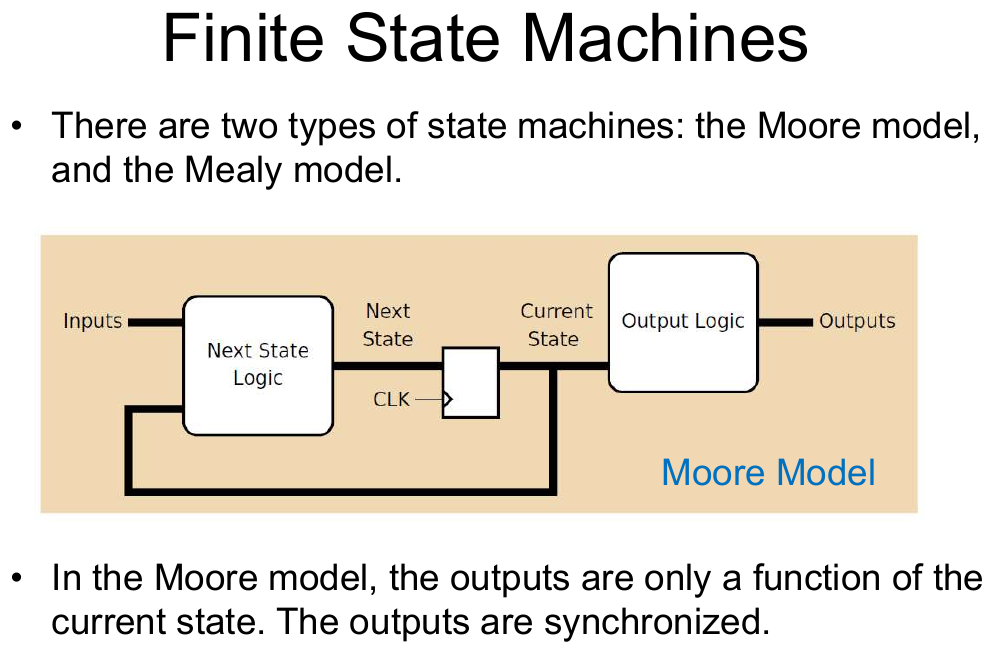

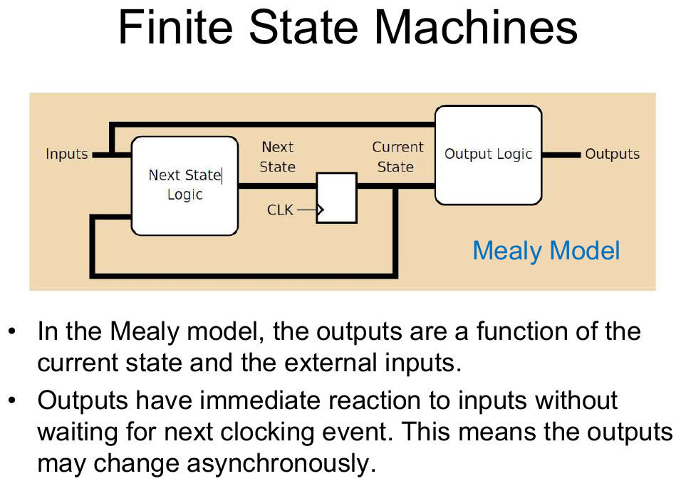

**How to read these diagrams:**
- Both: inputs go into **next-state logic**, then into the flip-flops (clocked), then into **output logic**.
- **Moore:** the output logic only sees the **current state**. Outputs change only on clock edges. They're synchronised.
- **Mealy:** the output logic also sees the **inputs** (the extra line). Outputs can change as soon as an input changes, without waiting for the clock.

---

### 📐 Rule 45: Moore vs Mealy

| | Moore | Mealy |
|---|---|---|
| Output depends on | state only | state **and** input |
| Output written | inside the circle: A/0 | on the arrow: 1/0 |
| Output changes | only at clock edges (synchronous) | straight away (asynchronous) |
| States needed | often **one more** | fewer |

**Use it when:**
"Explain the difference", or "design a Moore / Mealy machine for…".

---

## 2. The design procedure

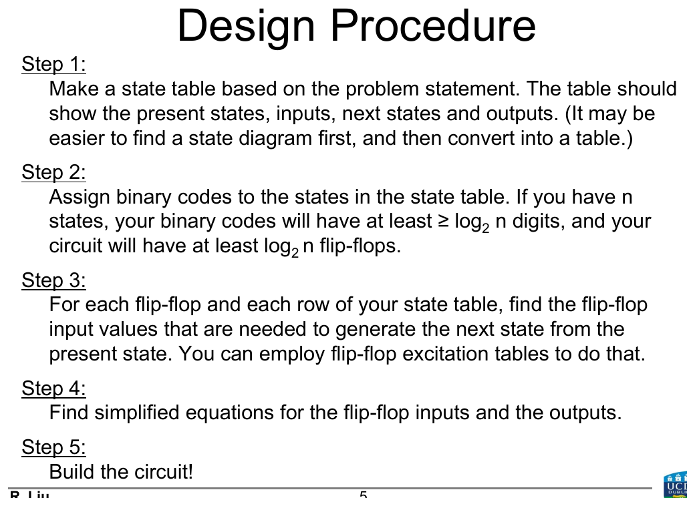

---

### 📐 Rule 43: the 5 design steps

**Step 1.** Make a **state table** from the problem. A state diagram first often helps.

**Step 2.** **Assign binary codes** to the states. n states need at least log₂ n flip-flops.

**Step 3.** For each flip-flop and each row, find the **flip-flop inputs** that cause the change. Use the excitation table (Rule 44).

**Step 4.** **K-map** each flip-flop input and each output. Unused states are don't cares (x).

**Step 5.** **Draw** the circuit.

**Use it when:**
Any "design a synchronous circuit / state machine / counter / sequence detector" question.

---

## 3. Step 1 for a sequence detector: 1001 (Mealy)

The circuit has one input X (one bit per clock) and one output Z.

Z = 1 when the last four inputs were **1001**.

```
Input : 1 1 1 0 0 1 1 0 1 0 0 1 0 0 1 1 0
Output: 0 0 0 0 0 1 0 0 0 0 0 1 0 0 1 0 0
```

The states remember **how much of the pattern** we've seen:

| State | Meaning |
|---|---|
| A | none of 1001 yet |
| B | seen 1 |
| C | seen 10 |
| D | seen 100 |

<br>

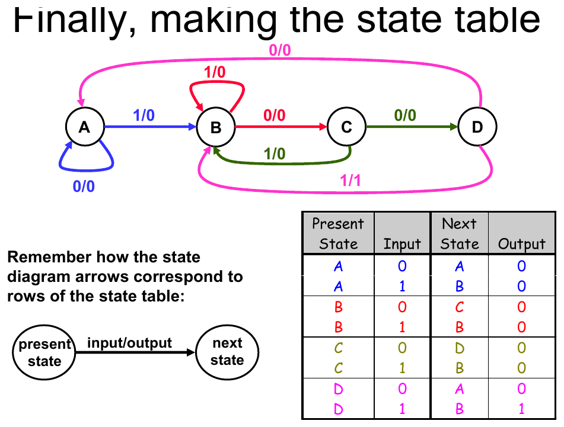

**How to read this diagram:**
- A → B on 1/0 (first bit). B → C on 0/0. C → D on 0/0.
- D → B on **1/1**: pattern found, output 1. And that last 1 can start the next 1001, so go to **B**, not A. That's **overlapping**.
- Every state needs **two** arrows (X = 0 and X = 1). The "wrong" bits send you back to the longest part of the pattern you still have:
  - A on 0 stays at A. B on 1 stays at B (that 1 is a fresh start).
  - C on 1 → B. D on 0 → A (1000 has none of the pattern left).

---

### 🧠 Check
You're in state C (seen 10) and the input is 1. Why go to B, not A?

<details><summary>Answer</summary>

The last bits are now 101. The **last 1** could be the start of a new 1001.

So we've seen "1" of the pattern. That's state **B**.

</details>

---

## 4. Step 2: assign binary codes

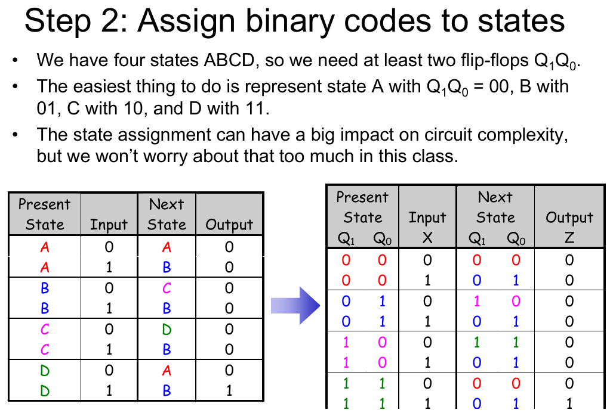

4 states → log₂ 4 = **2** flip-flops, Q1 Q0.

Simplest: A = 00, B = 01, C = 10, D = 11.

| Q1 Q0 | X | next Q1 Q0 | Z |
|---|---|---|---|
| 00 | 0 | 00 | 0 |
| 00 | 1 | 01 | 0 |
| 01 | 0 | 10 | 0 |
| 01 | 1 | 01 | 0 |
| 10 | 0 | 11 | 0 |
| 10 | 1 | 01 | 0 |
| 11 | 0 | 00 | 0 |
| 11 | 1 | 01 | 1 |

---

## 5. Step 3: the excitation table

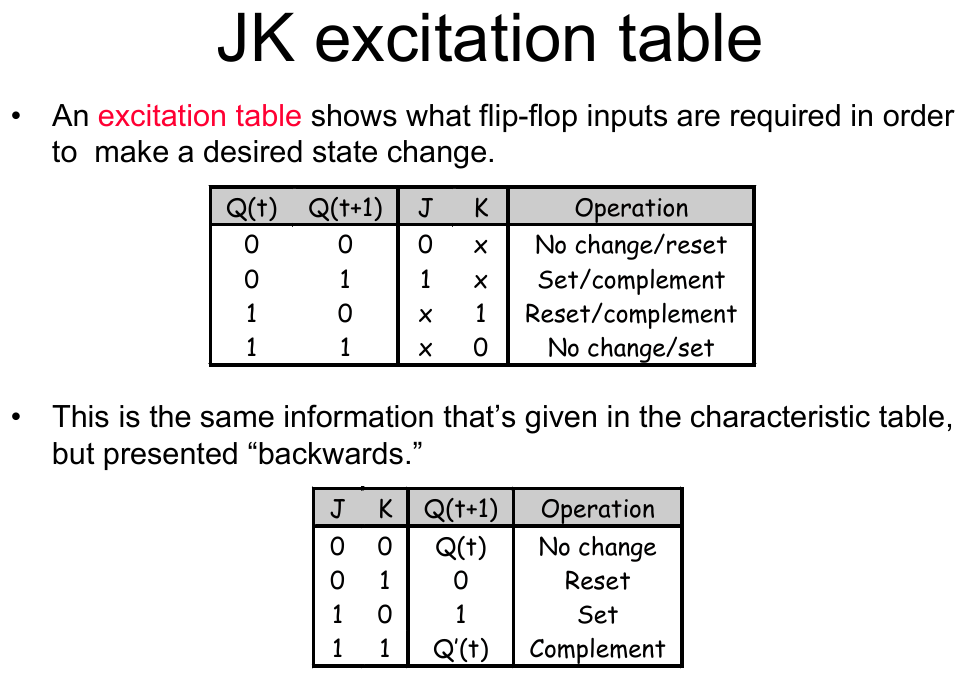

**How to read this diagram:**
- Top: you know Q now and Q next. Which J and K make that happen?
- 0 → 1: J must be 1. K can be anything: JK = 10 (set) or 11 (toggle) both work. So K = **x**.
- Bottom: the normal JK table, for comparison. The excitation table is the same information **backwards**.

---

### 📐 Rule 44: excitation tables

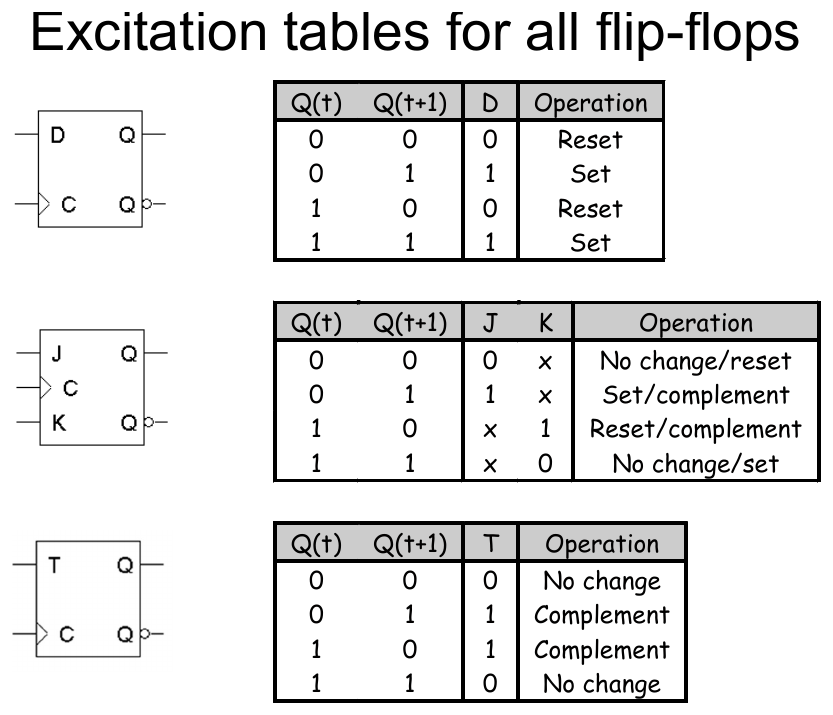

| Q → Q_next | D | J | K | T |
|---|---|---|---|---|
| 0 → 0 | 0 | 0 | x | 0 |
| 0 → 1 | 1 | 1 | x | 1 |
| 1 → 0 | 0 | x | 1 | 1 |
| 1 → 1 | 1 | x | 0 | 0 |

| Symbol | Means |
|---|---|
| x | don't care: either value works |

**Why it works:**
Each row asks "which inputs give this change?" and reads the characteristic table (Topic 13) backwards.

**Use it when:**
Step 3 of every design. **Never** use the characteristic table here. That's for analysis.

---

### 🧠 Check
A JK flip-flop must go from 1 to 0. What are J and K? Why?

<details><summary>Answer</summary>

**J = x, K = 1.**

JK = 01 (reset) works. JK = 11 (toggle from 1) also works. Both have K = 1. J can be either.

</details>

---

## 6. Steps 3 and 4: JK inputs for the 1001 detector

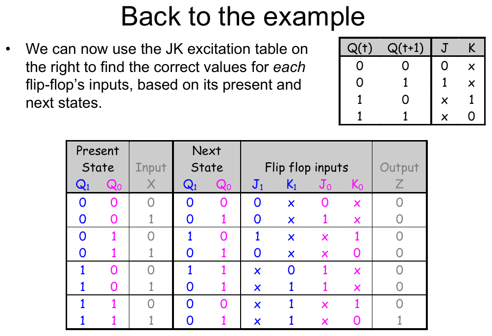

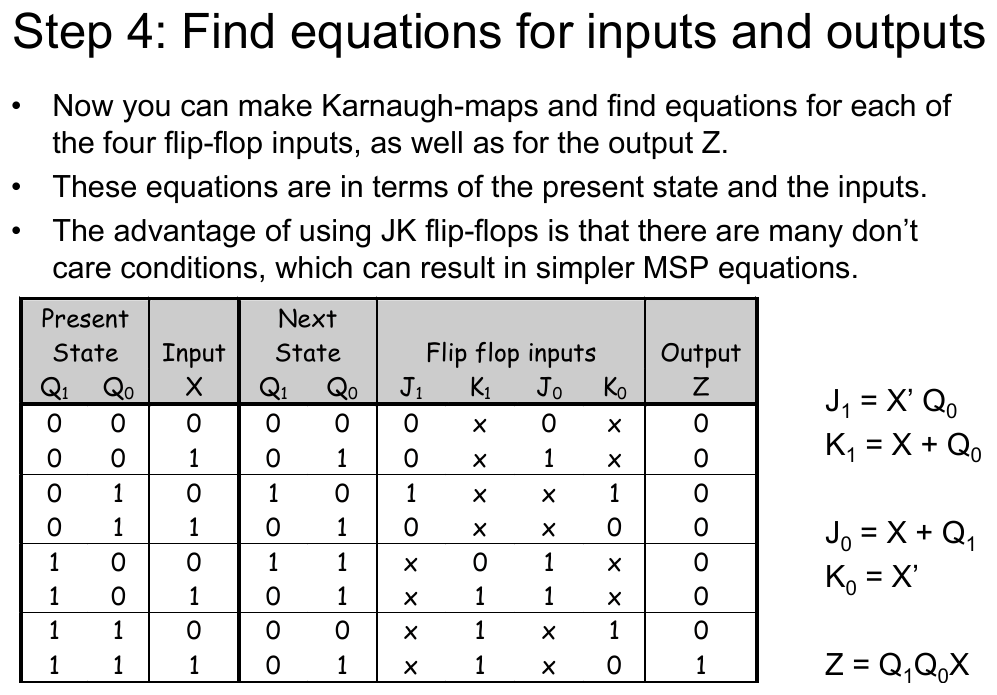

**How to read these diagrams:**
- For each row, compare the present bit with the next bit. Look up Rule 44.
- Lots of **x** entries. That's the big plus of JK: more don't cares, smaller K-maps.
- K-map each column. Result:

$$J_1 = X'Q_0 \qquad K_1 = X + Q_0 \qquad J_0 = X + Q_1 \qquad K_0 = X' \qquad Z = Q_1Q_0X$$

---

## 7. Step 5: the circuit

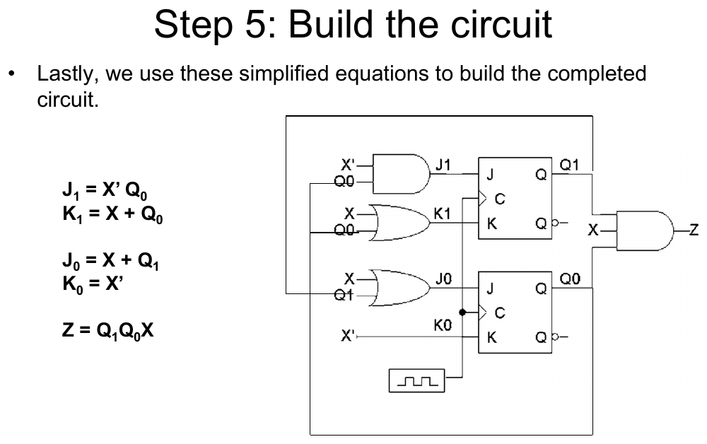

**How to read this diagram:**
- Two JK flip-flops sharing the clock (the square wave at the bottom).
- An AND gate makes J1. OR gates make K1 and J0. K0 is just X'.
- The AND gate on the right makes Z = Q1Q0X.

---

## 8. The same machine with D flip-flops

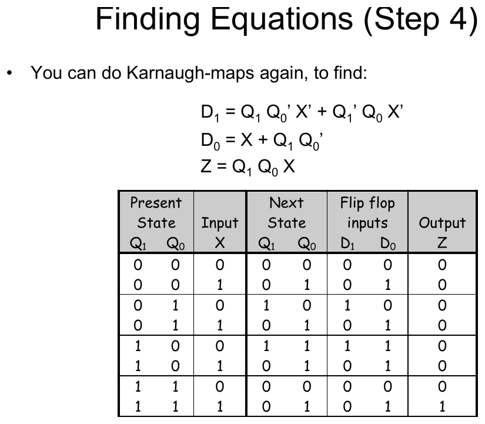

With D flip-flops, Step 3 is free: **D = the next state** column.

K-map the next-state columns:

$$D_1 = Q_1Q_0'X' + Q_1'Q_0X' \qquad D_0 = X + Q_1Q_0' \qquad Z = Q_1Q_0X$$

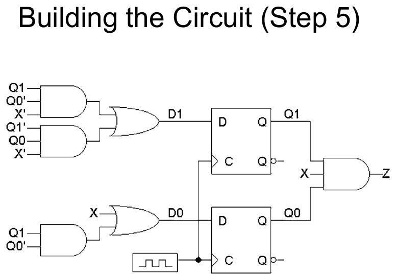

<br>

| | JK | D |
|---|---|---|
| Inputs per flip-flop | 2 | 1 |
| Don't cares | many → simpler gates | none |
| Excitation table | needed | not needed (D = next) |
| Used in practice | less | **more** |

---

## 9. The same detector as a Moore machine (T flip-flops)

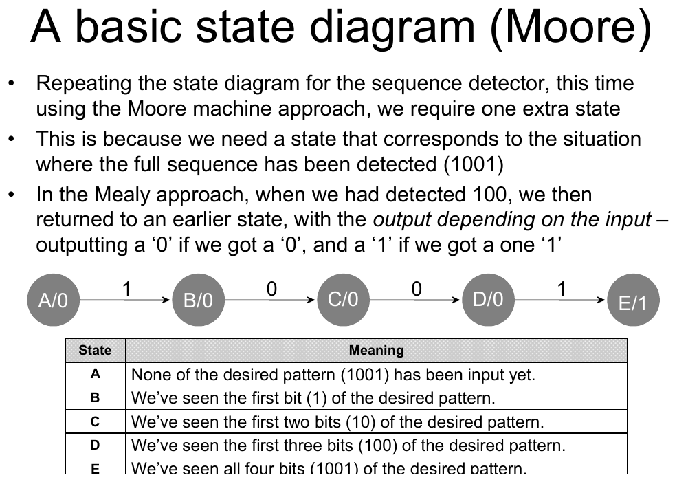

**How to read this diagram:**
- The output is now **inside** each circle: A/0, B/0, C/0, D/0, **E/1**.
- E means "just seen 1001". It's the only state with output 1.
- Moore needs one **extra** state (E). Mealy put the output on the D → B arrow instead.

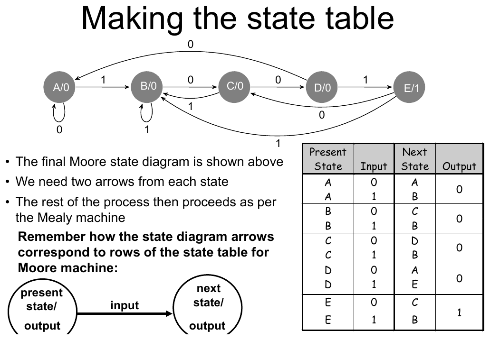

5 states → **3** flip-flops (log₂ 5 rounds up to 3). States 101, 110, 111 are unused: **don't cares**.

<br>

With T flip-flops (T = 1 when the bit changes), the K-maps give:

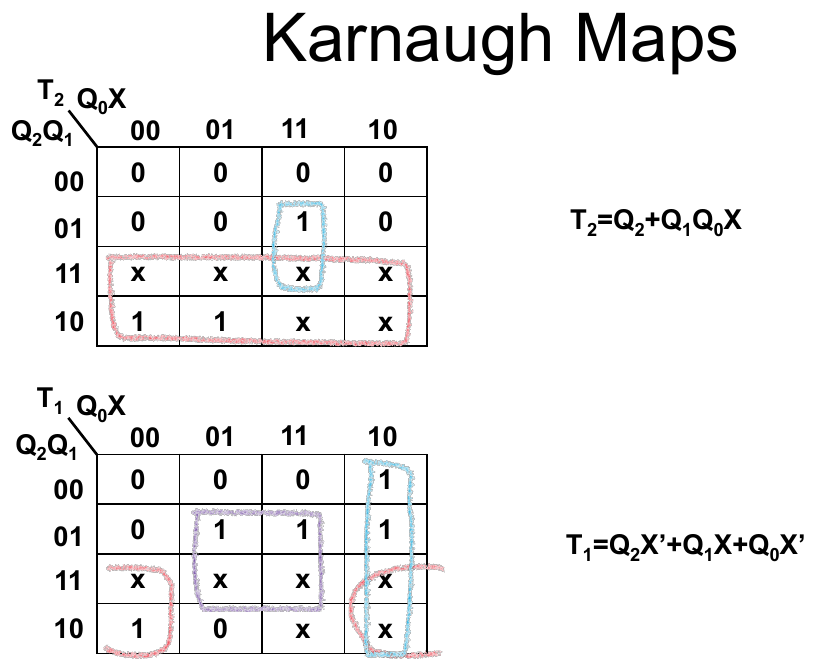

$$T_2 = Q_2 + Q_1Q_0X \qquad T_1 = Q_2X' + Q_1X + Q_0X' \qquad T_0 = Q_1 + Q_0'X + Q_0X'$$

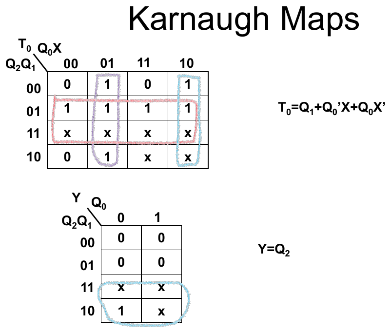

$$Y = Q_2$$

---

## 10. Using unused states as don't cares

When n flip-flops have **more** than the states you need, the extra codes never happen.

Put **x** in their K-map cells. Bigger groups, smaller circuit.

**But check afterwards** that each unused state leads back into the cycle (Topic 16 §5). If it doesn't, the machine could get stuck after power-up.

---

## 11. Two sequences, one circuit (slides 33 to 35)

**Design a one-input, two-output Mealy detector for 1011 and 1110.**

Output 00 normally. 01 when 1011 is found. 10 when 1110 is found. Overlapping allowed. **One** circuit block.

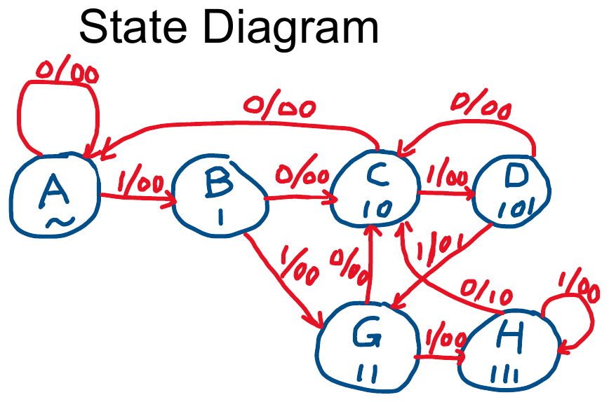

**How to read this diagram:**
- Each state remembers the longest useful ending: A (nothing), B (1), C (10), D (101), G (11), H (111).
- D on 1 → G with output **01**: 1011 found. The last "11" is kept (state G).
- H on 0 → C with output **10**: 1110 found. The last "10" is kept (state C).
- H on 1 stays at H: 1111 still ends in 111.

6 states → 3 flip-flops. Then Steps 2 to 5 as usual.

The trick: **both patterns share one state diagram.** That's the idea behind 2023 Q3.

---

## 12. Worked example: Final 2023 Q3

**Use JK flip-flops to design a 3-bit synchronous binary state machine with two modes. Mode 1: 011 → 001 → 010 → 000 → 100 → back to 011. Mode 2: 111 → 110 → 101 → back to 111. One circuit block only. Minimum flip-flops and gates.**

<br>

**Step 1. One state diagram for both modes.**

The two cycles use **all 8** codes once each: 011, 001, 010, 000, 100 and 111, 110, 101.

So one 3-bit machine can hold both. Which cycle it runs depends only on where it **starts**. No input needed.

<br>

**Step 2.** The codes are given. 3 bits → **3** flip-flops A B C (A = left bit). That's the minimum.

<br>

**Step 3. State table with JK inputs** (Rule 44):

| A B C | next A B C | J_A K_A | J_B K_B | J_C K_C |
|---|---|---|---|---|
| 000 | 100 | 1 x | 0 x | 0 x |
| 001 | 010 | 0 x | 1 x | x 1 |
| 010 | 000 | 0 x | x 1 | 0 x |
| 011 | 001 | 0 x | x 1 | x 0 |
| 100 | 011 | x 1 | 1 x | 1 x |
| 101 | 111 | x 0 | 1 x | x 0 |
| 110 | 101 | x 0 | x 1 | 1 x |
| 111 | 110 | x 0 | x 0 | x 1 |

<br>

**Step 4. K-maps** (A down the side, BC across):

J_A: 1 at 000. x in the whole A = 1 row.

| A \ BC | 00 | 01 | 11 | 10 |
|---|---|---|---|---|
| **0** | 1 | 0 | 0 | 0 |
| **1** | x | x | x | x |

Group column 00 (with the x below): **J_A = B'C'**

K_A: 1 at 100. x in the A = 0 row. Same shape: **K_A = B'C'**

<br>

J_B: 1 at 001, 100, 101. x where B = 1.

| A \ BC | 00 | 01 | 11 | 10 |
|---|---|---|---|---|
| **0** | 0 | 1 | x | x |
| **1** | 1 | 1 | x | x |

Groups: the A = 1 row → A. Columns 01 and 11 → C. **J_B = A + C**

K_B: 1 at 010, 011, 110. 0 at 111. x where B = 0.

| A \ BC | 00 | 01 | 11 | 10 |
|---|---|---|---|---|
| **0** | x | x | 1 | 1 |
| **1** | x | x | 0 | 1 |

Groups: the A = 0 row → A'. Columns 00 and 10 → C'. **K_B = A' + C'** = (AC)'

<br>

J_C: 1 at 100, 110. 0 at 000, 010. x where C = 1. **J_C = A**

K_C: 1 at 001, 111. 0 at 011, 101. x where C = 0.

| A \ BC | 00 | 01 | 11 | 10 |
|---|---|---|---|---|
| **0** | x | 1 | 0 | x |
| **1** | x | 0 | 1 | x |

No two 1s are next to each other. **K_C = A'B' + AB** = (A ⊕ B)' (XNOR)

<br>

**Step 5. The circuit.**

| Input | Gate |
|---|---|
| J_A = K_A = B'C' = (B + C)' | **one NOR** gate, feeding both J_A and K_A |
| J_B = A + C | one OR gate |
| K_B = (AC)' | one NAND gate |
| J_C = A | a wire from Q_A |
| K_C = (A ⊕ B)' | one XNOR gate |

**3 JK flip-flops + 4 gates.** All three clocks tied to one common clock.

<br>

**Check** (analyse it back, Topic 14): from 011: J_A K_A = 00, J_B K_B = 11, J_C K_C = 00 → next **001** ✓. Running the whole thing gives 011 → 001 → 010 → 000 → 100 → 011 and 111 → 110 → 101 → 111 ✓.

---

### 🧠 Check
Why is a third flip-flop needed in 2023 Q3, even though Mode 2 has only 3 states?

<details><summary>Answer</summary>

One circuit must hold **both** modes: 5 + 3 = 8 different states.

8 states need log₂ 8 = **3** flip-flops.

</details>

---

## Drawing checklist: the logic diagram of a state machine

1. Draw the flip-flops in a row (A, B, C), with their type (JK, D, T).
2. One **common clock** line into every C input. That's what "synchronous" means.
3. Label every flip-flop input with its equation (J_A = B'C', ...).
4. Draw each gate. Its inputs come from the Q (or Q') outputs. Show the feedback wires.
5. Draw the output gate (Mealy: uses inputs too).
6. Write the parts count: flip-flops and gates.

---

## Method: any state machine design

| You're asked for | Use |
|---|---|
| state diagram from words | §3: one state per "how much I've seen" |
| how many flip-flops | log₂(number of states), round up |
| flip-flop inputs | Rule 44 excitation table, row by row |
| equations | K-maps (Topic 8), with x for JK and unused states |
| D flip-flops | D = next state (§8) |
| T flip-flops | T = 1 where the bit changes (§9) |
| two modes / two sequences, one circuit | one state diagram that holds both (§11, §12) |
| "minimum gates" | use every x; look for XOR / XNOR / NOR shapes (§12) |
| Moore or Mealy | Rule 45 |

---

Next: [End-of-topic test](../questions/15-state-machine-design.md)
