# Topic 16: Counters: synchronous and ripple

Slide exercises: modulo-5 counter (Lecture 17/18, slides 4 to 10), "how would the design change for a count-down counter? With D or JK flip-flops?" (slide 16) · Past finals: **2023 Q2a (60% of Q2)**

Slides: Lecture 17/18, all

---

## The big idea

A **counter** is a sequential circuit whose **state is the output**.

Each clock, it moves to the next number.

<br>

Two kinds:

| Synchronous | Ripple |
|---|---|
| **every** flip-flop gets the **same** clock | each flip-flop is clocked by the **one before it** |
| designed like any state machine (Topic 15) | no design needed: every flip-flop just toggles |
| fast, any sequence | simple, slow, only counts in binary (or BCD) |

---

**How to use these notes:**
When you see 🧠, stop.
Answer it on paper first.
Then click to check.

---

## 🎯 In the final

**2023 Q2a (60% of Q2):** "Design a three-bit binary **ripple count-down** counter using **D** flip-flops. Show the logic diagram, draw the output waveforms and briefly explain how this circuit can be used as a **frequency divider**."

That is exactly the slide 16 exercise. Worked in full in §8.

A synchronous counter (§2 to §5) is also fair game: it's a state machine with no input.

---

## ⭐ Learn by heart from this topic

There is **no formula sheet** in this exam. So learn all of this.

- Rule 46: synchronous counter = Topic 15 design with no input. Unused states → x, then **check** they lead back.
- Rule 47: ripple counter: every flip-flop **toggles** (T = 1, or J = K = 1, or **D = Q'**).

| Flip-flops trigger on | Next clock from **Q** | Next clock from **Q'** |
|---|---|---|
| **negative** edge (bubble) | counts **up** | counts **down** |
| **positive** edge | counts **down** | counts **up** |

- Equation 48: an n-bit ripple counter has 2ⁿ states. Stage k (k = 1 for the first) gives **f₀ / 2ᵏ**.
- BCD (decade) counter: 0 to 9, then back to 0.

**Memory hook:** "Negative edge, take Q, go up. Flip one, flip the direction."

---

## 1. What a counter is

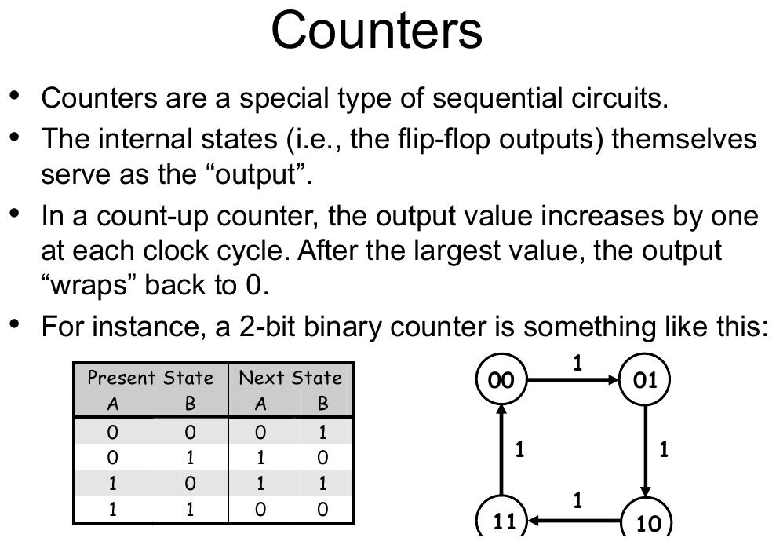

**How to read this diagram:**
- Present state AB → next state. 00 → 01 → 10 → 11 → 00.
- The state diagram is one loop. The arrows are labelled with the clock (no input).
- After the largest value, it **wraps** back to 0.

---

## 2. Synchronous counter: modulo-5

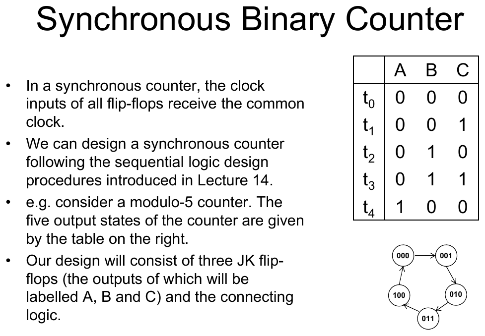

**How to read this diagram:**
- Three flip-flops A B C. The sequence t₀ to t₄: 000, 001, 010, 011, 100. Then back to 000.
- Only 5 of the 8 states are used. That's **modulo-5**.
- All flip-flops share one clock. So we design it with the Topic 15 steps.

---

## 3. JK inputs from the excitation table

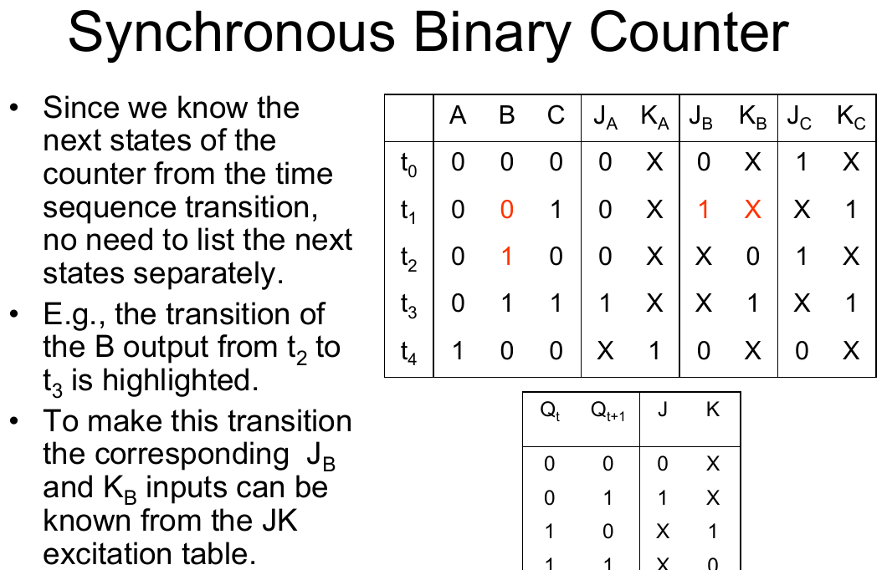

**How to read this diagram:**
- No separate "next state" column is needed: the next row **is** the next state.
- Red: B goes 0 → 1 from t₁ to t₂. The JK excitation table says J_B = 1, K_B = x.
- Do this for every bit and every row.

| t | A B C | J_A K_A | J_B K_B | J_C K_C |
|---|---|---|---|---|
| t₀ | 000 | 0 x | 0 x | 1 x |
| t₁ | 001 | 0 x | 1 x | x 1 |
| t₂ | 010 | 0 x | x 0 | 1 x |
| t₃ | 011 | 1 x | x 1 | x 1 |
| t₄ | 100 | x 1 | 0 x | 0 x |

---

## 4. Six K-maps

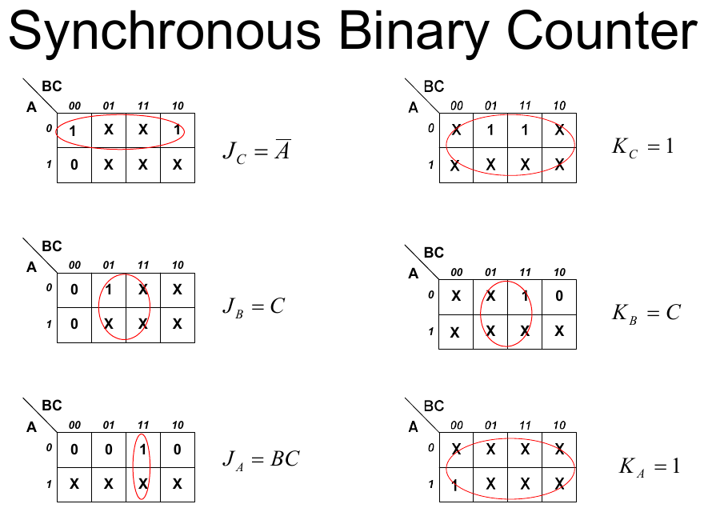

States 101, 110, 111 are unused: x in every map.

$$J_A = BC \quad K_A = 1 \qquad J_B = C \quad K_B = C \qquad J_C = A' \quad K_C = 1$$

---

## 5. Unused states: make sure they come back

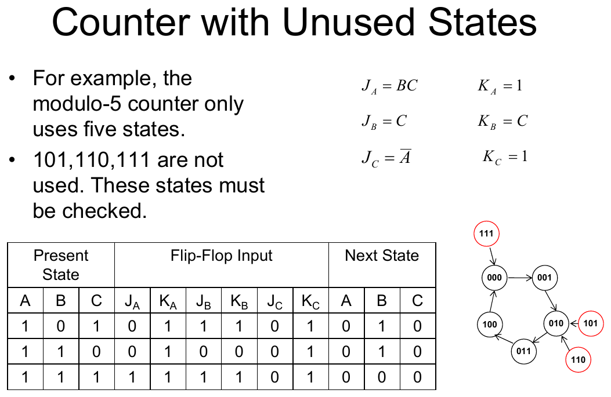

**How to read this diagram:**
- We used 101, 110, 111 as don't cares. So the circuit **does** do something in them. We must check what.
- Put each into the equations. The table shows: 101 → 010, 110 → 010, 111 → 000.
- All three land in the main loop (the red circles join the cycle). ✓

If an unused state **didn't** come back (for example, two unused states looping to each other), the counter could get stuck after power-up. Then you'd fix that state's next state and redesign.

---

### 📐 Rule 46: designing a synchronous counter

**Step 1.** List the count sequence. Each row's next state is the next row.

**Step 2.** Find the flip-flop inputs with the excitation table (Topic 15, Rule 44).

**Step 3.** K-map each input. Unused states are **x**.

**Step 4.** **Check every unused state**: does it lead back into the count? If not, assign it a next state and redo.

**Step 5.** Draw: all clock inputs on **one** clock line.

**Use it when:**
"Design a synchronous counter that counts …" (any sequence, any flip-flop type).

---

### 🧠 Check
A modulo-6 counter uses 3 flip-flops. How many unused states must you check?

<details><summary>Answer</summary>

3 flip-flops = 8 states. 8 − 6 = **2** unused states.

</details>

---

## 6. The binary ripple counter

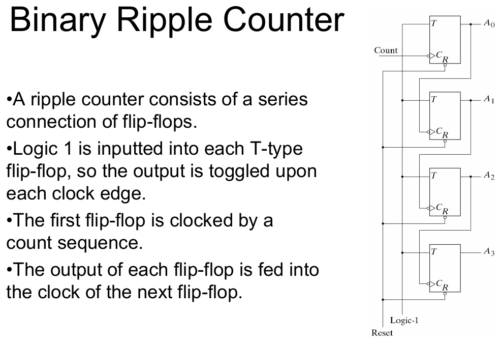

**How to read this diagram:**
- Four **T** flip-flops in a column, A₀ at the top. Every T input is tied to **logic 1**, so each one **toggles** on its clock edge.
- Only A₀ gets the count pulses.
- Each output Aᵢ is wired to the **clock of the next** flip-flop.
- The small bubble at C: they trigger on the **negative** edge (1 → 0).
- Reset clears them all to 0000 at the start.

<br>

**How it counts up:**

A₀ toggles on every falling edge of the input.

A₁ toggles when A₀ falls from 1 to 0. That's a **carry**.

A₂ toggles when A₁ falls. And so on.

The clock "ripples" down the chain, one flip-flop at a time. Hence the name.

---

## 7. Waveforms and the frequency divider

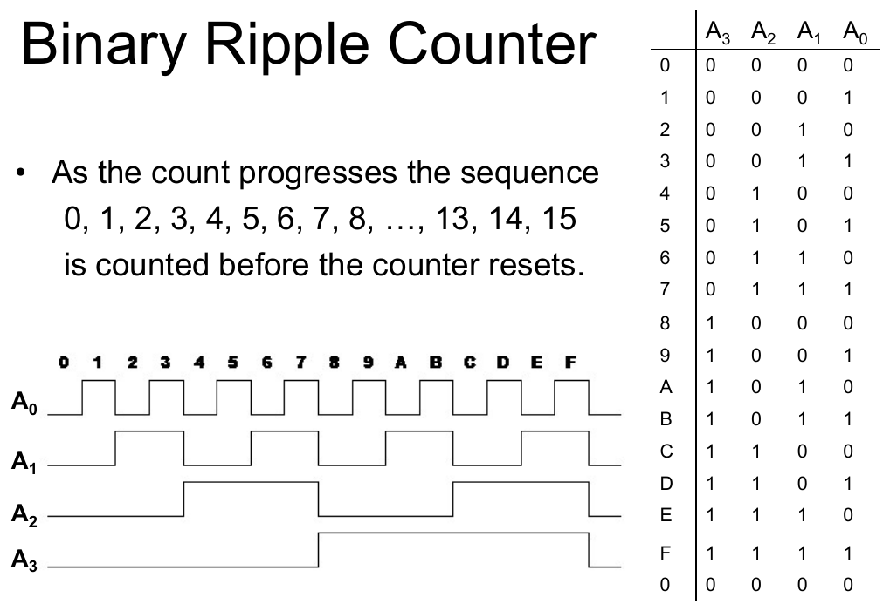

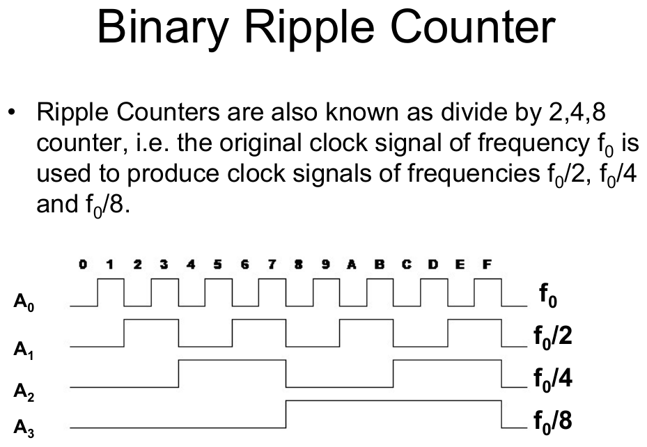

**How to read these diagrams:**
- The count goes 0, 1, 2, ..., 15, then back to 0.
- A₀ is a square wave at **half** the input frequency. A₁ at a quarter. A₂ at an eighth. A₃ at a sixteenth.
- Each stage **halves** the frequency.

---

### 📐 Equation 48: ripple counter facts

$$\text{states} = 2^n \qquad f_k = \frac{f_0}{2^k}$$

| Symbol | Means |
|---|---|
| n | number of flip-flops |
| f₀ | the input clock frequency |
| k | stage number: 1 for the first flip-flop, n for the last |
| f_k | frequency of that stage's output |

**What it means:**
A 3-bit ripple counter counts 8 states and gives f₀/2, f₀/4, f₀/8.

**Use it when:**
"Explain how it can be used as a **frequency divider**". Every output is a clean square wave at f₀/2ᵏ.

---

### 📐 Rule 47: building any ripple counter

**Make each flip-flop toggle:**

| Flip-flop | Wire it as |
|---|---|
| T | T = 1 |
| JK | J = K = 1 |
| D | **D = Q'** (its own Q' back to D) |

**Pick the clock source for each next stage:**

| Flip-flops trigger on | from Q | from Q' |
|---|---|---|
| negative edge | **up** | **down** |
| positive edge | **down** | **up** |

**Why it works:**
Counting **up**, a bit flips when the bit below it goes **1 → 0** (a carry). Counting **down**, a bit flips when the bit below it goes **0 → 1** (a borrow).

A negative-edge flip-flop sees the 1 → 0 of whatever drives it. Driven from Q, that's Q falling (up). Driven from Q', that's Q rising (down).

**Use it when:**
"Design a ripple up / down counter with D / JK / T flip-flops" (2023 Q2a, slide 16).

---

### 🧠 Check
You build a ripple counter from **positive**-edge T flip-flops, each clocked from the previous **Q**. Up or down?

<details><summary>Answer</summary>

**Down.**

Positive edge sees Q going 0 → 1. A bit flipping when the one below rises is a **borrow**: counting down.

</details>

---

## 8. Worked example: Final 2023 Q2a

**Design a three-bit binary ripple count-down counter using D flip-flops. Show the logic diagram, draw the output waveforms, and explain how it can be used as a frequency divider.**

<br>

**Step 1. Make each D flip-flop toggle:** connect **D = Q'** on every flip-flop (Rule 47).

**Step 2. Pick the clock connections.** Use negative-edge flip-flops, as on the slides. For **down**, clock each stage from the previous **Q'**.

<br>

**Logic diagram (describe it like this, and draw it):**

| Flip-flop | D input | Clock input |
|---|---|---|
| FF0 (Q₀, LSB) | Q₀' | the input clock CLK |
| FF1 (Q₁) | Q₁' | **Q₀'** |
| FF2 (Q₂, MSB) | Q₂' | **Q₁'** |

All three have a Reset line to start at 000.

(With positive-edge flip-flops, clock FF1 from Q₀ and FF2 from Q₁ instead. Same count.)

<br>

**Count sequence:**

| Falling edge | 0 | 1 | 2 | 3 | 4 | 5 | 6 | 7 | 8 |
|---|---|---|---|---|---|---|---|---|---|
| Q₂ Q₁ Q₀ | 000 | 111 | 110 | 101 | 100 | 011 | 010 | 001 | 000 |
| Count | 0 | 7 | 6 | 5 | 4 | 3 | 2 | 1 | 0 |

<br>

**Waveforms** (changes on the falling clock edges):

```
CLK  ‾‾__‾‾__‾‾__‾‾__‾‾__‾‾__‾‾__‾‾__
Q0   __‾‾‾‾____‾‾‾‾____‾‾‾‾____‾‾‾‾__
Q1   __‾‾‾‾‾‾‾‾________‾‾‾‾‾‾‾‾______
Q2   __‾‾‾‾‾‾‾‾‾‾‾‾‾‾‾‾______________
```

On paper: draw CLK, then Q₀ toggling on every falling edge, Q₁ toggling every time Q₀ **rises**, Q₂ every time Q₁ rises. In a real ripple counter each change is a little **later** than the one before (one flip-flop delay each).

<br>

**Frequency divider:**

Q₀ completes one cycle every 2 clock periods: **f/2**.

Q₁ every 4: **f/4**. Q₂ every 8: **f/8** (Equation 48).

So taking the output from Q₀, Q₁ or Q₂ divides the clock frequency by 2, 4 or 8.

---

## 9. BCD ripple counter

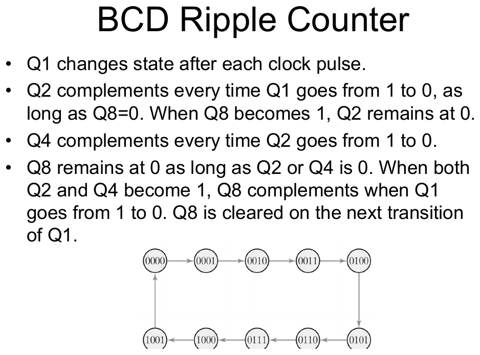

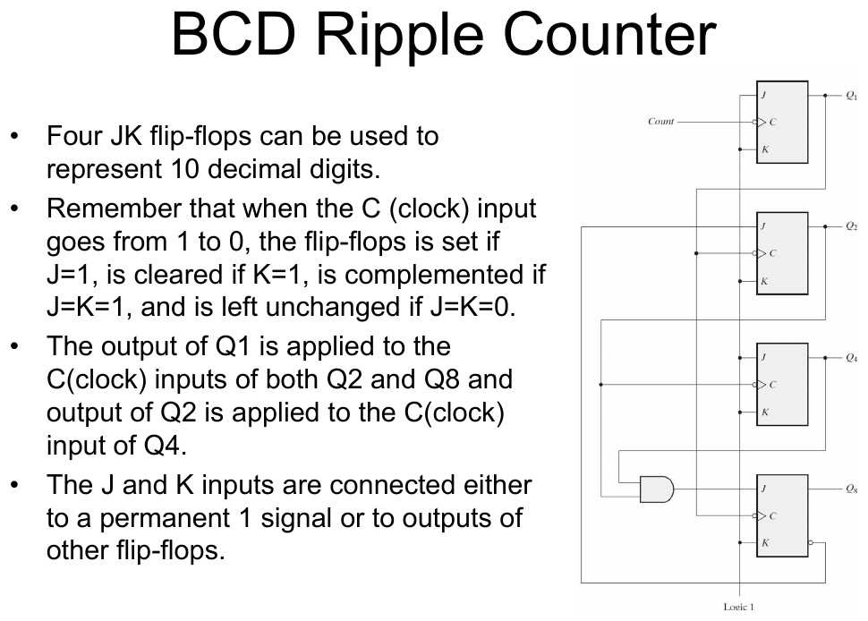

**How to read these diagrams:**
- A **decade** counter: 0000 to 1001 (0 to 9), then back to 0000.
- Four negative-edge **JK** flip-flops: Q1, Q2, Q4, Q8 (the names are the binary weights).
- Q1 toggles on every count pulse.
- Q2 toggles when Q1 falls, **but only while Q8 = 0** (J of Q2 comes from Q8').
- Q4 toggles when Q2 falls.
- Q8 sets when Q1 falls **while Q2 = Q4 = 1** (the AND gate), and is cleared on the next fall of Q1.

So after 1001 (9), the next pulse gives 0000.

---

## 10. Multi-decade counters

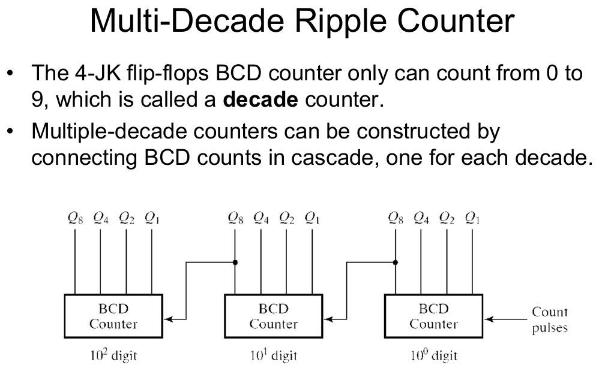

One BCD counter counts 0 to 9.

Chain them: each one's Q8 output clocks the next. That gives units, tens, hundreds: 000 to 999.

---

## Drawing checklist: a ripple counter

1. Draw n flip-flops in a row, LSB on the **left** (or top), with their type.
2. Wire each one to **toggle**: T = 1, J = K = 1, or D = Q'.
3. The input clock goes to the **LSB only**.
4. Each next clock from Q or Q' of the previous one (Rule 47). Mark the edge type (bubble or not).
5. A common Reset to all.
6. Label the outputs Q₀ (LSB) to Qₙ₋₁ (MSB).

## Drawing checklist: counter waveforms

1. Draw CLK first, square, at least 2ⁿ periods.
2. Q₀ changes on every active edge of CLK.
3. Each later Qₖ changes only when the previous output makes the "right" transition (Rule 47).
4. Write the count under the edges (0, 7, 6, ...) and check it.
5. Label each line f/2, f/4, f/8.

---

## Method: counter questions

| You're asked for | Use |
|---|---|
| synchronous counter, any sequence | Rule 46 (Topic 15 steps, no input) |
| does it self-start / unused states | §5: put each unused state in the equations |
| ripple up or down, any flip-flop | Rule 47 |
| waveforms | §8 and the drawing checklist |
| frequency divider | Equation 48: f₀ / 2ᵏ |
| decimal counting | BCD counter, §9 |

---

Next: [End-of-topic test](../questions/16-counters.md)
