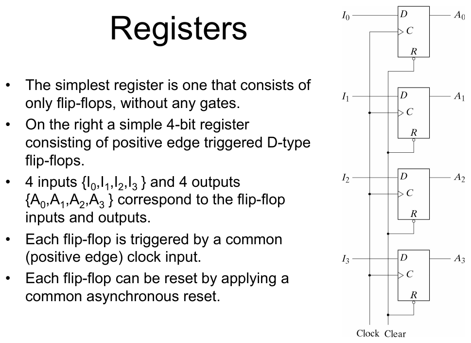
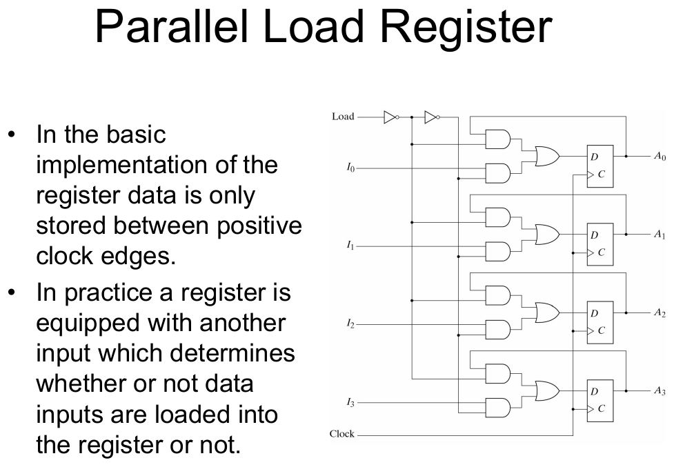
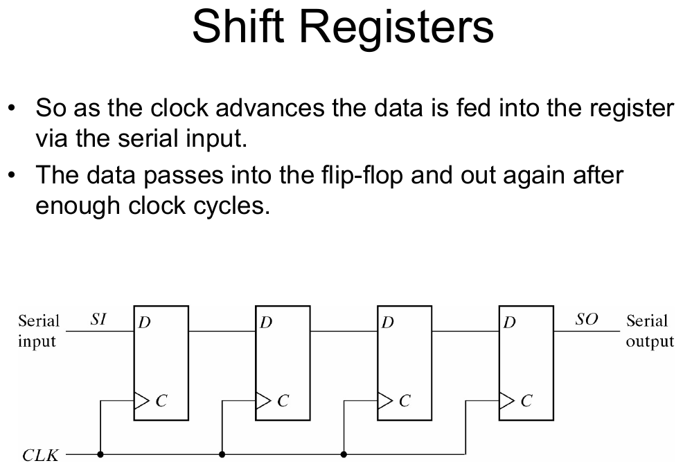
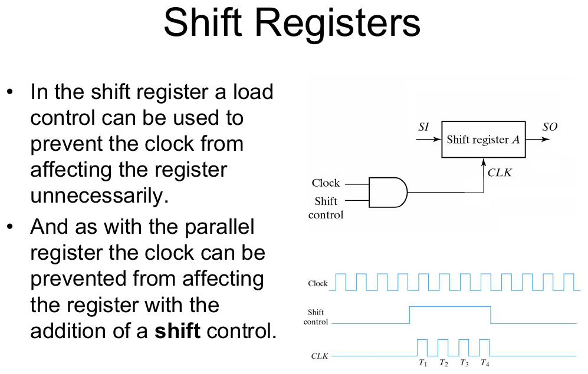
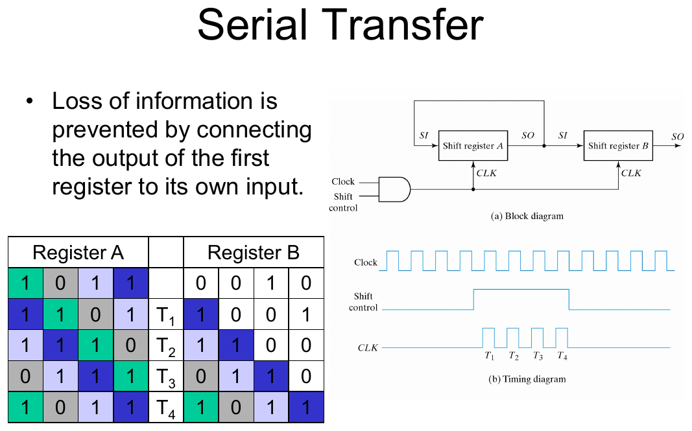
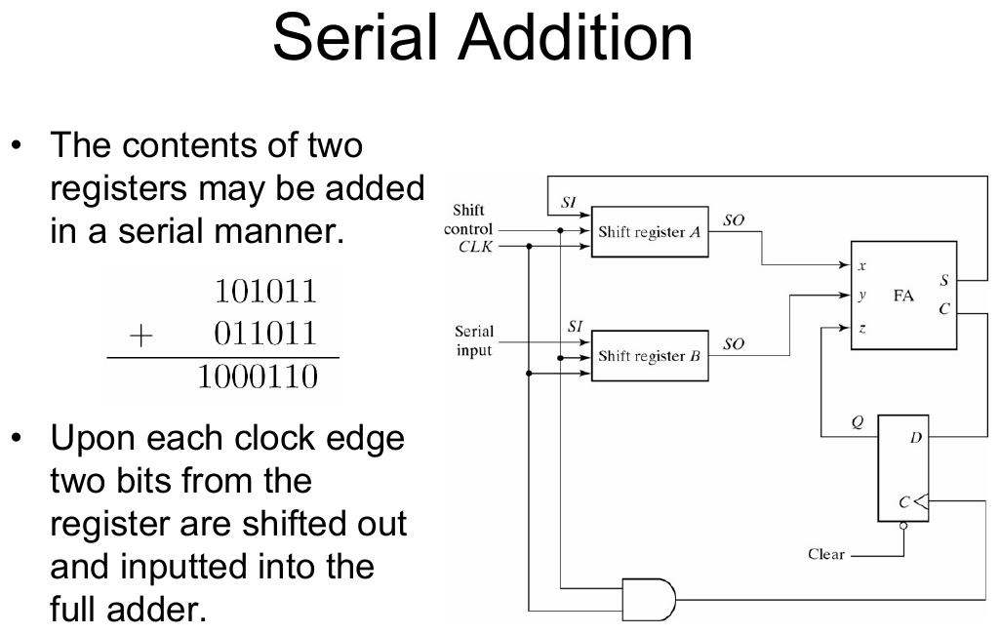
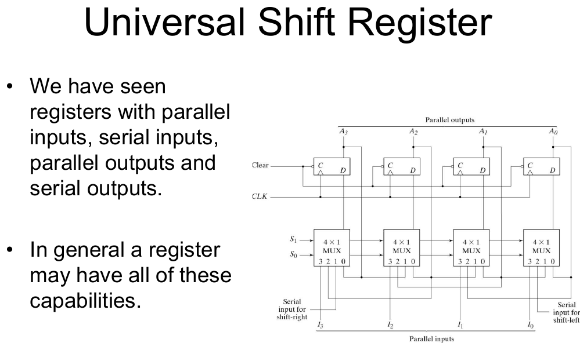
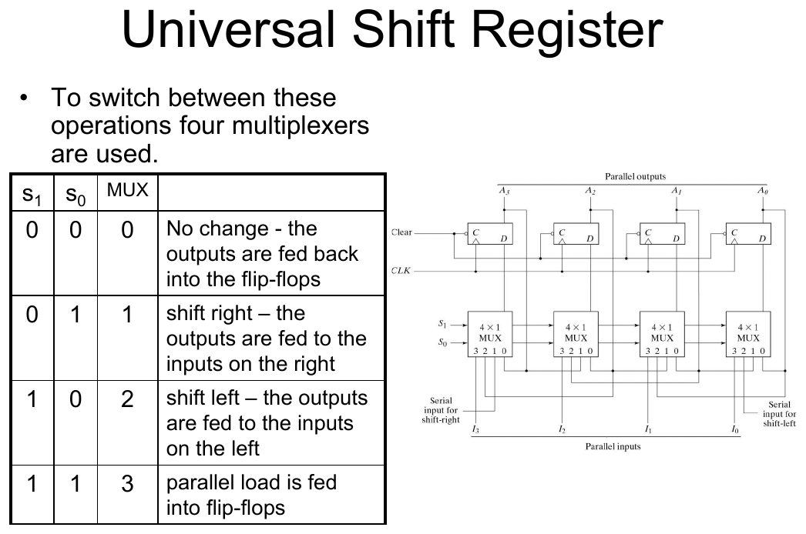

# Topic 17: Registers and shift registers

Slide exercises: "how can a shift register be used as a sequence detector?" (Lecture 19, slide 11) · Past finals: none

Slides: Lecture 19, all

---

## The big idea

A **register** is a group of flip-flops that stores a **word** (several bits).

One flip-flop per bit.

 

Gates around the flip-flops decide **how** data gets in and out:
- **Parallel:** all bits at once.
- **Serial:** one bit per clock, shifting along.

---

**How to use these notes:**
When you see 🧠, stop.
Answer it on paper first.
Then click to check.

---

## 🎯 In the final

Not asked in 2023. Registers are in the syllabus ("sequential circuits: flip-flops, **registers**, counters").

Likely as a short "explain" or "trace the contents" part. And shift registers are the base of ring and Johnson counters (Topic 18).

---

## ⭐ Learn by heart from this topic

There is **no formula sheet** in this exam. So learn all of this.

- An n-bit register = n flip-flops, one shared clock.
- Rule 49: parallel load: **D = L·I + L'·Q**. L = 1 loads the new bit I. L = 0 keeps the old bit Q.
- Rule 50: shift register: each Q feeds the next D. **n clocks** to move n bits in (or out).
- Universal shift register (s₁ s₀): 00 hold, 01 shift right, 10 shift left, 11 parallel load.
- Serial transfer: link the output back to the input to keep the data.
- Serial adder: two shift registers + **one full adder** + **one D flip-flop** for the carry.

**Memory hook:** "Parallel = all at once. Serial = one per tick."

---

## 1. The simplest register

**How to read this diagram:**
- Four positive-edge **D** flip-flops in a column.
- Inputs I₀ to I₃ go straight into the D inputs. Outputs A₀ to A₃.
- One **Clock** line to all four. One **Clear** line to all four (asynchronous reset).

On each rising clock edge, all four inputs are copied to the outputs **at once**. That's **parallel load**.

Clear = 0 wipes the word to 0000 at any time.

---

## 2. Parallel load register (with a Load control)

**How to read this diagram:**
- Same four D flip-flops.
- In front of each D: a small **2-to-1 mux** made of two ANDs and an OR (Topic 12).
- The Load line picks which goes into D: the new input I, or the flip-flop's own output A (fed back).

---

### 📐 Rule 49: parallel load

$$D = L \cdot I + L' \cdot Q$$

| Symbol | Means |
|---|---|
| L | the Load control |
| I | the new data bit |
| Q | the bit already stored |

**What it means:**
L = 1: D = I, so the new data goes in on the next clock.

L = 0: D = Q, so the flip-flop reloads its own value. It **holds**.

**Use it when:**
"Explain how the load input works", or "draw one stage of a parallel load register".

---

### 🧠 Check
Load = 0 and a clock edge arrives. What does the register store?

Answer

Its **old** value. D = Q, so each flip-flop reloads what it already had.

---

## 3. Shift registers

**How to read this diagram:**
- Four D flip-flops in a **row**. Each Q goes into the **next** D.
- Data comes in on the left: **serial input** SI.
- Data leaves on the right: **serial output** SO.
- One clock to all.

On each clock edge, every bit moves **one place to the right**.

---

### 📐 Rule 50: shift register timing

**One bit moves one place per clock.**

So an n-bit shift register needs:
- **n** clocks to load an n-bit word in.
- **n** more clocks to shift it all out.

**Use it when:**
"Show the register contents after each clock."

---

### 🧠 Check
A 4-bit shift register (shifting right) starts at 0000. The serial input gets 1, then 0, then 1, then 1. What does it hold after each clock?

Answer

The new bit enters on the left. Everything else moves right.

1000 → 0100 → 1010 → **1101**.

---

## 4. A shift register as a sequence detector (slide 11)

The register always holds the **last n input bits**.

Put an AND gate on its outputs (with NOT gates where the pattern has a 0).

Example: to find **1001**, AND together Q₀, Q₁', Q₂', Q₃ (in the order the bits arrive).

The AND output is 1 exactly when the last 4 bits were 1001.

---

## 5. Shift control

**How to read this diagram:**
- The clock passes through an AND gate with the **Shift control**.
- Shift control = 0: no clock pulses reach the register. It holds.
- Shift control = 1: the clock gets through. It shifts.
- Bottom: the register only gets the 4 pulses T₁ to T₄.

---

## 6. Serial transfer

**How to read this diagram:**
- Register A's serial output goes into register B's serial input.
- A's output **also** goes back into A's own input. So A isn't lost: it goes round in a circle.
- After 4 shift pulses, B holds A's word, and A holds its own word again.

| | Register A | Register B |
|---|---|---|
| start | 1011 | 0010 |
| T₁ | 1101 | 1001 |
| T₂ | 1110 | 1100 |
| T₃ | 0111 | 0110 |
| T₄ | **1011** | **1011** |

---

## 7. Serial addition

**How to read this diagram:**
- Two shift registers, A and B, shift out one bit each per clock, LSB first.
- Both bits go into **one full adder** (Topic 10).
- The carry out goes into a **D flip-flop**. Next clock, it comes back as the carry in.
- The sum bit goes back into register A (or into a third register).

So n-bit addition takes **n clocks** and only **one** full adder.

Slide example: 101011 + 011011 = **1000110** (43 + 27 = 70).

---

## 8. Universal shift register

**How to read these diagrams:**
- Four D flip-flops. In front of each: a **4-to-1 mux** (Topic 12).
- The two select lines s₁ s₀ choose what goes into each D.

| s₁ s₀ | Mode |
|---|---|
| 0 0 | no change (each Q fed back to itself) |
| 0 1 | shift right |
| 1 0 | shift left |
| 1 1 | parallel load |

It can also clear, and take serial or parallel inputs and outputs. One circuit does everything.

---

## Method: register questions

| You're asked for | Use |
|---|---|
| contents after each clock | Rule 50: one place per clock |
| how load works | Rule 49 |
| copy one register to another, keep the original | serial transfer with feedback (§6) |
| add two numbers with one adder | serial adder (§7) |
| detect a pattern with a register | AND the last n bits (§4) |
| what s₁ s₀ does | universal shift register table (§8) |

---

Next: [End-of-topic test](../questions/17-registers.md)
