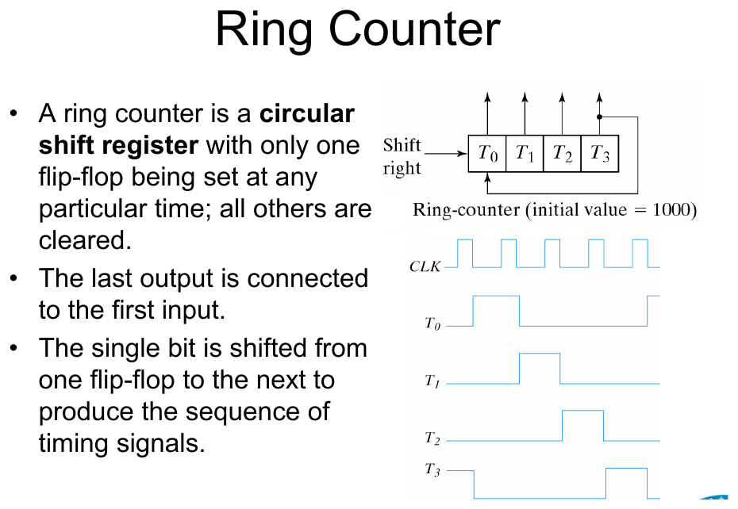
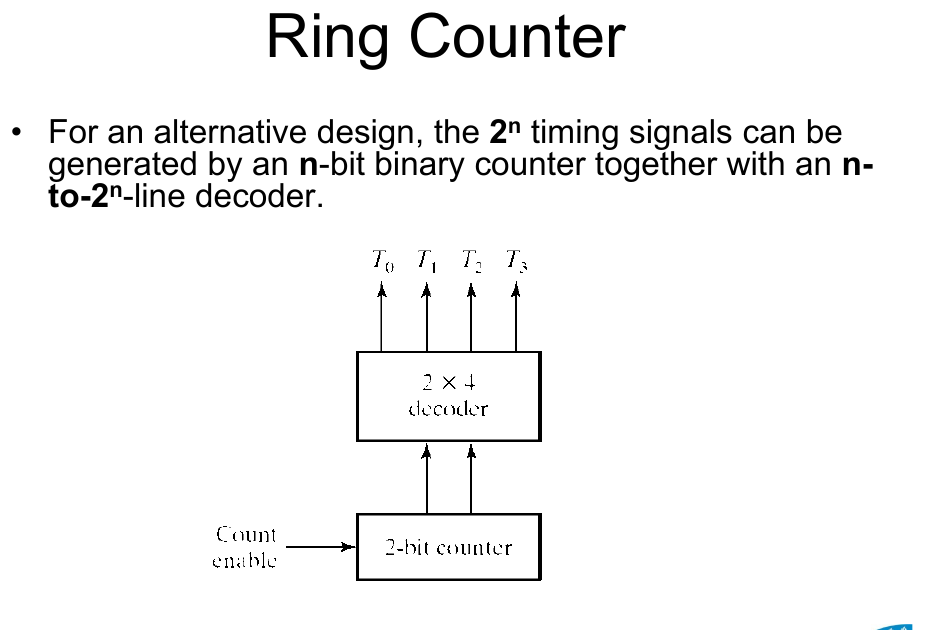
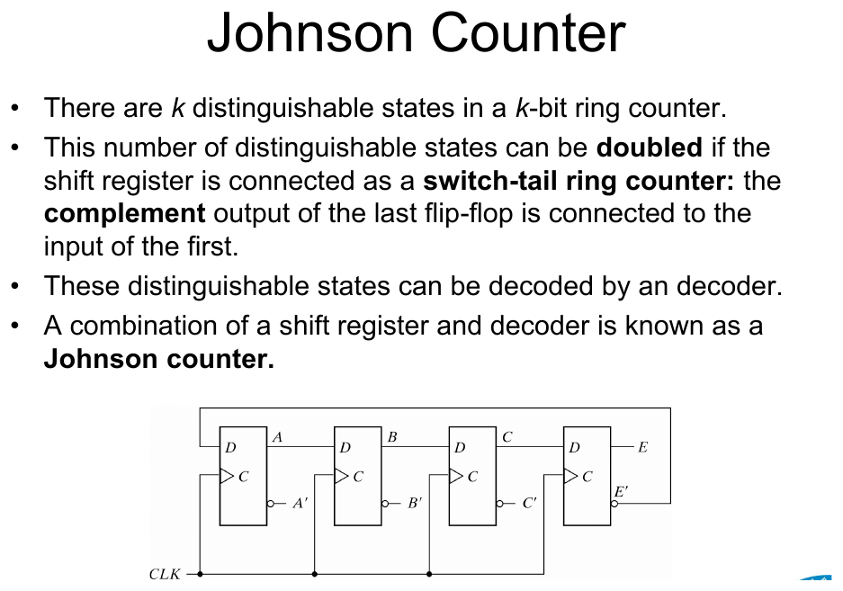
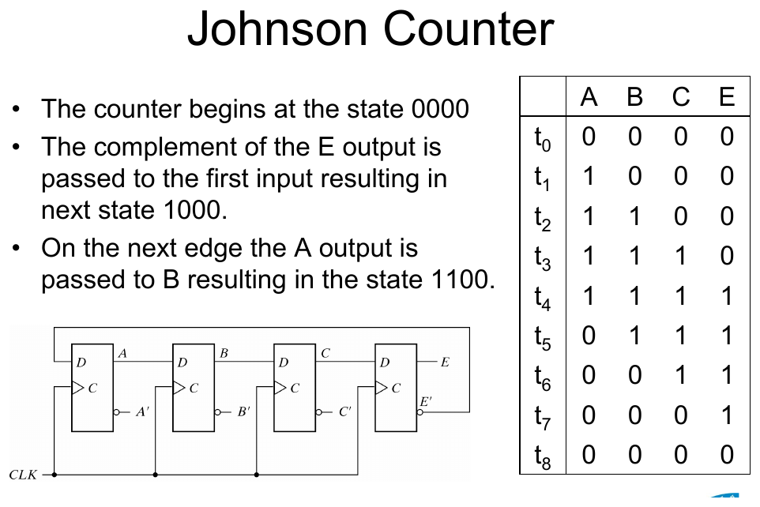
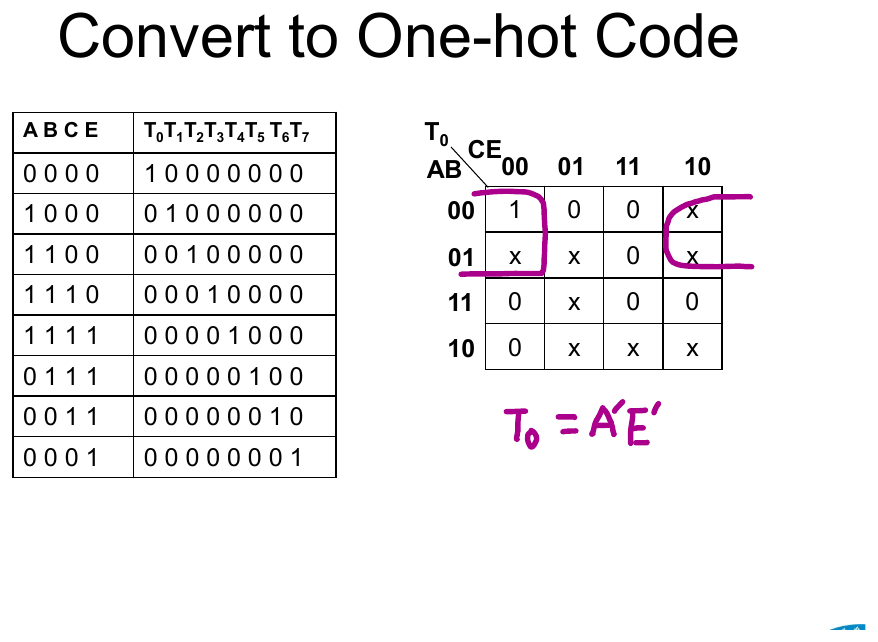
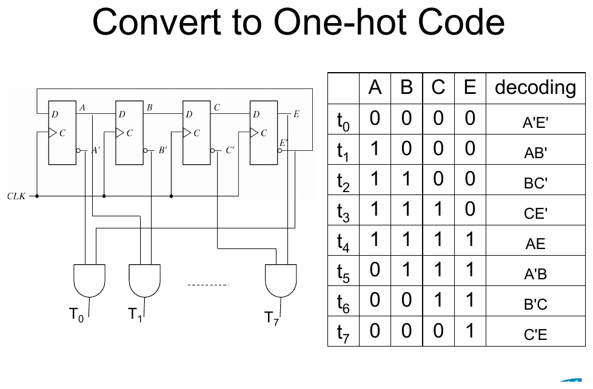

# Topic 18: Ring counters and Johnson counters

Slide exercises: "use a 3-bit Johnson counter and gates to make a binary counter counting 0 to 5" (Lecture 20, slide 10) · Past finals: none

Slides: Lecture 20, all

---

## The big idea

Join the end of a shift register (Topic 17) back to its start.

The bits go round and round. That's a **counter** made from a shift register.

 

Two versions:

| Ring counter | Johnson counter |
|---|---|
| last **Q** → first D | last **Q'** → first D (switch-tail) |
| one 1 goes round | 1s fill up, then 0s fill up |
| n flip-flops → **n** states | k flip-flops → **2k** states |
| outputs are already one-hot | needs 2-input AND gates to decode |

They make **timing signals**: one output high at a time, in turn.

---

**How to use these notes:**
When you see 🧠, stop.
Answer it on paper first.
Then click to check.

---

## 🎯 In the final

Not asked in 2023. In the syllabus under "counters".

The slide exercise (§6) is a perfect exam part: a Johnson counter plus gates, designed with K-maps. Same skills as Topic 15.

---

## ⭐ Learn by heart from this topic

There is **no formula sheet** in this exam. So learn all of this.

- Ring counter: n flip-flops, **n** states, start at 1000, the single 1 shifts along.
- Or: 2ⁿ timing signals from an **n-bit binary counter + n-to-2ⁿ decoder**.
- Rule 51: Johnson counter: **Q' of the last** flip-flop → D of the first. k flip-flops → **2k** states.
- Each Johnson state is decoded by **one 2-input AND gate**: look at the boundary between the 1s and the 0s.
- 4-bit Johnson: A'E', AB', BC', CE', AE, A'B, B'C, C'E.

**Memory hook:** "Ring passes one 1. Johnson fills with 1s, then empties."

---

## 1. Ring counter

**How to read this diagram:**
- A 4-bit shift register T₀ T₁ T₂ T₃, shifting right.
- The last output T₃ loops back to the first input. A ring.
- It starts at **1000**: only one flip-flop is set.
- The waveforms: T₀, T₁, T₂, T₃ go high one after another, one clock each.

1000 → 0100 → 0010 → 0001 → 1000.

To make 2ⁿ timing signals this way, you need **2ⁿ** flip-flops.

---

## 2. Ring counter vs counter + decoder

**How to read this diagram:**
- A 2-bit binary counter feeds a 2 × 4 decoder (Topic 11).
- The decoder turns each count 00, 01, 10, 11 into one output T₀ to T₃.
- Same timing signals, but only **2** flip-flops instead of 4. You pay with the decoder gates.

---

### 🧠 Check
How many flip-flops do you need for 8 timing signals with a ring counter? With a counter and decoder?

Answer

Ring: **8** flip-flops.

Counter + decoder: a 3-bit counter (**3** flip-flops) and a 3-to-8 decoder.

---

## 3. Johnson counter (switch-tail ring)

**How to read this diagram:**
- Four D flip-flops A, B, C, E in a row, shifting right.
- The **complement** E' of the last one goes back into A. That's the "switch tail".

**How to read the table:**
- Start at 0000. E' = 1 goes into A: 1000.
- Then 1100, 1110, 1111. The 1s fill up from the left.
- Now E' = 0 goes in: 0111, 0011, 0001, 0000. The 0s fill up.
- **8** states from **4** flip-flops.

---

### 📐 Rule 51: Johnson counter

$$\text{states} = 2k$$

| Symbol | Means |
|---|---|
| k | number of flip-flops |

**How it's wired:** a k-bit shift register with the **last Q'** fed back to the **first D**.

**How each state is decoded:** one **2-input AND** gate. Look for the boundary:

| State | A B C E | Gate |
|---|---|---|
| t₀ | 0000 | A'E' |
| t₁ | 1000 | AB' |
| t₂ | 1100 | BC' |
| t₃ | 1110 | CE' |
| t₄ | 1111 | AE |
| t₅ | 0111 | A'B |
| t₆ | 0011 | B'C |
| t₇ | 0001 | C'E |

**Why 2 inputs are enough:**
In every Johnson state, the 1s sit together and the 0s sit together. Two neighbouring bits (or the two ends) are enough to tell which state it is.

**Use it when:**
"How many states?", "decode the Johnson counter", "make k timing signals with half the flip-flops of a ring counter".

---

## 4. Decoding to one-hot

**How to read this diagram:**
- Left: each Johnson state, and the one-hot output (T₀ to T₇) it should give.
- Right: the K-map for T₀. The 8 codes that never happen (like 0100) are **x**.
- With all those x's, T₀ groups down to just **A'E'**.

8 AND gates, each with 2 inputs, give the 8 timing signals T₀ to T₇.

---

## 5. Watch out: unused states

A 3-bit Johnson counter uses 6 of its 8 codes. The other two are **010** and **101**.

Trace them: 010 → 101 → 010 → ... They loop **on their own**, outside the main count.

So a Johnson counter must be **reset to 000** at power-up. (Topic 16 §5: always check unused states.)

---

## 6. Worked example: the slide 10 exercise

**Use a 3-bit Johnson counter and gates to make a binary counter that counts 0 to 5.**

 

**Step 1. The Johnson sequence** (A B C, C' fed back to A):

| Count | A B C | Q₂ Q₁ Q₀ wanted |
|---|---|---|
| 0 | 000 | 000 |
| 1 | 100 | 001 |
| 2 | 110 | 010 |
| 3 | 111 | 011 |
| 4 | 011 | 100 |
| 5 | 001 | 101 |

010 and 101 never happen: **x**.

 

**Step 2. K-map each output** (A down the side, BC across):

Q₂: 1 at 011 and 001. x at 010, 101.

| A \ BC | 00 | 01 | 11 | 10 |
|---|---|---|---|---|
| **0** | 0 | 1 | 1 | x |
| **1** | 0 | x | 0 | 0 |

**Q₂ = A'C**

Q₁: 1 at 110 and 111. **Q₁ = AB**

Q₀: 1 at 100, 111, 001. x at 010, 101.

| A \ BC | 00 | 01 | 11 | 10 |
|---|---|---|---|---|
| **0** | 0 | 1 | 0 | x |
| **1** | 1 | x | 1 | 0 |

**Q₀ = AB' + B'C + AC**

 

**Step 3. The circuit:** three D flip-flops in a shift register (D_A = C', D_B = A, D_C = B), reset to 000. Then the gates above on the outputs.

---

## Method: ring and Johnson questions

| You're asked for | Use |
|---|---|
| ring counter states | n flip-flops → n states (§1) |
| Johnson states | Rule 51: 2k |
| Johnson sequence | fill with 1s from the left, then with 0s (§3) |
| decode a Johnson state | Rule 51 table: one 2-input AND |
| Johnson + gates → any count | table of states → K-maps with x for unused codes (§6) |
| self-starting? | trace the unused codes (§5) |

---

Next: [End-of-topic test](../questions/18-ring-johnson.md)
