# Topic 19: Memory: RAM, ROM and flash

Slide exercises: none set · Past finals: none

Slides: Lecture 21, all

---

## The big idea

Memory stores binary **words** at numbered **addresses**.

 

Two families:

| RAM (random access memory) | ROM (read only memory) |
|---|---|
| read **and** write | read only (programmed once, or rarely) |
| **volatile**: loses data with no power | **non-volatile**: keeps data |
| SRAM (flip-flop cells), DRAM (capacitor cells) | mask ROM, PROM, EPROM, EEPROM, flash |

Inside, both are a **decoder** (Topic 11) picking one word, plus storage cells.

---

**How to use these notes:**
When you see 🧠, stop.
Answer it on paper first.
Then click to check.

---

## 🎯 In the final

Not asked in 2023. In the syllabus ("memory circuits").

Likely as a short part: "how many address lines?", "how many gates in the decoder?", "SRAM vs DRAM", "volatile vs non-volatile". Learn the numbers in Rule 52 and Rule 53.

---

## ⭐ Learn by heart from this topic

There is **no formula sheet** in this exam. So learn all of this.

- Rule 52: 2ᵏ words × n bits → **k address lines**, n data lines.
- 1 kB = 2¹⁰ = 1024 bytes. 1 MB = 2²⁰. 1 GB = 2³⁰.
- Rule 53: a k × 2ᵏ decoder = **2ᵏ AND gates with k inputs** each. Two-dimensional: two (k/2) × 2^(k/2) decoders = 2 × 2^(k/2) gates with k/2 inputs.
- ROM: k × 2ᵏ decoder + **n OR gates** with 2ᵏ inputs each.
- SRAM cell: **6 transistors**, a latch. DRAM cell: **1 transistor + 1 capacitor**, needs **refresh**.
- PROM: fuses, blown once. EPROM: erased by **UV light**. EEPROM: erased **electrically**. Flash: EEPROM erased **in-circuit**, floating-gate transistors.

**Memory hook:** "S for Static and Six. D for Dynamic and Decays."

---

## 1. A memory unit

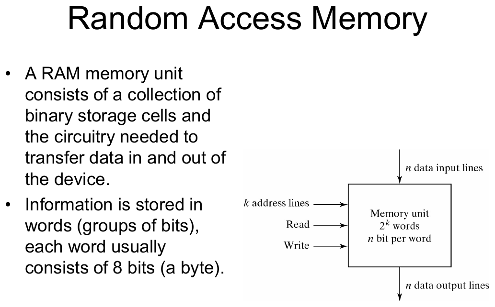

**How to read this diagram:**
- k **address lines** pick one of 2ᵏ words.
- n **data input** lines carry a word in (for a write).
- n **data output** lines carry a word out (for a read).
- **Read** and **Write** controls say which operation.

---

## 2. Size and address lines

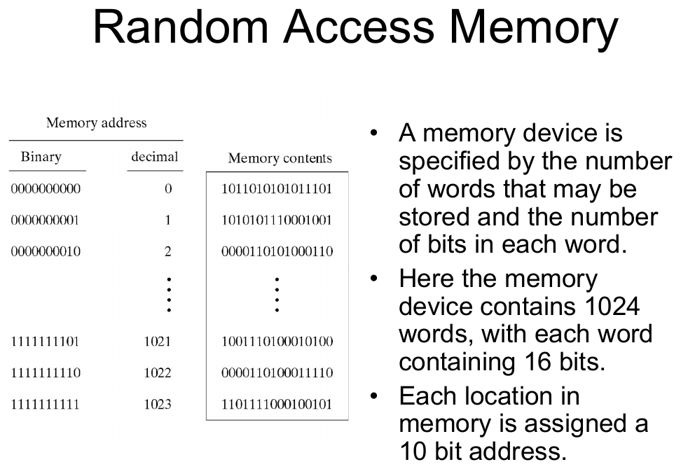

**How to read this diagram:**
- 1024 words, each 16 bits.
- Each word has an address from 0 to 1023.
- In binary that needs **10 bits**: 0000000000 to 1111111111.

---

### 📐 Rule 52: memory size

$$\text{words} = 2^k \qquad \text{total bits} = 2^k \times n$$

| Symbol | Means |
|---|---|
| k | number of address lines |
| n | bits per word (data lines) |

| Prefix | Means |
|---|---|
| 1 k | 2¹⁰ = 1024 |
| 1 M | 2²⁰ = 1,048,576 |
| 1 G | 2³⁰ |

**Use it when:**
"How many address lines does a 64K × 8 memory need?" → 64K = 2⁶ × 2¹⁰ = 2¹⁶, so **16**.

---

### 🧠 Check
A memory has 12 address lines and 8 data lines. How many bytes does it store?

Answer

2¹² = **4096** words of 8 bits = 4096 bytes = **4 kB**.

---

## 3. The binary storage cell

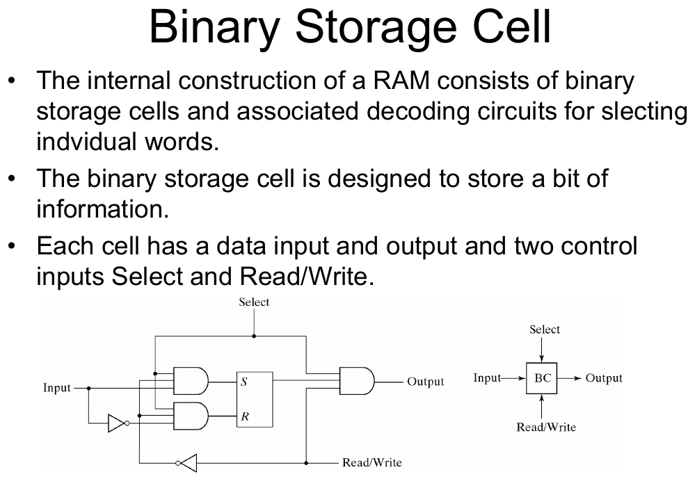

**How to read this diagram:**
- At the centre: an **SR latch** (Topic 13) holds the bit.
- **Select** = 0: the latch sees "no change" and the output is 0. The cell is switched off.
- Select = 1 and **Read/Write = 0**: a **write**. The input goes into the latch.
- Select = 1 and **Read/Write = 1**: a **read**. The latch goes to the output.
- Right: the block symbol BC.

---

## 4. A 4 × 3 RAM

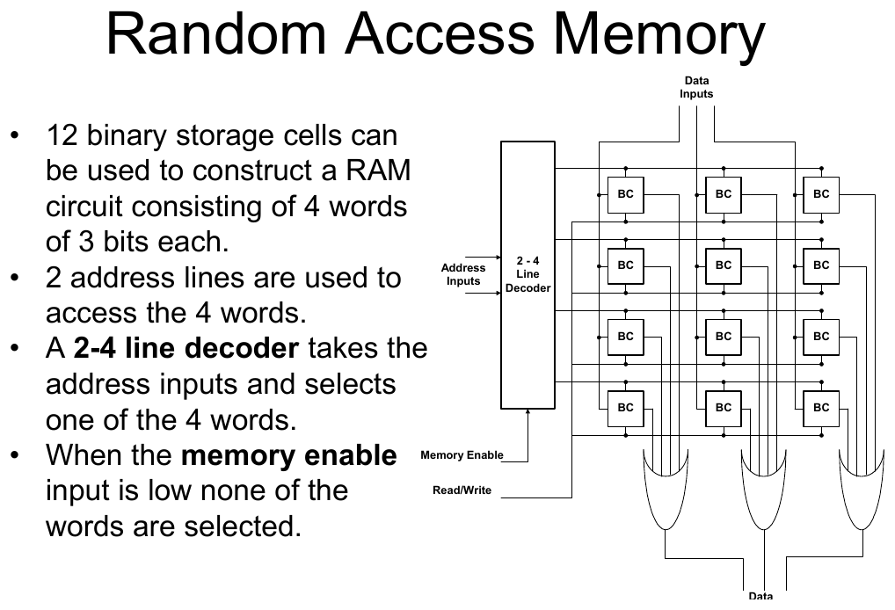

**How to read this diagram:**
- 12 binary cells (BC) in a grid: **4 words** (rows) of **3 bits** (columns).
- 2 address lines go into a **2-to-4 decoder**. It picks one row.
- **Memory enable** low: no row is picked.
- **Read:** the picked row's cells go through the OR gates at the bottom to the data outputs.
- **Write:** the data inputs load into the picked row.

---

## 5. Two-dimensional decoding

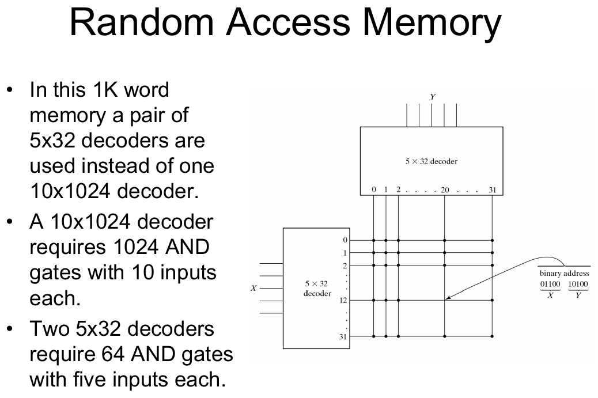

**How to read this diagram:**
- A 1K-word memory needs a 10-bit address.
- Instead of one 10 × 1024 decoder, split the address: 5 bits to an X decoder, 5 bits to a Y decoder.
- Each cell sits where one X line crosses one Y line.

---

### 📐 Rule 53: decoder cost

| Decoder | AND gates | Inputs per gate |
|---|---|---|
| one k × 2ᵏ | 2ᵏ | k |
| two (k/2) × 2^(k/2) | 2 × 2^(k/2) | k/2 |

For a 1K memory (k = 10): one decoder = **1024** gates of 10 inputs. Two decoders = **64** gates of 5 inputs.

**Use it when:**
"Why is two-dimensional selection used?" Far fewer, smaller gates.

---

## 6. SRAM and DRAM

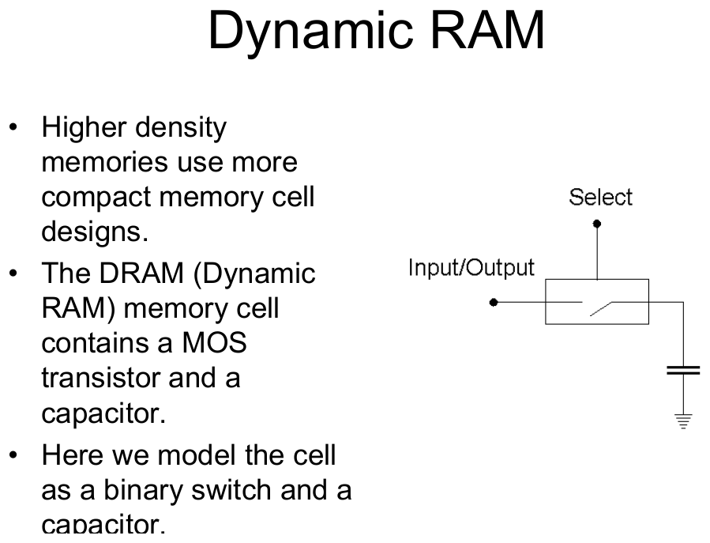

**How to read this diagram:**
- A DRAM cell: one switch (a MOS transistor) and one **capacitor**.
- Select high: the switch closes.
- Write: the input charges the capacitor (1) or empties it (0).
- Read: if charge flows out, it's a 1.

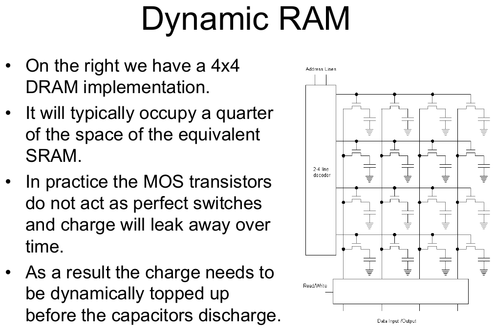

| | SRAM | DRAM |
|---|---|---|
| Cell | latch, about **6 transistors** | **1 transistor + 1 capacitor** |
| Size | big | about **¼** of SRAM |
| Keeps data while powered? | yes ("static") | **no**: the charge leaks, so it must be **refreshed** ("dynamic") |
| Volatile? | yes | yes |

---

### 🧠 Check
Why does DRAM need refreshing but SRAM doesn't?

Answer

DRAM stores the bit as **charge on a capacitor**. The transistor isn't a perfect switch, so the charge **leaks away**. It must be topped up regularly.

SRAM stores the bit in a **latch**, which holds it as long as there's power.

---

## 7. Volatile and non-volatile

**Volatile:** loses its data when the power goes off. All RAM (SRAM and DRAM).

**Non-volatile:** keeps its data. Magnetic disks, ROM, flash.

---

## 8. ROM

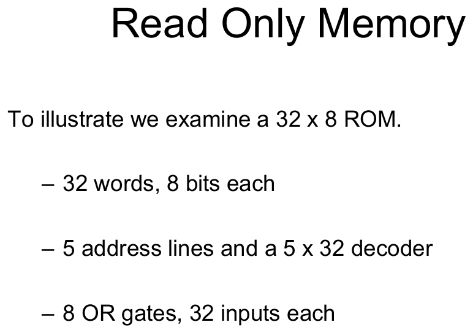

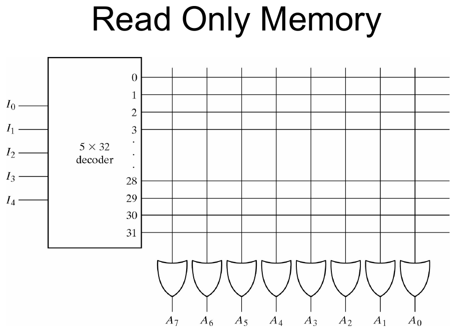

**How to read this diagram:**
- 5 inputs go into a **5 × 32 decoder**. It makes all 32 minterms (Topic 11).
- 8 **OR gates** at the bottom, each with 32 possible inputs.
- Every crossing between a decoder line and an OR input is a **cross point**: connected or not.

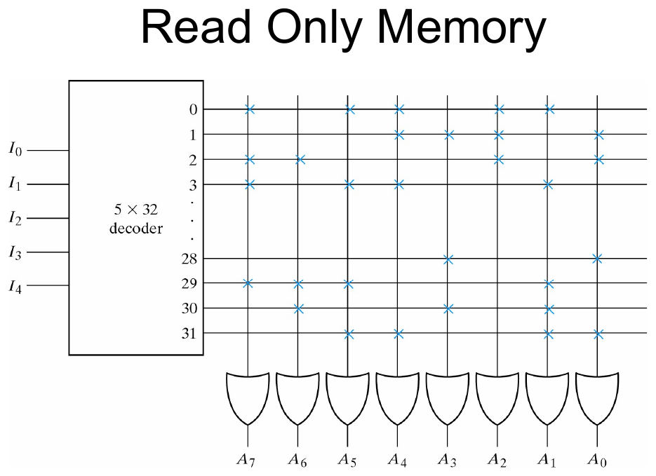

**How to read this diagram:**
- An **x** marks a connected cross point (fuse intact = 1).
- Word 0 (address 00000) is 10110110. Word 3 (address 00011) is 10110010.
- Address 00011 makes decoder output 3 go high. Every OR gate with an x on line 3 outputs 1.

A k-input, n-output ROM = a k × 2ᵏ decoder + n OR gates.

---

## 9. Types of ROM

| Type | How it's programmed | Can you change it? |
|---|---|---|
| Mask ROM | at the factory | no |
| PROM | blow fuses with a high-voltage pulse. Blown = 0, intact = 1 | no, once only |
| EPROM | electrically | erase with **ultraviolet** light |
| EEPROM | electrically | erase **electrically** |
| Flash | electrically, **in the circuit** | yes, no special programmer |

---

## 10. Flash memory

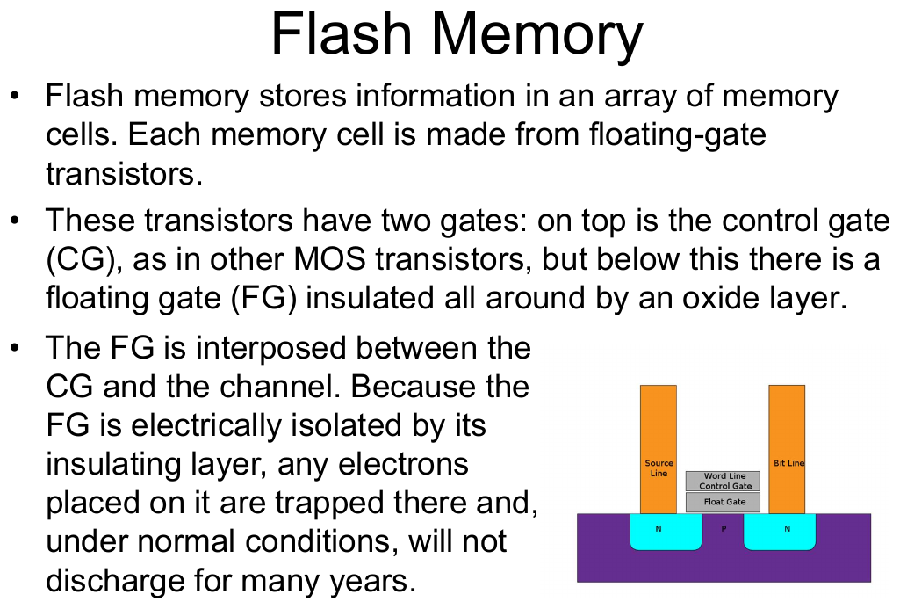

**How to read this diagram:**
- Each cell is a MOS transistor with **two gates**: a control gate (CG) on top, and a **floating gate** (FG) underneath, sealed in oxide.
- Electrons put on the FG are **trapped** for years.
- Trapped charge **changes the threshold voltage** of the transistor.
- To read: apply a voltage between the two possible thresholds. The transistor conducts or not. That's the bit.

**NOR flash:** each cell connects straight between the bit line and ground. Acts like a NOR gate.

**NAND flash:** several cells **in series**. The bit line is pulled low only if all of them conduct. Denser.

Used in phones, cameras, USB sticks and SSDs.

---

## Method: memory questions

| You're asked for | Use |
|---|---|
| address lines, words, total bits | Rule 52 |
| decoder size, two-dimensional decoding | Rule 53 |
| how a read / write works | §3, §4 |
| SRAM vs DRAM | §6 table |
| volatile vs non-volatile | §7 |
| ROM structure | decoder + OR gates (§8) |
| PROM / EPROM / EEPROM / flash | §9 table |

---

Next: [End-of-topic test](../questions/19-memory.md)
