# Topic 20: Programmable logic: PROM, PAL, PLA, CPLD, FPGA

Slide exercises: none set · Past finals: none

Slides: Lecture 22, all

---

## The big idea

A ROM is a decoder (an **AND array**) and some OR gates (an **OR array**).

If you can choose the connections, you can make **any** combinational circuit. No new wiring needed.

 

Which array you can program gives the device its name:

| Device | AND array | OR array |
|---|---|---|
| **PROM** | fixed (a full decoder) | **programmable** |
| **PAL** | **programmable** | fixed |
| **PLA** | **programmable** | **programmable** |

Add flip-flops and you can build **sequential** circuits too: **CPLD** and **FPGA**.

---

**How to use these notes:**
When you see 🧠, stop.
Answer it on paper first.
Then click to check.

---

## 🎯 In the final

Not asked in 2023. In the syllabus ("configurable logic, FPGAs").

Likely as a short "explain" part, or "implement this function with a PROM / PAL / PLA". Learn the table in Rule 54.

---

## ⭐ Learn by heart from this topic

There is **no formula sheet** in this exam. So learn all of this.

- Rule 54: PROM = fixed AND + programmable OR. PAL = programmable AND + fixed OR. PLA = both programmable.
- A ROM can be a **look-up table**: address = input, stored word = output.
- PAL and PLA: gates only → **combinational** only. CPLD and FPGA add **flip-flops** → sequential.
- CPLD: several PLDs + a programmable switch matrix + I/O blocks. Each PLD has 8 to 16 **macrocells** (SOP logic + an optional flip-flop).
- FPGA: thousands of **CLBs** (configurable logic blocks), **IOBs** (I/O blocks), and a **switch matrix**. A CLB has a look-up table (any function of **4** variables), muxes and flip-flops.
- One switch-matrix point: **6** switches → 2⁶ = **64** ways to connect 4 wires.
- **ASIC:** custom chip, high performance, low power, cheap in high volume. **FPGA:** off the shelf, low development cost, short time to market, reconfigurable.

**Memory hook:** "PAL fixes the OR. PROM fixes the AND. PLA fixes nothing."

---

## 1. A decoder + OR gates = any function

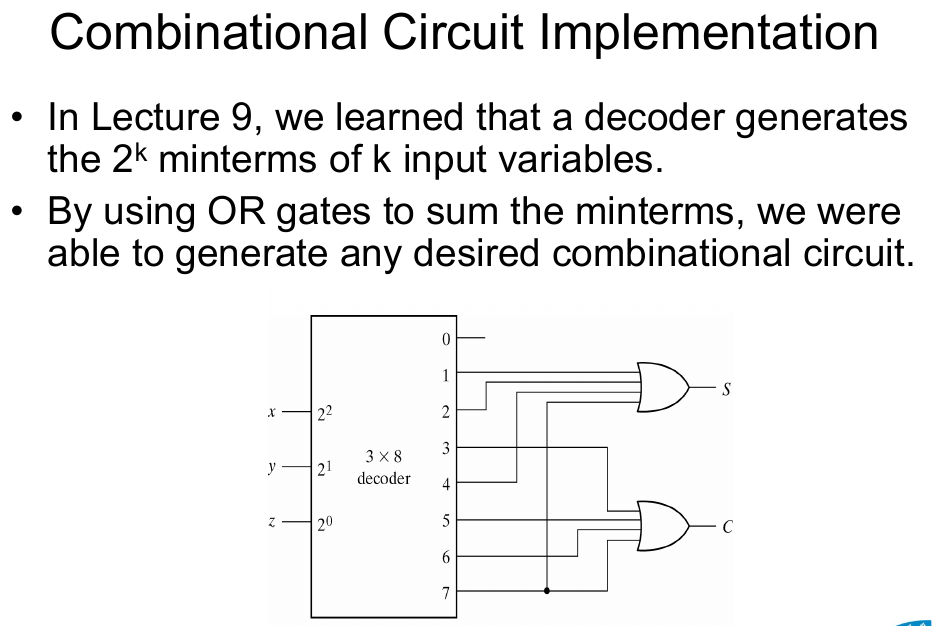

**How to read this diagram:**
- A 3 × 8 decoder makes all 8 minterms of x, y, z (Topic 11).
- Two OR gates pick the minterms each output needs.
- Here: the full adder. S = Σm(1, 2, 4, 7), C = Σm(3, 5, 6, 7).

A ROM is exactly this: a decoder and OR gates. So a ROM can **be** a combinational circuit.

---

## 2. A ROM as a look-up table

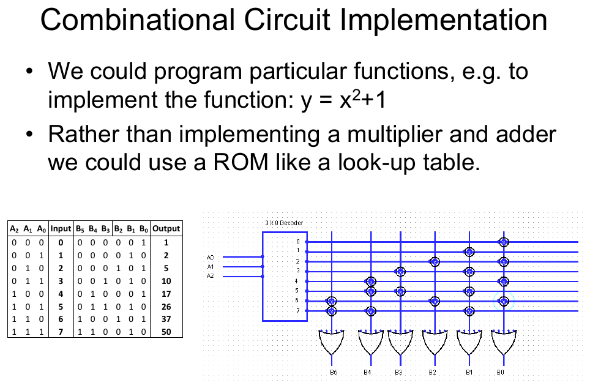

**How to read this diagram:**
- Left: a table of x (0 to 7, on A₂A₁A₀) and y = x² + 1 (on B₅ to B₀).
- Right: a 3 × 8 decoder and 6 OR gates. A dot marks a connection.
- Instead of building a multiplier and an adder, just **store** the answers.

| x | 0 | 1 | 2 | 3 | 4 | 5 | 6 | 7 |
|---|---|---|---|---|---|---|---|---|
| y | 1 | 2 | 5 | 10 | 17 | 26 | 37 | 50 |

The biggest answer is 50, which needs **6** bits. So 6 OR gates.

---

### 🧠 Check
How big a ROM do you need for y = x² + 1 with x from 0 to 7?

Answer

3 inputs → 2³ = **8** words. Largest y = 50 → **6** bits per word.

An **8 × 6** ROM (3 × 8 decoder + 6 OR gates).

---

## 3. PROM, PAL and PLA

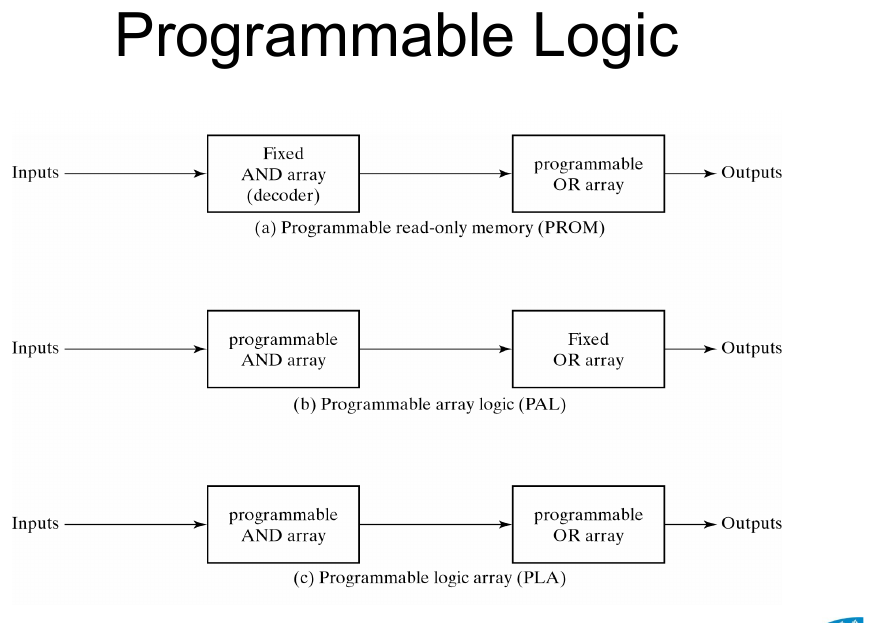

**How to read this diagram:**
- (a) PROM: fixed AND array (a full decoder), programmable OR array.
- (b) PAL: programmable AND array, fixed OR array.
- (c) PLA: both programmable.

---

### 📐 Rule 54: the three programmable devices

| | AND array | OR array | Makes | Note |
|---|---|---|---|---|
| PROM | fixed (all 2ⁿ minterms) | programmable | any sum of minterms | big: every minterm is built |
| PAL | programmable | fixed | sum of products, fixed groups | easy to program |
| PLA | programmable | programmable | any sums of shared products | most flexible, hardest to program |

**Use it when:**
"Compare PROM, PAL and PLA", or "which device would you use?".

---

## 4. PAL: programmable AND array

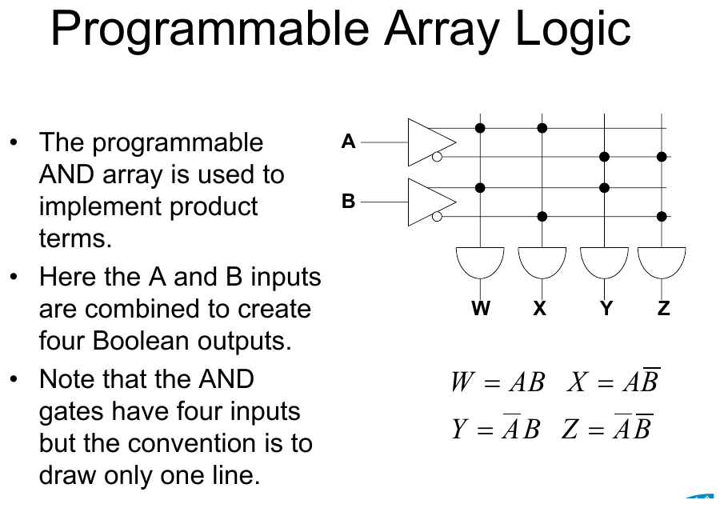

**How to read this diagram:**
- A and B each come in true and complemented (the buffer has both outputs).
- Each AND gate sits under a set of vertical lines. A dot = a connection.
- By convention, each AND gate is drawn with **one** input line, though it really has several.
- The four gates here make W = AB, X = AB', Y = A'B, Z = A'B'.

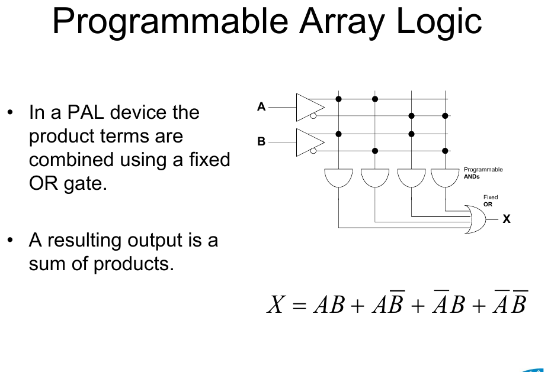

**How to read this diagram:**
- Same programmable AND gates.
- But they all feed one **fixed** OR gate. You can't choose which products go to which output.
- X = AB + AB' + A'B + A'B'.

---

## 5. PLA: both arrays programmable

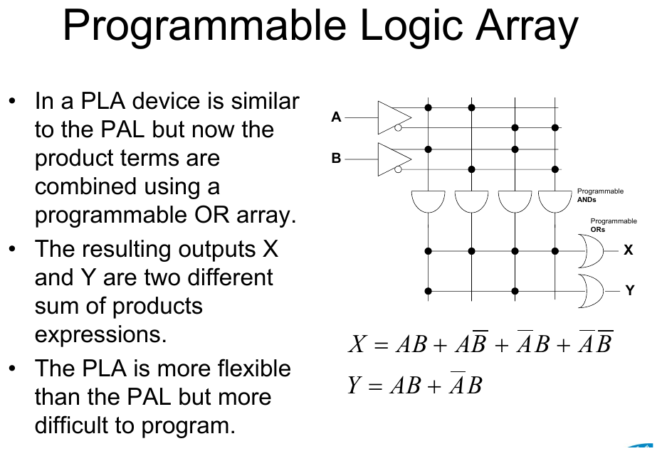

**How to read this diagram:**
- Programmable AND gates make the products.
- A second grid of dots (the OR array) chooses which products go into **each** OR gate.
- So X and Y can **share** products: X = AB + AB' + A'B + A'B', Y = AB + A'B.

---

## 6. Sequential programmable logic: CPLD

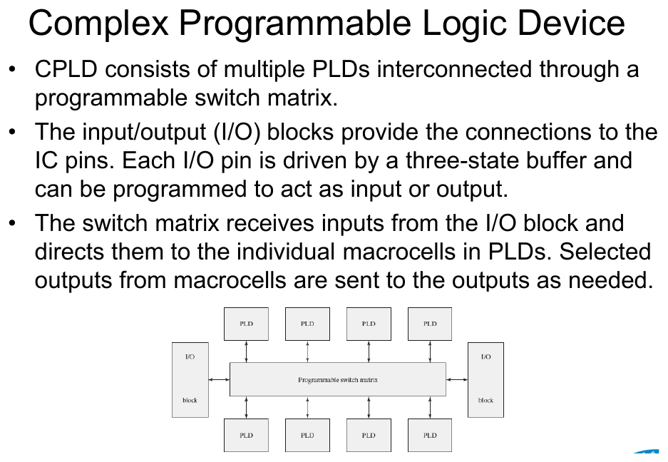

**How to read this diagram:**
- Several **PLDs** (PAL- or PLA-like blocks) around a **programmable switch matrix**.
- **I/O blocks** connect to the chip's pins. Each pin can be an input or an output (a three-state buffer).
- The switch matrix routes signals between the I/O blocks and the PLDs.

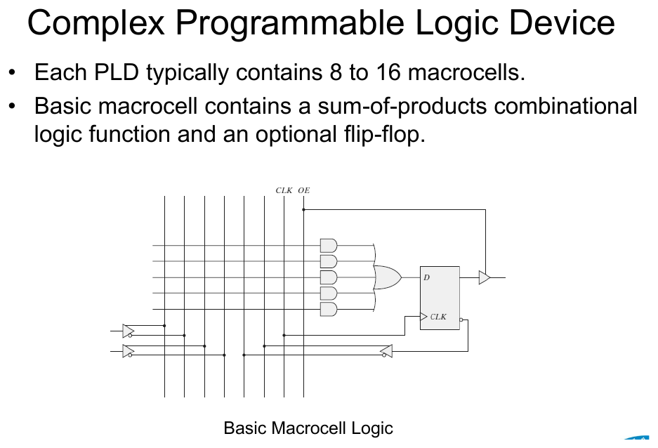

Each PLD has 8 to 16 **macrocells**. A macrocell = an SOP function + an optional **flip-flop** (the D box).

---

## 7. FPGA

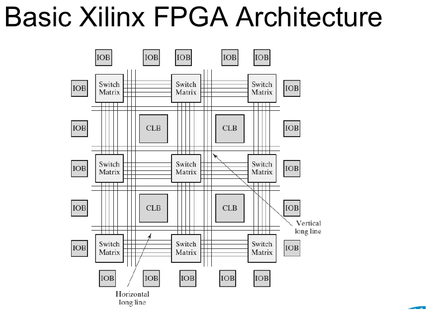

**How to read this diagram:**
- A grid of **CLBs** (configurable logic blocks).
- **Switch matrices** between them, joined by horizontal and vertical wires.
- **IOBs** (input/output blocks) all round the edge.

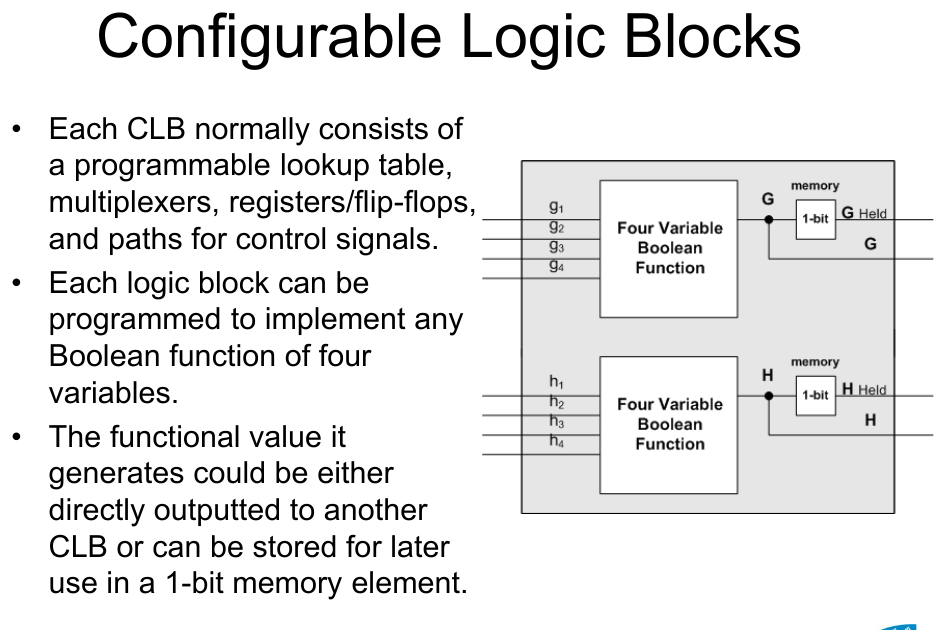

A CLB has a programmable **look-up table** (any Boolean function of **4** variables), multiplexers and **flip-flops**.

Its output can go straight to another CLB, or be **stored** in a flip-flop for later.

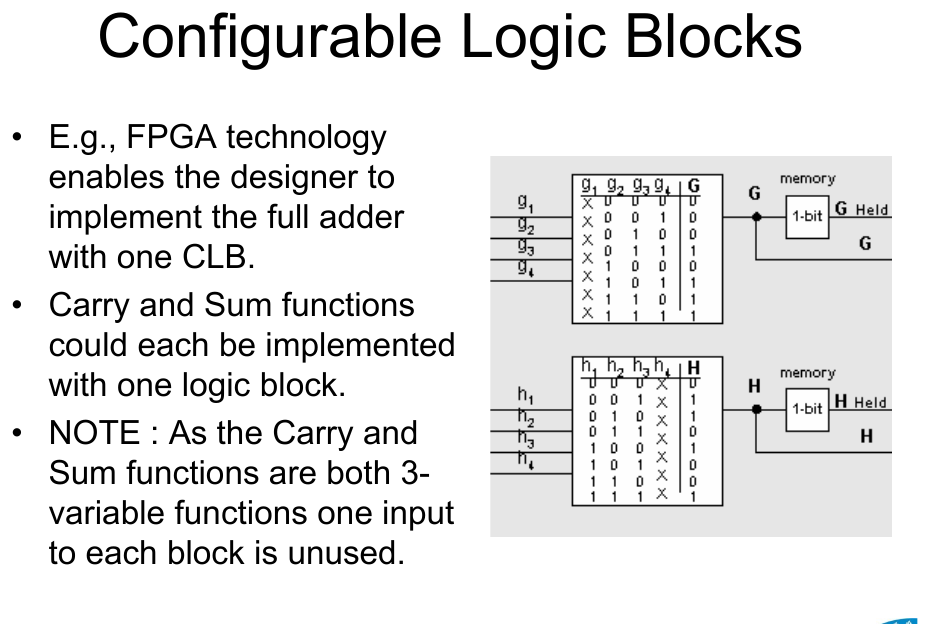

A full adder fits in **one** CLB: one look-up table for the sum, one for the carry. Each is a 3-variable function, so one of the 4 inputs is unused.

---

## 8. The switch matrix

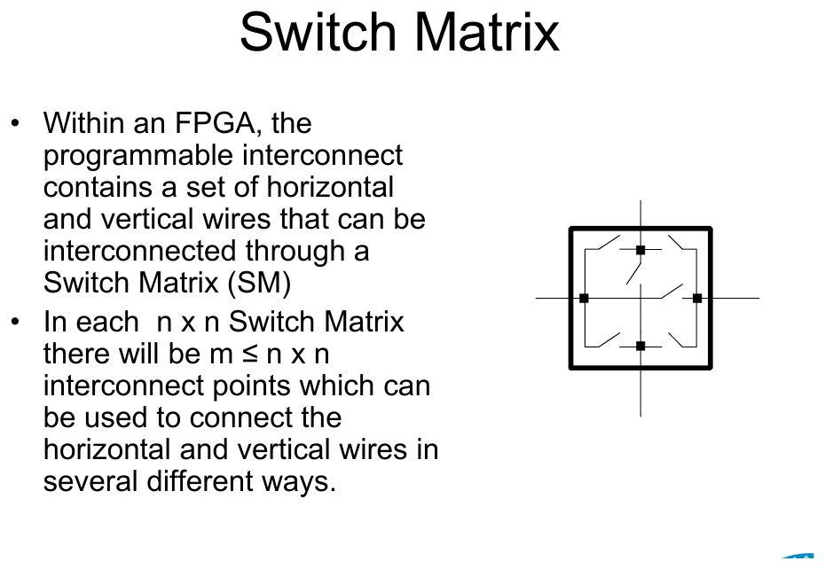

**How to read this diagram:**
- Horizontal and vertical wires cross. At an interconnect point, 4 wire ends meet.
- **6** switches, one between each pair of the 4 ends.
- Each switch is open or closed: 2⁶ = **64** possible connections.

---

## 9. ASIC vs FPGA

| ASIC | FPGA |
|---|---|
| designed from behaviour down to **physical layout** | bought **off the shelf** |
| sent to a foundry: expensive, slow | configured by the designer with a **bitstream** |
| high performance, low power | **low development cost** |
| cheap in **high volumes** | **short time to market** |
| fixed forever | **reconfigurable** |

Vendors: Xilinx, Altera.

---

## Method: programmable logic questions

| You're asked for | Use |
|---|---|
| PROM vs PAL vs PLA | Rule 54 |
| ROM size for a look-up table | inputs → 2ⁿ words, largest output → bits (§2) |
| function on a PROM | Σm of each output: connect those decoder lines (§1) |
| function on a PAL / PLA | minimum SOP of each output (Topic 8). PLA: share products. |
| why add flip-flops | sequential logic: CPLD macrocell, FPGA CLB (§6, §7) |
| what's in an FPGA | CLB, IOB, switch matrix (§7, §8) |
| ASIC or FPGA? | §9 table |

---

Next: [End-of-topic test](../questions/20-programmable-logic.md)
