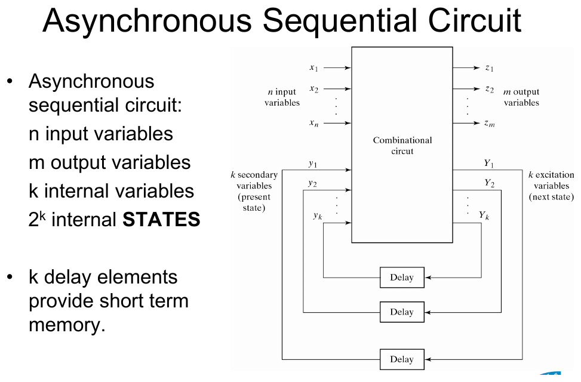
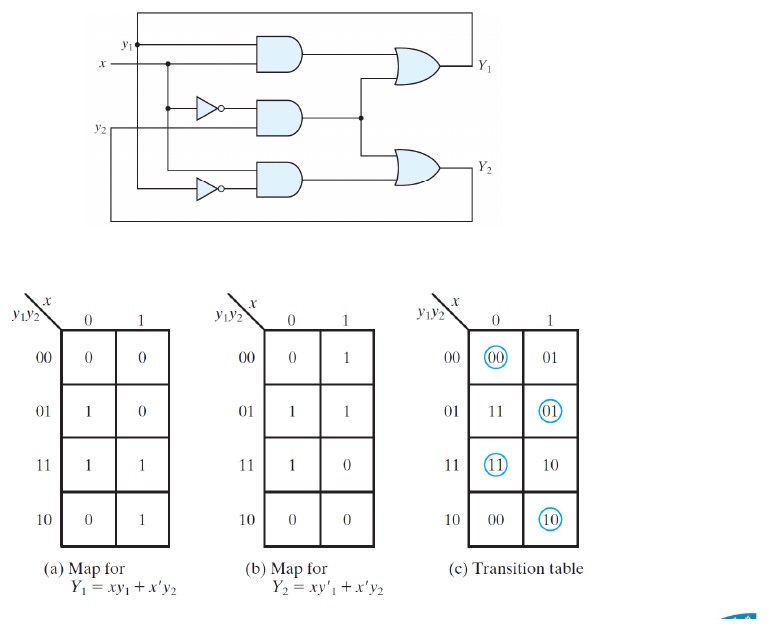
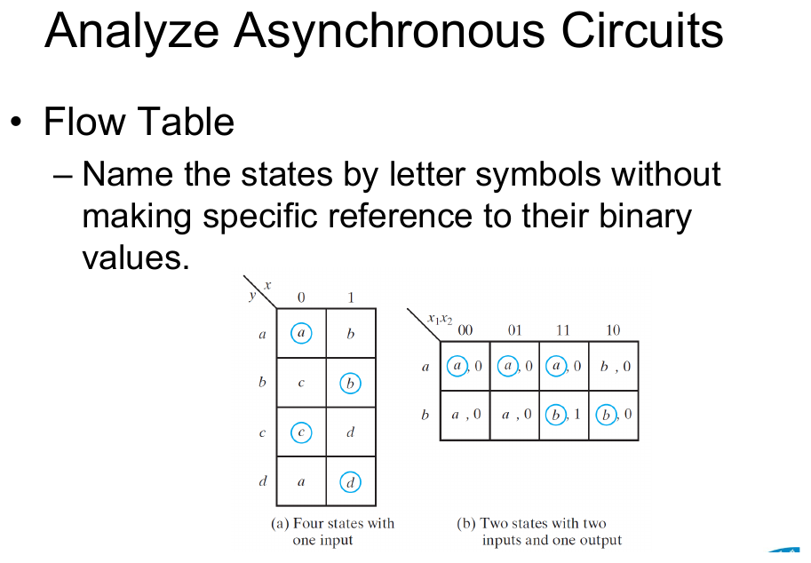
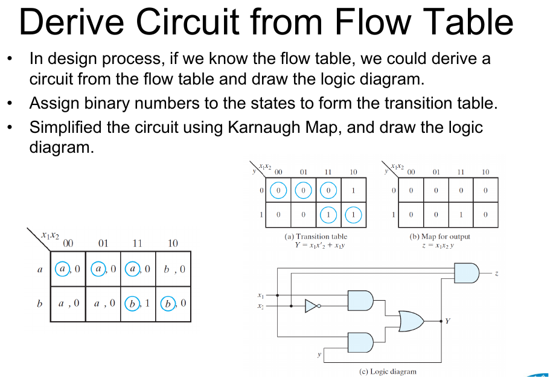
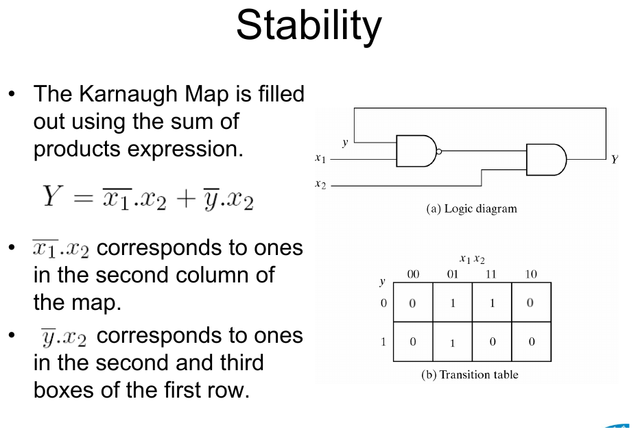
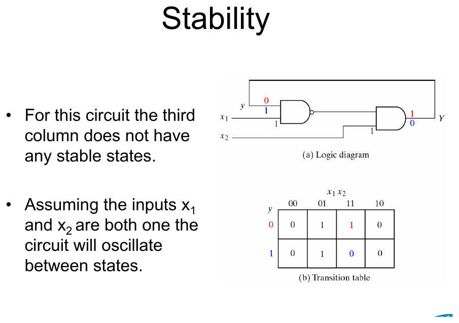
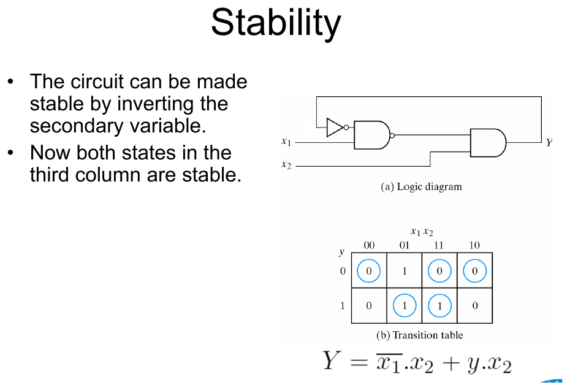
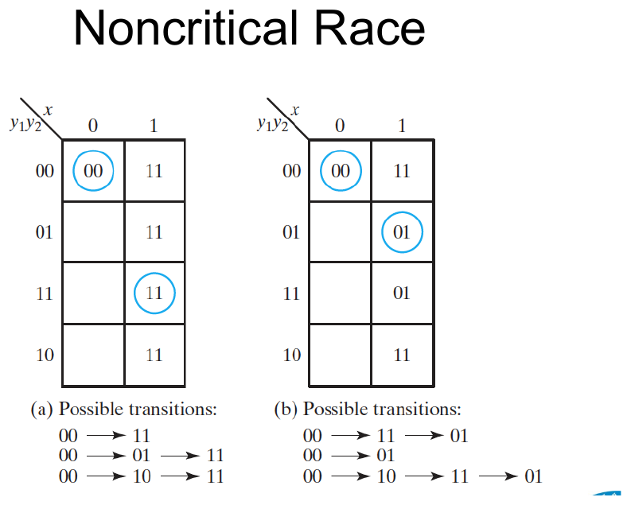
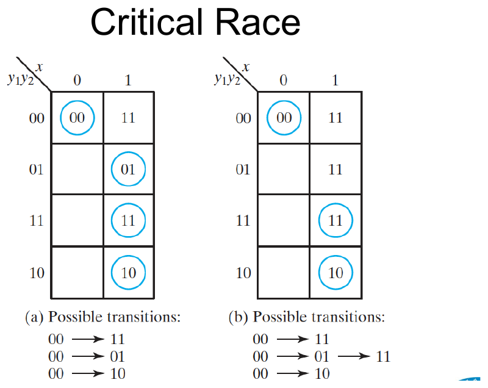
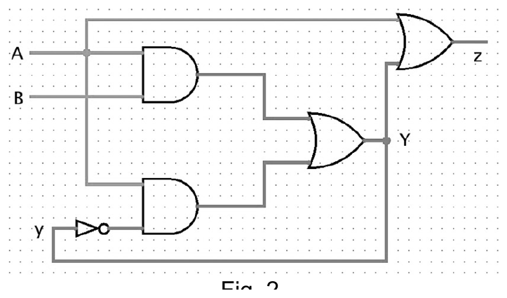

# Topic 21: Asynchronous sequential circuits

Slide exercises: the two-variable example (Lecture 23/24, slides 15 to 17), the unstable circuit (slides 18 to 23) · Past finals: **2023 Q4 (a whole question)**

Slides: Lecture 23/24, slides 1 to 29

---

## The big idea

An **asynchronous** circuit has **no clock**.

Its memory is just **feedback**: an output wired back to an input, with the gate delay acting as a tiny memory.

The state changes **as soon as** an input changes.

 

To analyse one:
1. Find the feedback loops. Call each loop's output **Y** (next state) and its input **y** (present state).
2. Write Y as a function of the inputs and y.
3. Plot it as a **transition table**: y down the side, inputs across.
4. **Circle** every cell where **Y = y**. Those are the **stable** states.

A column with **no** circle is **unstable**: the circuit oscillates.

---

**How to use these notes:**
When you see 🧠, stop.
Answer it on paper first.
Then click to check.

---

## 🎯 In the final

**2023 Q4 (a whole question):** a circuit with inputs A, B, one internal state y and output z.

- (a) Derive the transition table and show it on a K-map. (40%)
- (b) Obtain a flow table. (20%)
- (c) Is there a stability issue? Where? (40%)

Worked in full in §9. Expect the same three parts on a new circuit.

---

## ⭐ Learn by heart from this topic

There is **no formula sheet** in this exam. So learn all of this.

- No clock. Memory = feedback loops with delay.
- y = **secondary** variable (present state). Y = **excitation** variable (next state).
- Rule 55: transition table: y in rows, inputs in columns (Gray order), Y in the cells. **Circle Y = y.**
- **Total state** = the internal state + the input.
- **Flow table:** the same table with letters (a, b, ...) for states, and the output after a comma.
- Rule 56: a column with **no** circled state → **unstable**: Y keeps flipping. Period of oscillation = **2 × the loop delay**.
- **Fundamental mode:** inputs change **one at a time**, and only when the circuit is stable.
- **Race:** two or more state variables must change at once. **Noncritical**: ends in the same state either way. **Critical**: can end in different states. Avoid it with a state assignment where only one bit changes per transition.

**Memory hook:** "Circle where Y equals y. No circle, no rest."

---

## 1. Synchronous vs asynchronous

**How to read this diagram:**
- A combinational circuit with n inputs x and m outputs z.
- k outputs Y go back round to become the inputs y, through **delay** boxes.
- The delays aren't parts you add. They're the natural gate delays in the loop.
- k loops → 2ᵏ internal states.

| | Synchronous | Asynchronous |
|---|---|---|
| Changes when | a clock edge | an input changes |
| Memory | flip-flops | feedback loops (or latches) |
| Stability | guaranteed | **not** guaranteed |
| Design | systematic, large scale | hard |

Used for: very fast response, and joining two circuits with **different** clocks.

---

## 2. Stable and unstable

When the circuit settles, **y = Y** for every loop. That's a **steady state**.

- **Stable:** it settles after an input change.
- **Unstable:** the state variables keep changing and never settle.

 

**Fundamental mode:** to keep it predictable, only **one input** changes at a time, and only after the circuit has settled. With two inputs changing together, you can't tell which arrives first.

---

## 3. The transition table

**How to read this diagram:**
- Two loops: Y₁ and Y₂. One input x.
- Y₁ = xy₁ + x'y₂ and Y₂ = xy₁' + x'y₂.
- (a) and (b): a K-map of each Y, with y₁y₂ down the side and x across.
- (c): the two maps put together. Each cell holds Y₁Y₂.
- Circled cells: Y₁Y₂ equals the row's y₁y₂. Stable.

| y₁y₂ \ x | 0 | 1 |
|---|---|---|
| **00** | (00) | 01 |
| **01** | 11 | (01) |
| **11** | (11) | 10 |
| **10** | 00 | (10) |

(Brackets = circled = stable.)

---

### 📐 Rule 55: building a transition table

**Step 1.** Find every feedback loop.

**Step 2.** Call each loop's output Yᵢ and its input yᵢ.

**Step 3.** Write each Y as a Boolean function of the external inputs and the y's.

**Step 4.** Map it: **y's in the rows, inputs in the columns** (Gray order 00, 01, 11, 10).

**Step 5.** Combine all the Y maps into one table.

**Step 6.** **Circle** every cell where Y = y.

**Use it when:**
"Derive the transition table" (2023 Q4a).

---

### 🧠 Check
In the table above, the circuit is stable in 00 with x = 0. x changes to 1. Follow it.

Answer

Row 00, column x = 1: Y = 01. Not equal to 00, so it moves to row **01**.

Row 01, column 1: Y = 01. Equal → **stable** in 01.

---

## 4. The flow table

**How to read this diagram:**
- Same as the transition table, but each state gets a **letter** instead of its binary code.
- Circled letters are stable.
- (b): a flow table with two inputs and an output. Each cell is "next state, output", like (a), 0.

To get a flow table from a transition table: name each row (00 = a, 01 = b, ...), then replace every code in the cells by its letter. Add the output after a comma.

---

## 5. From a flow table to a circuit

**How to read this diagram:**
- Flow table: states a and b, inputs x₁x₂, output after the comma.
- Assign a = 0, b = 1. That gives a transition table.
- K-map it: **Y = x₁x₂' + x₁y**. Output: **z = x₁x₂y**.
- Then draw the gates, with Y fed back to y.

This is **design**: the reverse of §3.

---

## 6. An unstable circuit

**How to read this diagram:**
- A NAND gate (x₁, y) feeding an AND gate with x₂. The output Y goes back to y.
- So Y = (x₁y)'x₂ = **x₁'x₂ + y'x₂**.
- Transition table: row y = 0 is 0 1 1 0. Row y = 1 is 0 1 0 0.

**Column x₁x₂ = 11:** y = 0 gives Y = 1, and y = 1 gives Y = 0. **Neither** is circled.

So with x₁ = x₂ = 1, Y never settles: 0 → 1 → 0 → 1 ...

---

### 📐 Rule 56: spotting instability

**Look down each input column of the transition table.**

A column with **no** circled (stable) entry is **unstable**.

The circuit oscillates there. The period is **twice the delay** round the loop.

**Use it when:**
"Check whether there is a stability issue" (2023 Q4c).

**How to fix it (slide 23):** change the logic so that column gets a stable entry. On the slide, feeding y in **without** the inversion gives Y = x₁'x₂ + yx₂, and both cells in column 11 become stable.

---

## 7. Race conditions

A **race** happens when **two or more** state variables must change at once.

Example: the state must go 00 → 11. The delays are never exactly equal, so it really goes 00 → 10 → 11, or 00 → 01 → 11.

**Noncritical race:** whichever variable wins, the circuit ends in the **same** stable state. Harmless.

**Critical race:** depending on which wins, it can end in **different** stable states. Must be avoided.

In (a) of the critical race: going 00 → 11 in column x = 1. If y₂ wins, it reaches 01, which is stable: it stops there. If y₁ wins, it reaches 10, also stable. Three possible end states.

---

### 🧠 Check
How do you avoid a critical race?

Answer

Choose the **binary state assignment** so that only **one** state variable changes in every transition of the flow table.

Then there's never a race at all.

---

## 8. Hazards

Asynchronous circuits must also be free of **hazards**: short glitches when different paths have different delays.

That's Topic 22.

---

## 9. Worked example: Final 2023 Q4

**How to read this diagram:**
- Inputs A and B. A feedback line y comes up from the bottom.
- Top AND: A and B. Bottom AND: A and y' (y through a NOT).
- The two ANDs go into an OR. Its output is **Y**, and Y is fed back round to y.
- A second OR, top right, takes A (the line running across the top) and Y. Its output is **z**.

 

**(a) Transition table.**

One loop → one state variable.

$$Y = AB + Ay'$$

$$z = A + Y = A + AB + Ay' = A$$

Map Y with y in the rows and AB across:

| y \ AB | 00 | 01 | 11 | 10 |
|---|---|---|---|---|
| **0** | (0) | (0) | 1 | 1 |
| **1** | 0 | 0 | (1) | 0 |

Brackets mark Y = y (stable).

How each cell was found:
- AB = 00 or 01: A = 0, so Y = 0 in both rows.
- AB = 11: AB = 1, so Y = 1 in both rows.
- AB = 10: Y = Ay' = y'. So y = 0 → 1, y = 1 → 0.

 

**(b) Flow table.** Let a = (y = 0), b = (y = 1). Each cell is "next state, z":

| state \ AB | 00 | 01 | 11 | 10 |
|---|---|---|---|---|
| **a** | (a), 0 | (a), 0 | b, 1 | b, 1 |
| **b** | a, 0 | a, 0 | (b), 1 | a, 1 |

 

**(c) Stability.**

Look down each column (Rule 56):
- 00: a is stable. 01: a is stable. 11: b is stable.
- **10: no stable state.** In a, Y = 1, so it moves to b. In b, Y = 0, so it moves back to a.

So **yes, there is an instability**, when **A = 1 and B = 0**.

Y (and y) oscillate between 0 and 1 for as long as AB = 10. The period is twice the delay round the loop.

Example: stable in a with AB = 00. A goes to 1 → AB = 10 → it oscillates.

(The output z = A is not affected, but the internal state is.)

---

## Drawing checklist: transition table and flow table

1. Rows: the state variables y (Gray order if two: 00, 01, 11, 10).
2. Columns: the inputs in **Gray order**.
3. Each cell: the value of Y (or Y₁Y₂).
4. **Circle** every cell where Y equals the row's y.
5. Flow table: replace each code by a letter, circle the stable ones, add ", output".
6. Look down each column for a missing circle → unstable.

---

## Method: asynchronous circuit questions

| You're asked for | Use |
|---|---|
| Y and z from the circuit | read the gates, call each loop output Y (§9) |
| transition table | Rule 55 |
| flow table | letters instead of codes, add output (§4) |
| stable states | circle Y = y |
| instability | Rule 56: a column with no circle |
| what happens after an input change | move down the column to the row Y names, until it's circled (§3 🧠) |
| race critical or not | follow both orders. Same end state? Noncritical. (§7) |
| circuit from a flow table | assign codes, K-map Y (§5) |

---

Next: [End-of-topic test](../questions/21-asynchronous-circuits.md)
