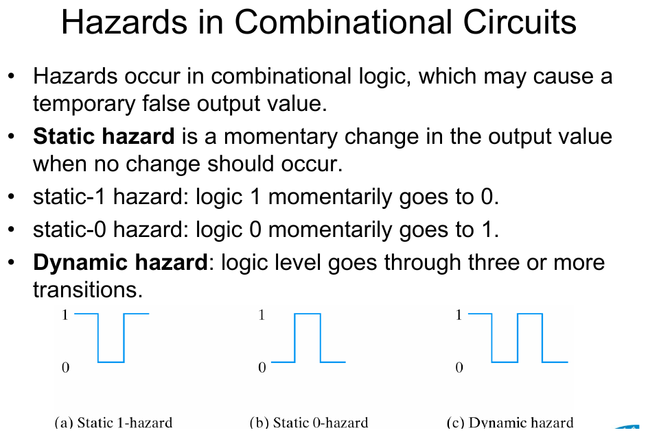
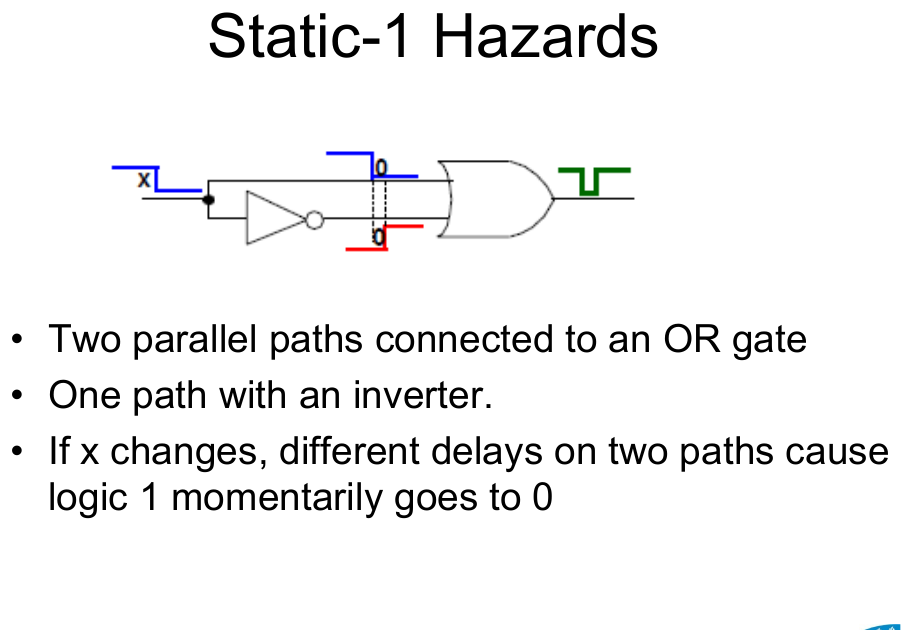
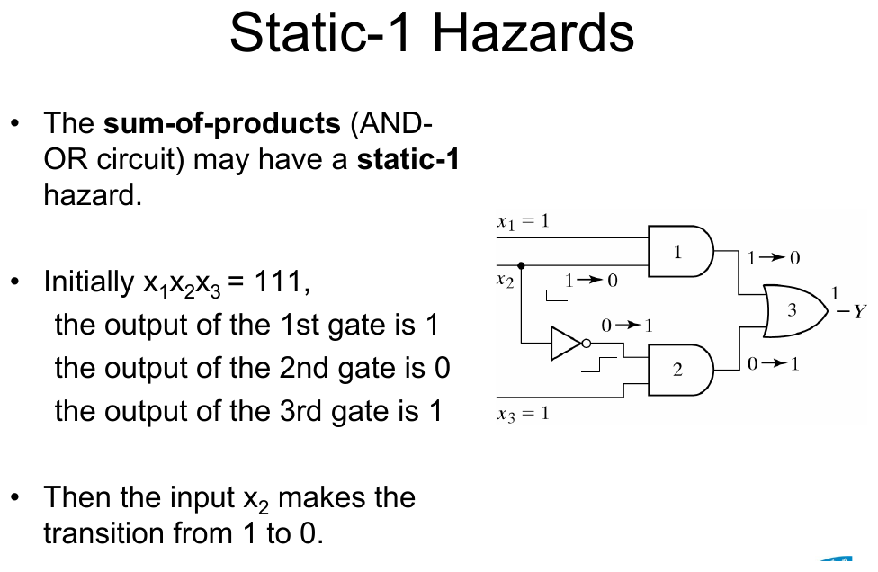
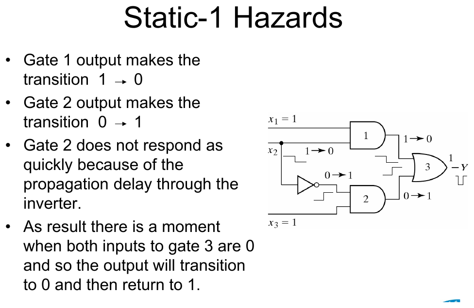
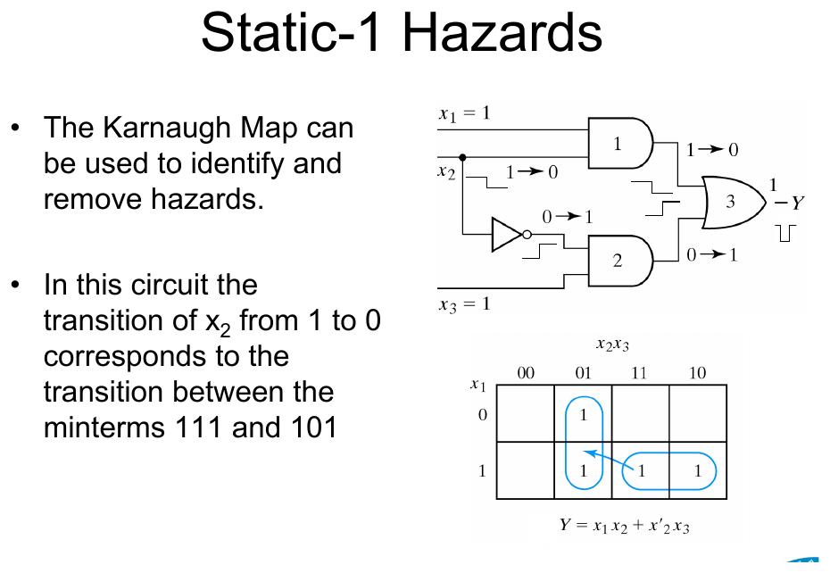
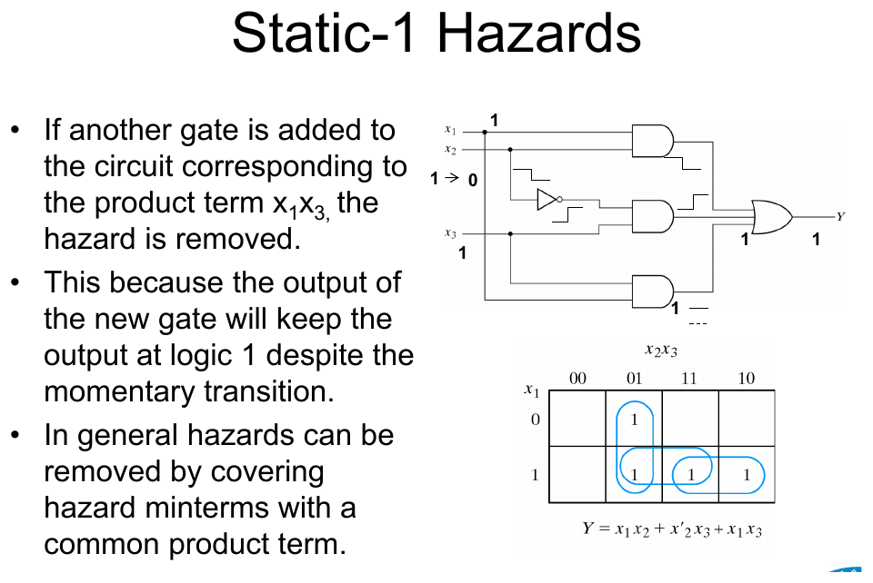
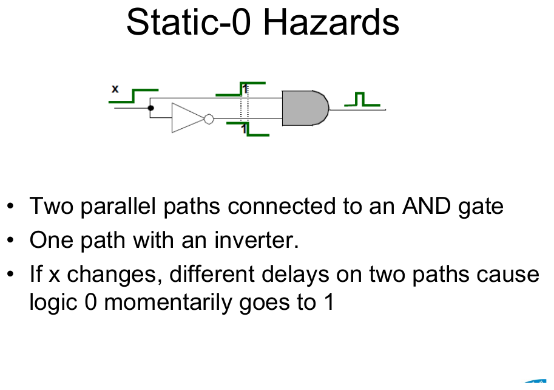
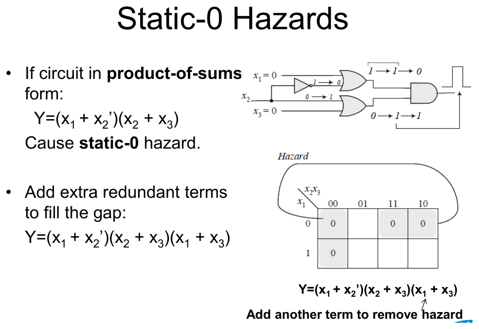

# Topic 22: Hazards (static and dynamic)

Slide exercises: Y = x₁x₂ + x₂'x₃ (Lecture 23/24, slides 33 to 36), Y = (x₁ + x₂')(x₂ + x₃) (slide 38) · Past finals: **2023 Q2b (40% of Q2)**

Slides: Lecture 23/24, slides 30 to 39

---

## The big idea

A **hazard** is a short **glitch** at a circuit's output.

It happens because different paths through the gates have **different delays**.

 

The classic case: a signal and its complement (through an inverter) meet at one gate. For a moment, the inverter hasn't caught up, and **both** paths are 0 (or both 1).

 

The fix: add a **redundant** term that holds the output steady during the change.

On a K-map: make sure every pair of **neighbouring 1s** sits inside **one** group.

---

**How to use these notes:**
When you see 🧠, stop.
Answer it on paper first.
Then click to check.

---

## 🎯 In the final

**2023 Q2b (40% of Q2):** "Briefly explain what causes static hazards in digital circuits. Implement the below Boolean function **without static-1 hazards**, using a **minimum number of gates**:

F(A, B, C, D) = AB'(D' + CD) + A'(B + CD) + A'CD'"

Worked in full in §6.

---

## ⭐ Learn by heart from this topic

There is **no formula sheet** in this exam. So learn all of this.

- **Static-1 hazard:** the output should stay 1, but drops to 0 for a moment. Happens in **SOP** (AND-OR).
- **Static-0 hazard:** should stay 0, but jumps to 1 for a moment. Happens in **POS** (OR-AND).
- **Dynamic hazard:** should change once, but changes 3 or more times (1 → 0 → 1 → 0).
- **Cause:** different propagation delays on different paths, especially a signal and its inverted copy.
- Rule 57: SOP is static-1 hazard free when **every pair of adjacent 1s** on the K-map is covered by **one common** product term. Add the missing terms.
- Rule 58: POS is static-0 hazard free when **every pair of adjacent 0s** is covered by **one common** sum term.
- The extra term is the **consensus** term: xy + x'z → add yz.

**Memory hook:** "Every neighbour pair needs a shared group."

---

## 1. Three kinds of hazard

**How to read this diagram:**
- (a) Static-1: the output is 1, dips to 0, returns to 1.
- (b) Static-0: the output is 0, spikes to 1, returns to 0.
- (c) Dynamic: the output should go 1 → 0 once, but bounces: 1 → 0 → 1 → 0.

"Static" = the output **shouldn't** change at all. "Dynamic" = it should change **once**.

---

## 2. Where a static-1 hazard comes from

**How to read this diagram:**
- One signal x splits into two paths into an OR gate.
- One path goes through an **inverter**, so it's a little **late**.
- x falls 1 → 0. The direct path drops at once. The inverted path rises a bit later.
- For that moment, **both** OR inputs are 0. The output glitches to 0.

---

## 3. A static-1 hazard in a real SOP circuit

**How to read these diagrams:**
- Y = x₁x₂ + x₂'x₃. Gate 1 makes x₁x₂. Gate 2 makes x₂'x₃ (x₂ goes through an inverter first). Gate 3 ORs them.
- Start: x₁x₂x₃ = 111. Gate 1 = 1, gate 2 = 0, Y = 1.
- x₂ falls 1 → 0. Y should stay 1 (now gate 2 holds it).
- But gate 1 falls **first**. Gate 2 rises **later** (it waits for the inverter).
- For a moment both are 0: Y glitches 1 → 0 → 1.

---

## 4. Finding and fixing it with a K-map

**How to read this diagram:**
- The two groups: x₁x₂ (cells 110, 111) and x₂'x₃ (cells 001, 101).
- The change x₂: 1 → 0 moves from cell **111** to cell **101**.
- Those two cells are **neighbours**, but in **different** groups. The arrow jumps between groups. That's the hazard.

**The fix:** add a group that covers **both** cells: 101 and 111 → **x₁x₃**.

$$Y = x_1x_2 + x_2'x_3 + x_1x_3$$

While x₂ changes, x₁x₃ stays 1 the whole time. No glitch.

x₁x₃ is **redundant** logically (Y is the same function), but it's needed for timing.

---

### 📐 Rule 57: removing static-1 hazards (SOP)

**Step 1.** Plot the function on a K-map. Find the minimum SOP groups.

**Step 2.** Look at **every pair of neighbouring 1s** (cells that differ in one bit, including wrap-round).

**Step 3.** If a pair is in **different** groups and **no** group covers both, that's a hazard.

**Step 4.** Add a group (a prime implicant) that covers that pair.

**Step 5.** Repeat until every neighbouring pair shares a group.

**Why it works:**
When one input changes, you move between two neighbouring cells. If one product term covers both, that term stays at 1 throughout, so the OR output can't dip.

**Use it when:**
"Implement F without static-1 hazards" (2023 Q2b).

**Shortcut (consensus):**

$$xy + x'z \;\rightarrow\; \text{add } yz$$

---

### 🧠 Check
F = AB + A'C. Is there a static-1 hazard? Fix it.

Answer

Cells 111 (in AB) and 011 (in A'C) are neighbours, in different groups. When A changes with B = C = 1: **hazard**.

Add the consensus term **BC** (covers 011 and 111).

**F = AB + A'C + BC**

---

## 5. Static-0 hazards (POS)

**How to read these diagrams:**
- The same idea with an **AND** gate: both inputs are 1 for a moment, so the output spikes to 1.
- Y = (x₁ + x₂')(x₂ + x₃). x₁ = 0, x₃ = 0, x₂ changes. Y should stay 0.
- On the K-map of the **0s**: cells 000 and 010 are neighbouring 0s in different groups.
- Add the sum term that covers both: **(x₁ + x₃)**.

$$Y = (x_1 + x_2')(x_2 + x_3)(x_1 + x_3)$$

---

### 📐 Rule 58: removing static-0 hazards (POS)

Same as Rule 57, but with the **0s** and **sum** terms:

Every pair of **neighbouring 0s** must be covered by **one common** sum term. Add the missing ones.

**Consensus:**

$$(x + y)(x' + z) \;\rightarrow\; \text{add } (y + z)$$

**Use it when:**
"Implement F in POS without static-0 hazards."

---

## 6. Worked example: Final 2023 Q2b

**Briefly explain what causes static hazards. Implement F(A, B, C, D) = AB'(D' + CD) + A'(B + CD) + A'CD' without static-1 hazards, using a minimum number of gates.**

 

**The cause (write this):**

Different paths through the circuit have **different propagation delays**, especially a signal and its inverted copy.

When one input changes, one product term can switch off **before** the other switches on. For that moment, the output falls (static-1) or rises (static-0) when it should have stayed the same.

 

**Step 1. Expand into products:**

F = AB'D' + AB'CD + A'B + A'CD + A'CD'

**Step 2. K-map** (AB down the side, CD across):

| AB \ CD | 00 | 01 | 11 | 10 |
|---|---|---|---|---|
| **00** | 0 | 0 | 1 | 1 |
| **01** | 1 | 1 | 1 | 1 |
| **11** | 0 | 0 | 0 | 0 |
| **10** | 1 | 0 | 1 | 1 |

F = Σm(2, 3, 4, 5, 6, 7, 8, 10, 11).

 

**Step 3. Minimum SOP:**

- Row 01 (cells 4, 5, 6, 7): **A'B**
- Cells 2, 3, 10, 11 (B = 0, C = 1, wraps top to bottom): **B'C**
- Cells 8 and 10 (A = 1, B = 0, D = 0): **AB'D'**

F = A'B + B'C + AB'D'

 

**Step 4. Check every neighbouring pair of 1s** (Rule 57):

| Pair | Cells | Same group? |
|---|---|---|
| 0010 – 0110 | 2, 6 | **No**: 2 is in B'C, 6 is in A'B |
| 0011 – 0111 | 3, 7 | **No**: 3 is in B'C, 7 is in A'B |
| all the rest | | yes |

So there are static-1 hazards when **B changes** with A = 0, C = 1.

 

**Step 5. Fix:** cells 2, 3, 6, 7 form a group of 4: A = 0, C = 1 → **A'C**.

$$F = A'B + B'C + AB'D' + A'C$$

 

**Gates:** 4 AND gates (A'B, B'C, A'C with 2 inputs, AB'D' with 3) and **1** OR gate with 4 inputs. NOT gates for A', B', D'.

**5 gates** (plus inverters). This is the minimum: the 3 minimum-SOP terms are all essential, and one extra term is the least that covers both hazard pairs.

---

## Drawing checklist: hazard-free circuit

1. Write the hazard-free expression first.
2. One AND gate per product term, one OR gate for the output (SOP).
3. Draw the inverters for complemented inputs.
4. Mark (or note) the **redundant** gate: "added to remove the static-1 hazard".
5. Give the gate count.

---

## Method: hazard questions

| You're asked for | Use |
|---|---|
| what causes static hazards | different path delays (§2, §6) |
| static-1 / static-0 / dynamic | §1 |
| is there a hazard? | K-map: neighbouring 1s in different groups (Rule 57) |
| make SOP hazard-free | Rule 57: add a group for each such pair |
| make POS hazard-free | Rule 58 |
| quick fix for two terms | consensus: xy + x'z → add yz |

---

Next: [End-of-topic test](../questions/22-hazards.md)
