# Topic 23: Physical transistor logic: NMOS and CMOS gates

Slide exercises: none set · Past finals: none

Slides: Lecture 25, all

---

## The big idea

Every gate in this module is really built from **transistors** used as **switches**.

 

| Transistor | Gate voltage **high** | Gate voltage **low** |
|---|---|---|
| **NMOS** | switch **closed** (conducts) | open |
| **PMOS** | open | switch **closed** (conducts) |

 

**CMOS** uses both together:
- **PMOS** transistors pull the output **up** to V_DD (logic 1).
- **NMOS** transistors pull it **down** to ground (logic 0).
- Only one side is on at a time, so almost **no current** flows when it's still.

---

**How to use these notes:**
When you see 🧠, stop.
Answer it on paper first.
Then click to check.

---

## 🎯 In the final

Not asked in 2023. In the syllabus ("CMOS logic").

Likely as a short "explain how a CMOS NAND works" or "sketch a CMOS NOR". Topic 9 Rule 25 (transistor counts) links here.

---

## ⭐ Learn by heart from this topic

There is **no formula sheet** in this exam. So learn all of this.

- **Positive logic:** high voltage = 1. **Negative logic:** high voltage = 0.
- Rule 59: NMOS **on** when its gate is **high**. PMOS **on** when its gate is **low** (bubble on the symbol).
- NMOS inverter: a load (resistor or always-on MOSFET) on top, NMOS below. Downside: **current flows** when the output is low.
- CMOS inverter: **2** transistors (1 PMOS on top, 1 NMOS below).
- CMOS **NAND**: PMOS in **parallel** (top), NMOS in **series** (bottom).
- CMOS **NOR**: PMOS in **series** (top), NMOS in **parallel** (bottom).
- Transmission gate: an NMOS and a PMOS side by side. N high, P low → closed. N low, P high → open.
- Slide counts: XOR with transmission gates = **8**. D latch = **10**. 4-to-1 mux = **16**.

**Memory hook:** "NAND: NMOS in series. NOR: NMOS in parallel. PMOS does the opposite."

---

## 1. Positive and negative logic

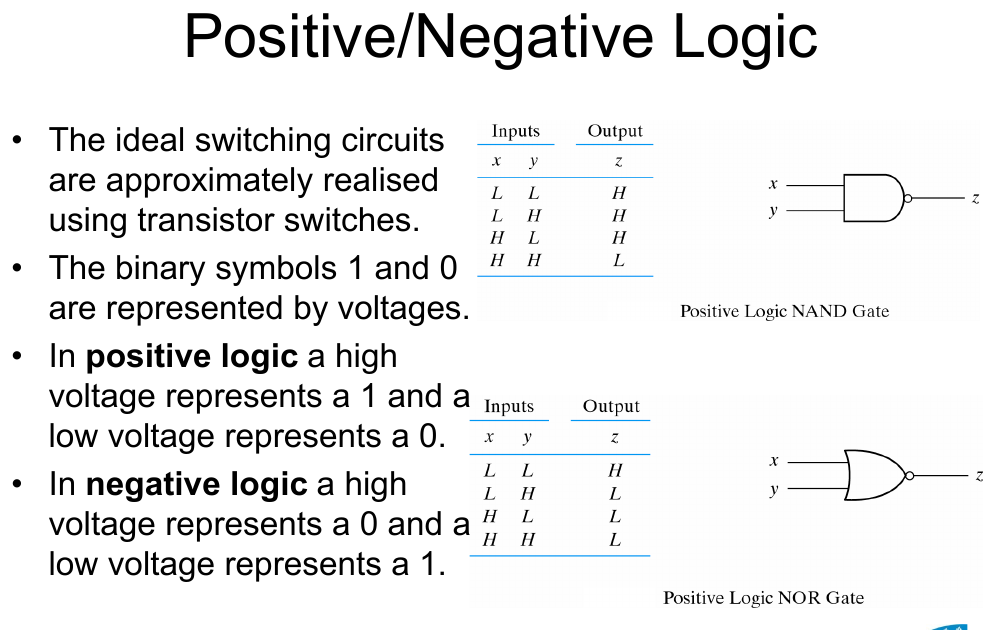

**How to read this diagram:**
- Each table is in **H** (high voltage) and **L** (low voltage).
- The top table: output L only when both inputs are H. In **positive logic** (H = 1), that's a **NAND**.
- The bottom table: output L when either input is H. In positive logic, that's a **NOR**.

The same circuit is a different gate if you swap to **negative logic** (H = 0): the NAND becomes a NOR.

---

## 2. NMOS and PMOS as switches

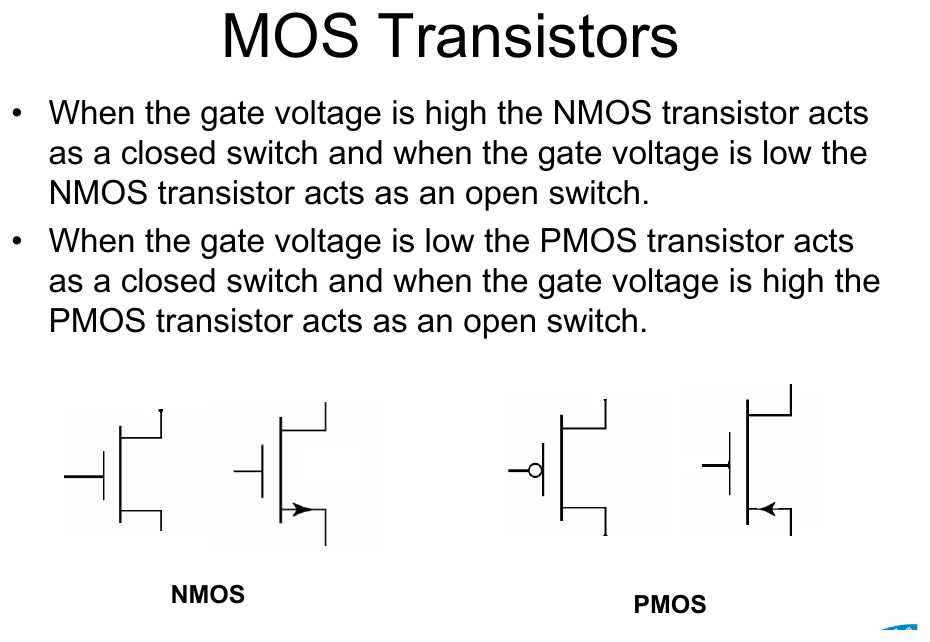

**How to read this diagram:**
- Left: NMOS symbols. Right: PMOS symbols (the bubble or reversed arrow on the gate).
- **NMOS:** high gate → closed switch. Low gate → open.
- **PMOS:** low gate → closed switch. High gate → open.

---

### 📐 Rule 59: MOS transistors as switches

| | Gate high (1) | Gate low (0) | Good at pulling |
|---|---|---|---|
| NMOS | **on** | off | **down** to 0 V |
| PMOS | off | **on** | **up** to V_DD |

**Why:** an NMOS has an n-channel that forms when the gate is above threshold. A PMOS has a p-channel that forms when the gate is below threshold.

**Use it when:**
Explaining any MOS gate: decide which transistors are on, and see if the output connects to V_DD or to ground.

---

## 3. The NMOS inverter

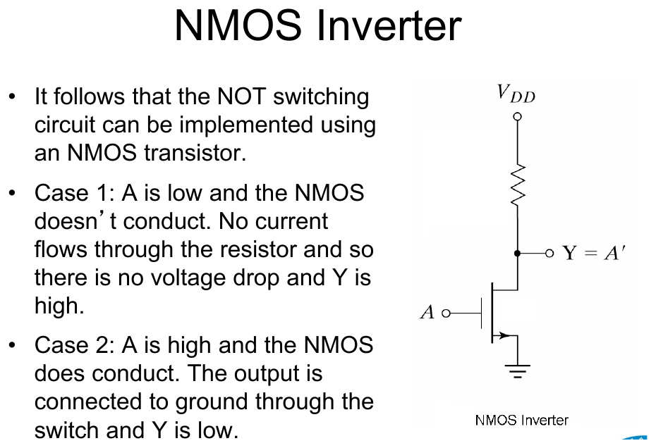

**How to read this diagram:**
- A resistor from V_DD to the output Y. An NMOS from Y to ground. Input A on the NMOS gate.
- A low: the NMOS is off. No current, no drop across the resistor. **Y high.**
- A high: the NMOS is on. Y is connected to ground. **Y low.**

So Y = A'.

In a chip, the resistor is replaced by a second MOSFET with its gate tied high (it acts as a resistive load).

**Problem:** when A is high, current flows from V_DD through the resistor to ground **all the time**. That wastes power.

---

## 4. NMOS NAND and NOR

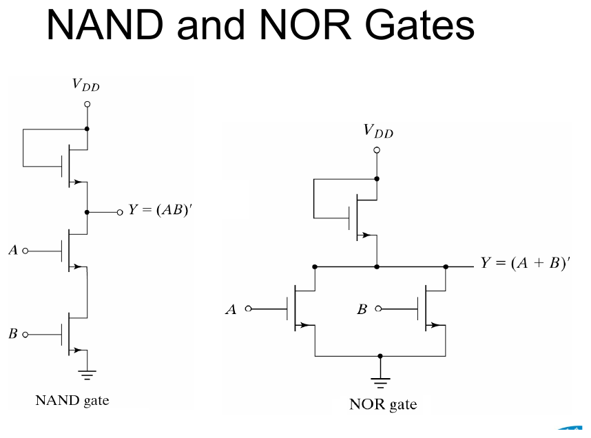

**How to read this diagram:**
- **NAND:** two NMOS in **series** below the load. Y is pulled low only when **both** A and B are high. Y = (AB)'.
- **NOR:** two NMOS in **parallel**. Y is pulled low when **either** is high. Y = (A + B)'.

---

## 5. The CMOS inverter

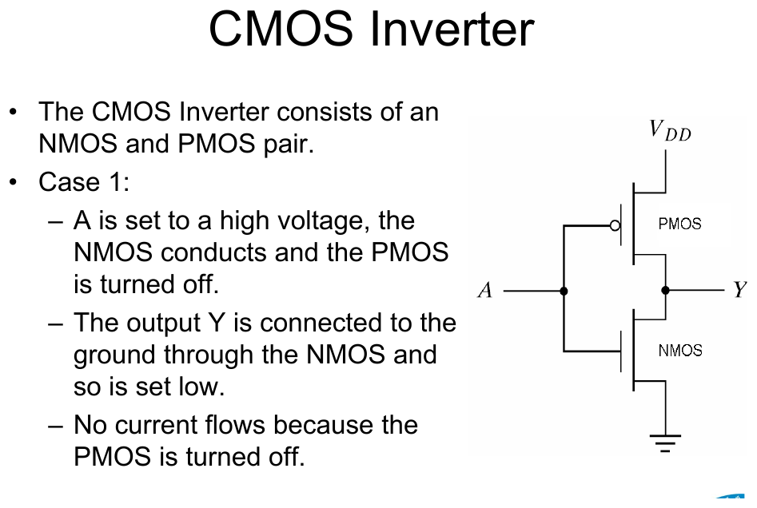

**How to read this diagram:**
- A PMOS on top (to V_DD), an NMOS below (to ground). Both gates on A. The output Y is in the middle.
- A high: NMOS on, PMOS off. **Y = 0.**
- A low: NMOS off, PMOS on. **Y = 1.**
- In both cases one transistor is off, so **no current** flows from V_DD to ground.

That's why CMOS is used everywhere: almost no power when it isn't switching.

---

### 🧠 Check
Why does a CMOS inverter use less power than an NMOS inverter?

Answer

In CMOS, the PMOS and NMOS are never both on. So there's **no path** from V_DD to ground when the output is steady.

In the NMOS inverter, when the output is low, current flows through the load **all the time**.

---

## 6. The CMOS NAND

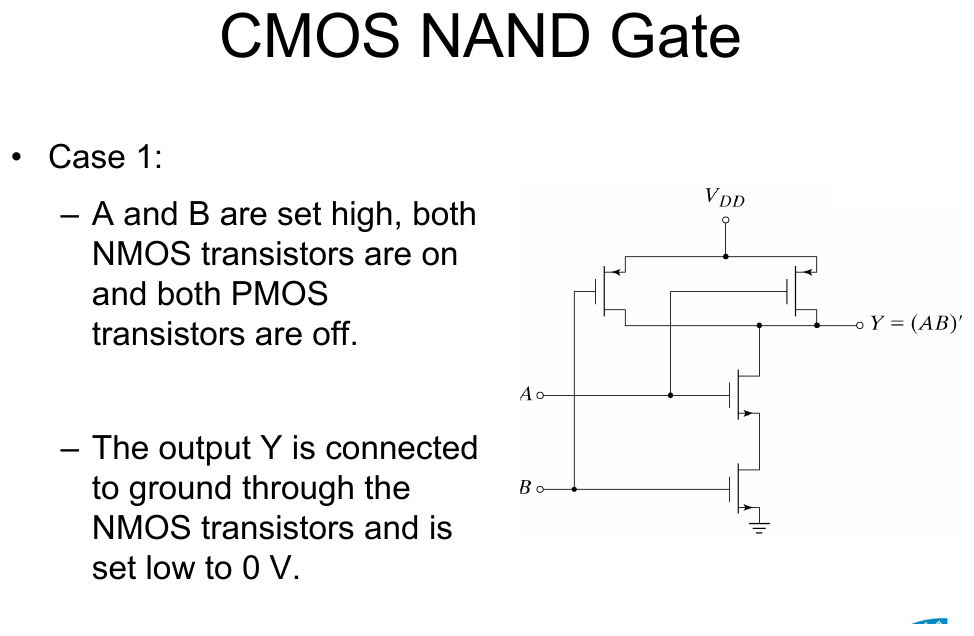

**How to read this diagram:**
- Top: **two PMOS in parallel** from V_DD to Y.
- Bottom: **two NMOS in series** from Y to ground.
- A and B both high: both NMOS on → Y connected to ground → **Y = 0**. Both PMOS off.
- A **or** B low: at least one NMOS is off (no path to ground), and at least one PMOS is on → **Y = 1**.

Y = (AB)'. **4** transistors (2n for n inputs, Topic 9 Rule 25).

---

## 7. The CMOS NOR

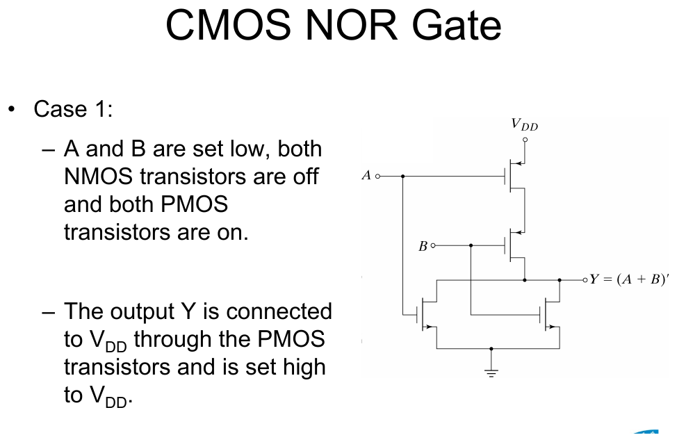

**How to read this diagram:**
- Top: **two PMOS in series**.
- Bottom: **two NMOS in parallel**.
- A and B both low: both PMOS on → **Y = 1**. Both NMOS off.
- A **or** B high: at least one NMOS on → **Y = 0**. The series PMOS path is broken.

Y = (A + B)'. **4** transistors.

 

| Gate | PMOS (pull-up) | NMOS (pull-down) |
|---|---|---|
| NAND | parallel | **series** |
| NOR | **series** | parallel |

The two halves are always the **opposite** connection.

---

### 🧠 Check
Draw (in words) a 3-input CMOS NAND. How many transistors?

Answer

Pull-up: **3 PMOS in parallel** from V_DD to Y.

Pull-down: **3 NMOS in series** from Y to ground.

**6** transistors (2n with n = 3).

---

## 8. The transmission gate

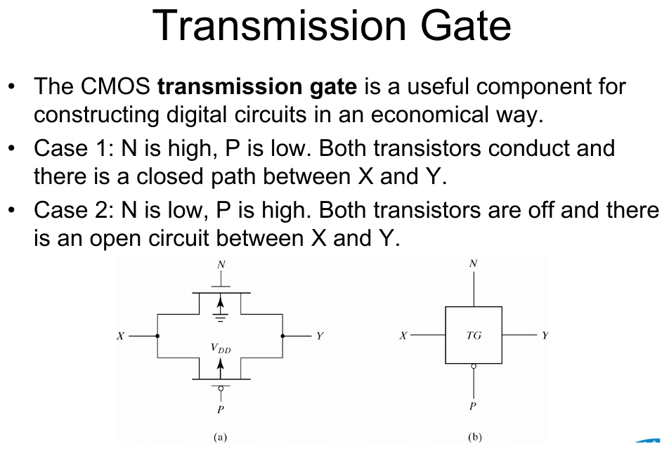

**How to read this diagram:**
- An NMOS and a PMOS side by side between X and Y. N controls the NMOS gate, P controls the PMOS gate.
- N high, P low: **both on**. X connects to Y. A closed switch.
- N low, P high: both off. X and Y are disconnected. An open switch.
- (b) the TG symbol.

It passes a signal in either direction, which makes some circuits much cheaper.

---

## 9. Circuits from transmission gates

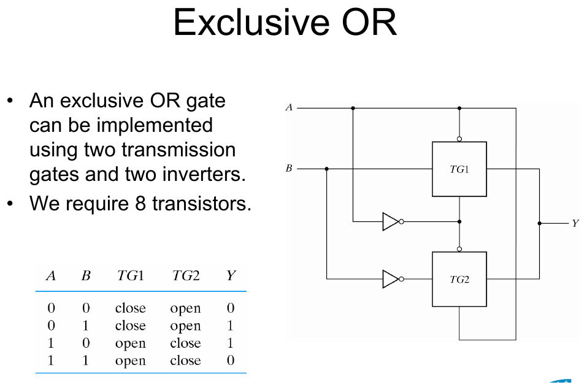

**How to read this diagram:**
- Two transmission gates TG1 and TG2, two inverters.
- B picks which TG is closed. TG1 passes A when B = 0. TG2 passes A' when B = 1.
- So Y = A when B = 0, and Y = A' when B = 1. That's **A ⊕ B**.
- 2 TGs × 2 + 2 inverters × 2 = **8** transistors.

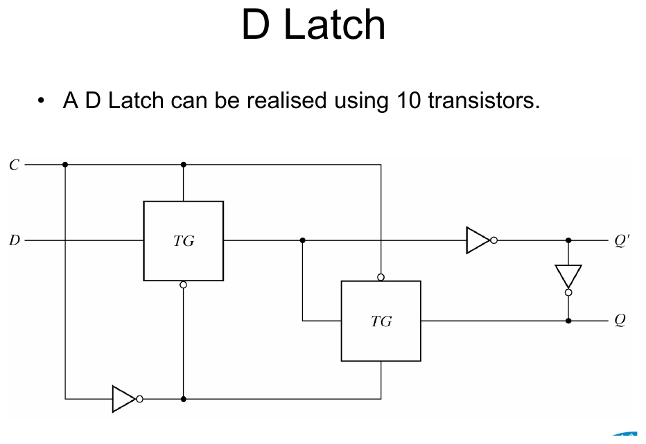

A **D latch** in **10** transistors: one TG lets D in when C = 1, another closes the feedback loop when C = 0.

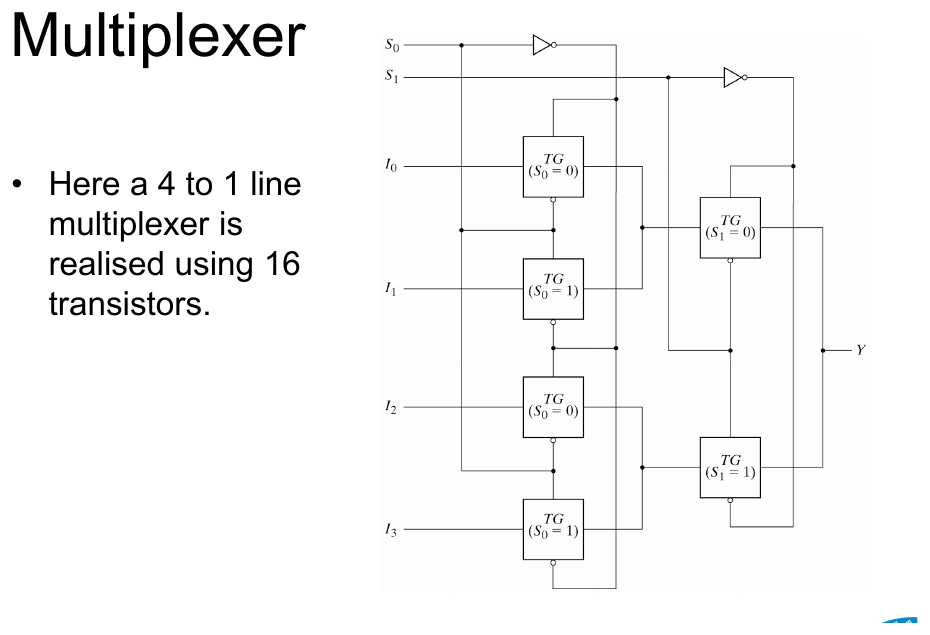

A **4-to-1 mux** in **16** transistors: S₀ picks within each pair, S₁ picks between the pairs.

---

## Method: transistor logic questions

| You're asked for | Use |
|---|---|
| when is an NMOS / PMOS on | Rule 59 |
| how a gate works | list each input case: which transistors are on, is Y joined to V_DD or ground? |
| CMOS NAND / NOR structure | §6, §7 table: series vs parallel |
| transistor count | NAND / NOR: 2n. NOT: 2. AND / OR: 2n + 2 (Topic 9 Rule 25) |
| why CMOS | no static current: low power (§5) |
| positive vs negative logic | §1 |
| transmission gate | §8 |

---

Next: [End-of-topic test](../questions/23-transistor-logic.md)
