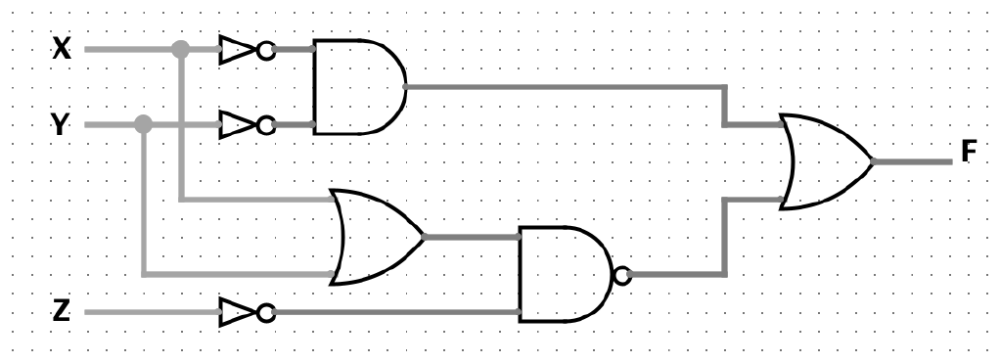
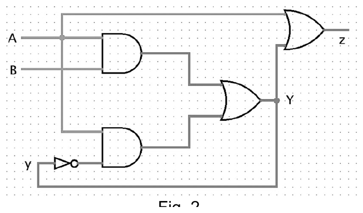

# Final 2023

The real EEEN20050 paper from Autumn 2023/24.

**2 hours. Answer all four questions. All questions carry equal marks (25 each).** The % next to each part is its share of that question.

Calculator allowed. **No formula sheet.**

Do it **timed and closed book**. Then mark yourself with the answers below.

There are **no official answers** for this paper. These are my worked answers, every one checked in Python (`tools/check_numbers.py`). Each part says which topic to go back to.

---

## Questions

### Q1. Combinational logic — 25 marks

A digital logic circuit is shown in Fig. 1.



(a) Write a Boolean logic function to describe the relationship between the inputs X, Y, Z and the output F. (10%)

(b) Draw the Karnaugh map and the truth table of the logic circuit. (30%)

(c) Express the logic function as a sum of minterms and as a product of maxterms, using the shorthand format. (20%)

(d) Simplify the above function using the Karnaugh map, and implement it with two-level NAND gate circuits. NOT gates can be used if needed. (40%)

---

### Q2. Ripple counter and static hazards — 25 marks

(a) Design a three-bit binary ripple count-down counter using D flip-flops. Show the logic diagram, draw the output waveforms and briefly explain how this circuit can be used as a frequency divider. (60%)

(b) Briefly explain what causes static hazards in digital circuits. Implement the below Boolean function without static-1 hazards, using a minimum number of gates:

F(A, B, C, D) = AB'(D' + CD) + A'(B + CD) + A'CD' (40%)

---

### Q3. Two-mode JK state machine — 25 marks

Use JK flip-flops and external gates to design a 3-bit synchronous binary state machine that has two modes of operation depending on its initial state.

| Mode 1 | Mode 2 |
|---|---|
| The initial state is 011. It cycles through the states 011 → 001 → 010 → 000 → 100 and back to 011, and then repeats the cycle when the clock is running. | The initial state is 111. It cycles through the states 111 → 110 → 101 and back to 111, and then repeats the cycle when the clock is running. |

Assume the two modes run autonomously depending on their initial state. There are no external control circuits or initial settings, but the two modes must be operated by **one** circuit block only. Using two separate circuits will not receive marks.

Show the design procedure, give the state table and logic functions, and sketch the logic diagram. Use the minimum number of flip-flops and external gates. (100%)

---

### Q4. Asynchronous sequential circuit — 25 marks

An asynchronous sequential circuit has two external inputs A and B, one internal state y and one external output z, described by the logic diagram in Fig. 2.



(a) Derive the transition table and show it on a Karnaugh map. (40%)

(b) Obtain a flow table for the circuit. (20%)

(c) Check whether there is a stability issue in this circuit. If there is, briefly explain where the instability can occur. (40%)

---

## Answers

<details><summary>Q1 answers</summary>

**(a)** Gate by gate: top AND = X'Y'. OR = X + Y. NAND = ((X + Y)Z')'.

**F = X'Y' + ((X + Y)Z')'**

DeMorgan on the NAND part: ((X + Y)Z')' = X'Y' + Z. So F = **X'Y' + Z**.

From: Topic 6 §6

<br>

**(b)** Truth table:

| X | Y | Z | F |
|---|---|---|---|
| 0 | 0 | 0 | 1 |
| 0 | 0 | 1 | 1 |
| 0 | 1 | 0 | 0 |
| 0 | 1 | 1 | 1 |
| 1 | 0 | 0 | 0 |
| 1 | 0 | 1 | 1 |
| 1 | 1 | 0 | 0 |
| 1 | 1 | 1 | 1 |

K-map:

| X \ YZ | 00 | 01 | 11 | 10 |
|---|---|---|---|---|
| **0** | 1 | 1 | 1 | 0 |
| **1** | 0 | 1 | 1 | 0 |

From: Topic 8 §11

<br>

**(c)** **F = Σm(0, 1, 3, 5, 7) = ΠM(2, 4, 6)**

From: Topic 7 §9

<br>

**(d)** Groups: columns 01 and 11 → Z. Cells 000, 001 → X'Y'. **F = X'Y' + Z**.

Two-level NAND: Gate 1 = NAND(X', Y'). Z goes straight to the output gate, so feed in Z'. Output = NAND(gate 1, Z').

**F = ((X'Y')' · Z')'** = X'Y' + Z ✓. 2 NAND gates + NOT gates for X', Y', Z'.

From: Topic 9 §11, Topic 9 Rule 26

</details>

<details><summary>Q2 answers</summary>

**(a)** Three negative-edge D flip-flops, each with **D = Q'** (so each toggles).

| Flip-flop | D | Clock |
|---|---|---|
| FF0 (Q₀) | Q₀' | CLK |
| FF1 (Q₁) | Q₁' | Q₀' |
| FF2 (Q₂) | Q₂' | Q₁' |

Clocking from **Q'** with negative-edge flip-flops makes it count **down**. (Positive-edge flip-flops: clock from Q instead.) Common Reset to 000.

Sequence: 000 → 111 → 110 → 101 → 100 → 011 → 010 → 001 → 000 (0, 7, 6, ..., 1, 0).

```
CLK  ‾‾__‾‾__‾‾__‾‾__‾‾__‾‾__‾‾__‾‾__
Q0   __‾‾‾‾____‾‾‾‾____‾‾‾‾____‾‾‾‾__
Q1   __‾‾‾‾‾‾‾‾________‾‾‾‾‾‾‾‾______
Q2   __‾‾‾‾‾‾‾‾‾‾‾‾‾‾‾‾______________
```

**Frequency divider:** each stage toggles half as often as the one before. Q₀ = f/2, Q₁ = f/4, Q₂ = f/8.

From: Topic 16 §8, Topic 16 Rule 47

<br>

**(b)** **Cause:** different paths through the gates have different propagation delays (especially a signal and its inverted copy). When one input changes, one product term can switch off before another switches on, so the output glitches.

F = Σm(2, 3, 4, 5, 6, 7, 8, 10, 11).

| AB \ CD | 00 | 01 | 11 | 10 |
|---|---|---|---|---|
| **00** | 0 | 0 | 1 | 1 |
| **01** | 1 | 1 | 1 | 1 |
| **11** | 0 | 0 | 0 | 0 |
| **10** | 1 | 0 | 1 | 1 |

Minimum SOP: A'B + B'C + AB'D'. Neighbours 2–6 and 3–7 are in different groups: static-1 hazards. Add **A'C**.

**F = A'B + B'C + AB'D' + A'C**: 4 AND gates + 1 OR gate.

From: Topic 22 §6, Topic 22 Rule 57

</details>

<details><summary>Q3 answers</summary>

**Step 1.** The two cycles use all 8 codes once. One state diagram holds both. The start state picks the mode. 8 states → **3** JK flip-flops A B C.

**Step 2 and 3.** State table with JK excitation:

| A B C | next | J_A K_A | J_B K_B | J_C K_C |
|---|---|---|---|---|
| 000 | 100 | 1 x | 0 x | 0 x |
| 001 | 010 | 0 x | 1 x | x 1 |
| 010 | 000 | 0 x | x 1 | 0 x |
| 011 | 001 | 0 x | x 1 | x 0 |
| 100 | 011 | x 1 | 1 x | 1 x |
| 101 | 111 | x 0 | 1 x | x 0 |
| 110 | 101 | x 0 | x 1 | 1 x |
| 111 | 110 | x 0 | x 0 | x 1 |

**Step 4.** K-maps:

**J_A = K_A = B'C'** = (B + C)'

**J_B = A + C. K_B = A' + C'** = (AC)'

**J_C = A. K_C = AB + A'B'** = (A ⊕ B)'

**Step 5.** One clock to all three. One NOR (B, C) → J_A and K_A. One OR (A, C) → J_B. One NAND (A, C) → K_B. Q_A → J_C. One XNOR (A, B) → K_C. **3 flip-flops + 4 gates.**

Check: from 011, J_A K_A = 00, J_B K_B = 11, J_C K_C = 00 → 001 ✓.

From: Topic 15 §12, Topic 15 Rule 44

</details>

<details><summary>Q4 answers</summary>

**(a)** Y = AB + Ay'. z = A + Y = A.

| y \ AB | 00 | 01 | 11 | 10 |
|---|---|---|---|---|
| **0** | (0) | (0) | 1 | 1 |
| **1** | 0 | 0 | (1) | 0 |

(Brackets = Y = y = stable.)

From: Topic 21 §9, Topic 21 Rule 55

<br>

**(b)** a = (y = 0), b = (y = 1). "next state, z":

| \ AB | 00 | 01 | 11 | 10 |
|---|---|---|---|---|
| **a** | (a), 0 | (a), 0 | b, 1 | b, 1 |
| **b** | a, 0 | a, 0 | (b), 1 | a, 1 |

From: Topic 21 §4

<br>

**(c)** **Yes.** Column **AB = 10** has no stable state: in a, Y = 1 → b. In b, Y = 0 → a. With A = 1, B = 0 the internal state oscillates between 0 and 1, with a period of twice the loop delay. All other columns have a stable state.

From: Topic 21 Rule 56

</details>
