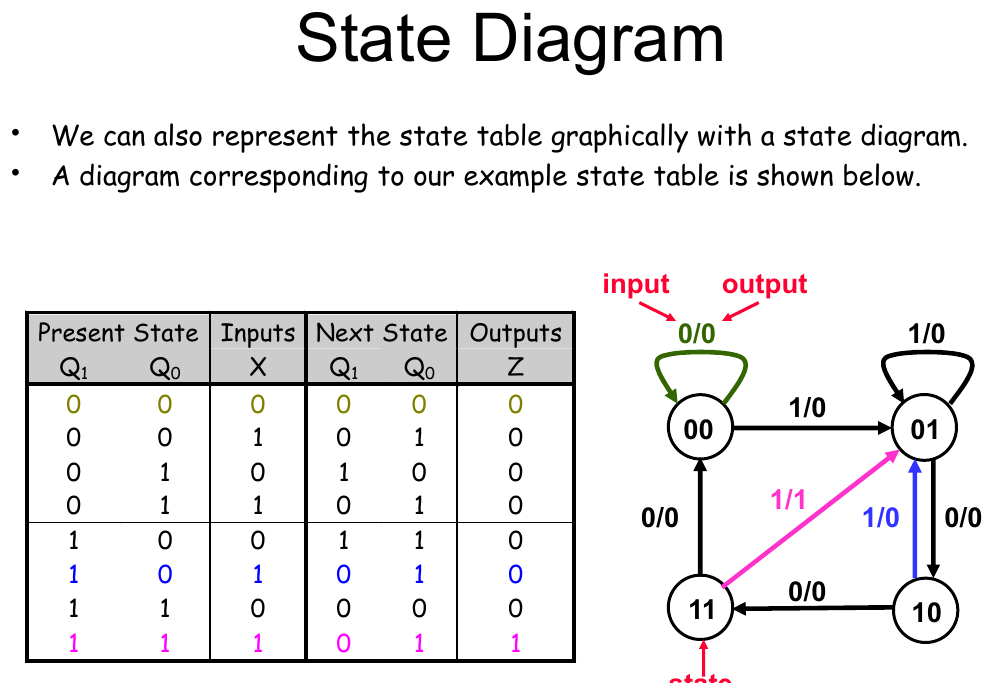

# Topic 14: End-of-topic test

Try each question first.
Then click to check.

Each answer says which notes section (§) it comes from.

Characteristic equations: JK: Q_t+1 = JQ' + K'Q. D: Q_t+1 = D. T: Q_t+1 = T ⊕ Q.

---

## Part A: Slide exercises and past-final questions

### S1 (Lecture 13, slides 4 to 6)

Two D flip-flops A and B, input x, output y:

A(t+1) = Ax + Bx. B(t+1) = A'x. y = (A + B)x'.

Make the state table.

Answer

| A B | x | A B next | y |
|---|---|---|---|
| 00 | 0 | 00 | 0 |
| 00 | 1 | 01 | 0 |
| 01 | 0 | 00 | 1 |
| 01 | 1 | 11 | 0 |
| 10 | 0 | 00 | 1 |
| 10 | 1 | 10 | 0 |
| 11 | 0 | 00 | 1 |
| 11 | 1 | 10 | 0 |

From: §1, §2

---

### S2 (Lecture 13, slides 8 to 17)

Two JK flip-flops with J1 = X'Q0, K1 = X + Q0, J0 = X + Q1, K0 = X'. Output Z = Q1Q0X.

Find the full state table and draw the state diagram.

Answer

| Q1 Q0 | X | J1 K1 | J0 K0 | next | Z |
|---|---|---|---|---|---|
| 00 | 0 | 0 0 | 0 1 | 00 | 0 |
| 00 | 1 | 0 1 | 1 0 | 01 | 0 |
| 01 | 0 | 1 1 | 0 1 | 10 | 0 |
| 01 | 1 | 0 1 | 1 0 | 01 | 0 |
| 10 | 0 | 0 0 | 1 1 | 11 | 0 |
| 10 | 1 | 0 1 | 1 0 | 01 | 0 |
| 11 | 0 | 1 1 | 1 1 | 00 | 0 |
| 11 | 1 | 0 1 | 1 0 | 01 | 1 |

 

**State diagram:** 4 circles. Arrows (input/output):

00 → 00 on 0/0, 00 → 01 on 1/0.

01 → 10 on 0/0, 01 → 01 on 1/0.

10 → 11 on 0/0, 10 → 01 on 1/0.

11 → 00 on 0/0, 11 → 01 on **1/1**.

From: §4, §6, §7, Rule 41

---

## Part B: Exam-style questions

### M1: True or false

1. A circuit with 3 flip-flops has 8 states.
2. A circuit with 2 inputs has 2 arrows leaving each state.
3. In a D flip-flop circuit, the state equations are the D input equations.
4. An output that depends on the input is a Moore output.
5. To find the next state of a JK flip-flop, you use its characteristic table.

Answer

1. **True.** 2³ = 8. (Rule 42)
2. **False.** 2² = **4** arrows. (Rule 42)
3. **True.** Q_t+1 = D. (§1)
4. **False.** That's **Mealy**. Moore outputs depend on the state only. (§4)
5. **True.** (Rule 41)

---

### M2: Multiple choice

A circuit has 2 JK flip-flops and 1 input. Its state diagram should have:

- A. 2 circles, 2 arrows each
- B. 4 circles, 2 arrows each
- C. 4 circles, 4 arrows each
- D. 8 circles, 2 arrows each

Answer

**B.** 2² = 4 states. 2¹ = 2 arrows out of each.

From: Rule 42

---

### M3: Analyse a D flip-flop circuit

Two D flip-flops A and B. Input x. Output z.

D_A = Bx + Ax'. D_B = A'x + Bx'. z = AB'.

1. Make the state table.
2. Draw the state diagram.
3. What does the circuit do when x = 1? When x = 0?
4. Is z a Mealy or a Moore output?

Answer

**1.** D flip-flops: next state = D (§1).

| A B | x | next A B | z |
|---|---|---|---|
| 00 | 0 | 00 | 0 |
| 00 | 1 | 01 | 0 |
| 01 | 0 | 01 | 0 |
| 01 | 1 | 11 | 0 |
| 10 | 0 | 10 | 1 |
| 10 | 1 | 00 | 1 |
| 11 | 0 | 11 | 0 |
| 11 | 1 | 10 | 0 |

 

**2.** Four circles. x = 0: every state loops to itself. x = 1: 00 → 01 → 11 → 10 → 00. Write z inside each circle (z = 1 only in 10).

 

**3.** x = 1: it counts **00 → 01 → 11 → 10 → 00**. That's a 2-bit **Gray code** counter (Topic 5). x = 0: it **holds**.

 

**4.** **Moore.** z = AB' uses only the state, not x.

From: §1, §2, Rule 41, Rule 42

---

### M4: Analyse a T flip-flop circuit

Two T flip-flops A and B. Input x. T_A = Bx. T_B = x.

Find the state table. What does the circuit do?

Answer

T = 1 toggles, T = 0 holds.

| A B | x | T_A T_B | next A B |
|---|---|---|---|
| 00 | 0 | 0 0 | 00 |
| 00 | 1 | 0 1 | 01 |
| 01 | 0 | 0 0 | 01 |
| 01 | 1 | 1 1 | 10 |
| 10 | 0 | 0 0 | 10 |
| 10 | 1 | 0 1 | 11 |
| 11 | 0 | 0 0 | 11 |
| 11 | 1 | 1 1 | 00 |

x = 1: **00 → 01 → 10 → 11 → 00**, a 2-bit binary up counter. x = 0: it **holds**. So x is a count enable.

From: §6, Rule 41, Topic 13 §11

---

### M5: Explain

List the three steps to analyse a clocked sequential circuit built from JK flip-flops.

Answer

1. Find the Boolean expressions for the **flip-flop inputs** (J, K) and the outputs, from the gates.
2. Use them to fill in the **flip-flop input columns** of the state table, for every present state and input.
3. Use the **JK characteristic table** (or Q_t+1 = JQ' + K'Q) to fill in the **next state** columns.

The result is a state table, which you can draw as a state diagram.

From: Rule 41

