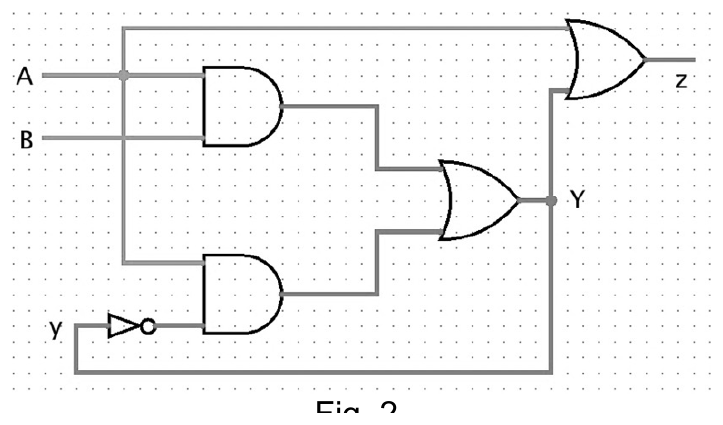

# Topic 21: End-of-topic test

Try each question first.
Then click to check.

Each answer says which notes section (§) it comes from.

Columns in Gray order: 00, 01, 11, 10. Brackets ( ) mean circled = stable.

---

## Part A: Slide exercises and past-final questions

### S1 (Lecture 23/24, slide 15)

An asynchronous circuit has one input x and two loops: Y₁ = xy₁ + x'y₂ and Y₂ = xy₁' + x'y₂. Derive the transition table and mark the stable states.

Answer

| y₁y₂ \ x | 0 | 1 |
|---|---|---|
| **00** | (00) | 01 |
| **01** | 11 | (01) |
| **11** | (11) | 10 |
| **10** | 00 | (10) |

Stable: 00 at x = 0, 01 at x = 1, 11 at x = 0, 10 at x = 1.

From: §3, Rule 55

---

### S2 (Lecture 23/24, slides 18 to 23)

Y = (x₁y)'x₂. Find the transition table. Is the circuit stable? How can it be made stable?

Answer

Y = (x₁' + y')x₂ = x₁'x₂ + y'x₂.

| y \ x₁x₂ | 00 | 01 | 11 | 10 |
|---|---|---|---|---|
| **0** | (0) | 1 | 1 | (0) |
| **1** | 0 | (1) | 0 | 0 |

Column **11** has no stable state. With x₁ = x₂ = 1, Y **oscillates** between 0 and 1, with a period of twice the loop delay.

**Fix:** feed y in without inverting: Y = x₁'x₂ + yx₂. Then column 11 reads 0, 1: both stable.

From: §6, Rule 56

---

### F2023-4 (Final 2023 Q4)

An asynchronous sequential circuit has two external inputs A and B, one internal state y and one external output z, described by Fig. 2.

(a) Derive the transition table and show it on a Karnaugh map. [40%]

(b) Obtain a flow table for the circuit. [20%]

(c) Check whether there is a stability issue in this circuit. If there is, briefly explain where the instability can occur. [40%]

Answer

**(a)** From the gates: **Y = AB + Ay'** and z = A + Y = **A**.

| y \ AB | 00 | 01 | 11 | 10 |
|---|---|---|---|---|
| **0** | (0) | (0) | 1 | 1 |
| **1** | 0 | 0 | (1) | 0 |

 

**(b)** a = (y = 0), b = (y = 1). Cells are "next state, z":

| \ AB | 00 | 01 | 11 | 10 |
|---|---|---|---|---|
| **a** | (a), 0 | (a), 0 | b, 1 | b, 1 |
| **b** | a, 0 | a, 0 | (b), 1 | a, 1 |

 

**(c)** **Yes.** Column **AB = 10** has no stable state. In a, Y = 1 → go to b. In b, Y = y' = 0 → go back to a.

So when **A = 1 and B = 0**, the internal state oscillates between 0 and 1 (period = twice the loop delay).

From: §9, Rule 55, Rule 56

---

## Part B: Exam-style questions

### M1: True or false

1. An asynchronous circuit changes state only on a clock edge.
2. A state is stable when Y = y.
3. In fundamental mode, two inputs may change at the same time.
4. A noncritical race always ends in the same stable state.
5. A column with no stable state means the circuit oscillates for that input.
6. The flow table uses letters for the states.

Answer

1. **False.** No clock: it changes as soon as an input changes. (§1)
2. **True.** (Rule 55)
3. **False.** One input at a time, and only when stable. (§2)
4. **True.** (§7)
5. **True.** (Rule 56)
6. **True.** (§4)

---

### M2: Multiple choice

In the 2023 Q4 circuit, the circuit is stable in state a with AB = 01. B changes to 1. What happens?

- A. It stays in a
- B. It goes to b and stays
- C. It oscillates
- D. It goes to b, then back to a

Answer

**B.** AB = 11. Row a says Y = 1 → go to b. Row b, column 11: (b) is stable. It stays in **b**, with z = 1.

From: §9

---

### M3: Analyse a circuit

An asynchronous circuit has inputs x₁, x₂ and one loop: Y = x₁x₂' + x₂'y. Output z = y.

1. Derive the transition table and circle the stable states.
2. Give the flow table.
3. Is it stable? What does it do?

Answer

**1.**

| y \ x₁x₂ | 00 | 01 | 11 | 10 |
|---|---|---|---|---|
| **0** | (0) | (0) | (0) | 1 |
| **1** | (1) | 0 | 0 | (1) |

 

**2.** a = (y = 0), b = (y = 1). z = y.

| \ x₁x₂ | 00 | 01 | 11 | 10 |
|---|---|---|---|---|
| **a** | (a), 0 | (a), 0 | (a), 0 | b, 0 |
| **b** | (b), 1 | a, 1 | a, 1 | (b), 1 |

 

**3.** **Stable:** every column has at least one circle.

It's a **latch**: x₁x₂ = 10 **sets** y to 1. x₂ = 1 **resets** it to 0. x₁x₂ = 00 **holds** whatever it had.

From: Rule 55, Rule 56, §4

---

### M4: Races

Two state variables y₁y₂. In column x = 1 the transition table is: row 00 → 11, row 01 → (01), row 11 → (11), row 10 → (10). The circuit is in 00 and x goes to 1. Is the race critical?

Answer

Both y₁ and y₂ must change (00 → 11): a **race**.

If y₂ changes first: 00 → **01**. Row 01 is stable. It stops there.

If y₁ changes first: 00 → **10**. Row 10 is stable. It stops there.

If both change together: **11**, stable.

It can end in **three different** states. **Critical race.** Fix it with a different state assignment, so only one bit changes per transition.

From: §7

---

### M5: Explain

What is fundamental mode, and why is it needed?

Answer

**Fundamental mode:** the inputs change **one at a time**, and only after the circuit has reached a **stable** state.

**Why:** when two inputs change together, gate delays mean you can't tell which one arrives first. The circuit could pass through an unexpected state and end up in the wrong place. Allowing only one change at a time, with time to settle, makes the behaviour predictable.

From: §2

